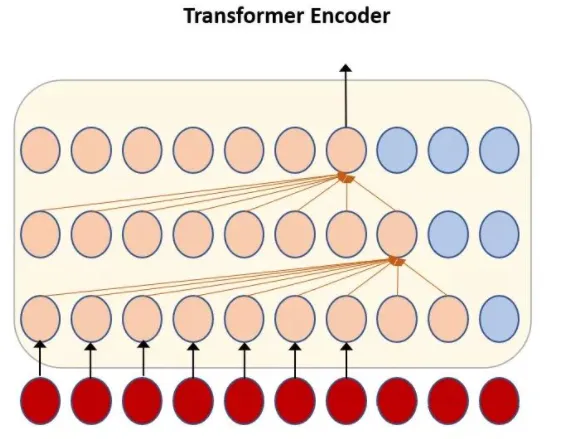

# ASR/TTS Interview Questions

Q1: ****Conformer model architecture****

- At the input, Conformer first downsamples the input with convolution, i.e. a 2D convolution layer with a 3x3 kernel and stride 2 reduces the input dimension to 1/4 of the original; it is then followed by a series of Conformer Blocks, which replace the previous Transformer Blocks for speech recognition.
- A Conformer Block mainly contains three basic modules: the feed forward module (FFM), the multi-head self attention module (MHSAM) and the convolution module (CM). Concretely, a feed forward module is attached on each side of the multi-head self-attention module and the convolution module. This structure splits the single feed-forward module of the Transformer into two half-step feed-forward layers connected to the output and the input of the attention layer, which improves the model more than using a single feed-forward layer.

Q2: ****How can a Transformer perform streaming recognition?****

- Chunk-based solution

The first solution is chunk-based, as shown below, where the dashed lines are chunk separators. The main idea is to group adjacent frames into a chunk and then process chunk by chunk. The advantage of this method is fast training and decoding, but because there is no connection between chunks, the model accuracy is poor.

- Chunk-based streaming Transformer:

First, on the left of the current frame, each frame in each layer looks back n frames, so as layers stack up, the Transformer's view of the history accumulates. With m layers, it can see n*m frames of history. Although it sees an extra n*m frames, these frames do not slow down decoding, because their representations have already been computed during the history computation and are not recomputed for the current chunk. Only the number of frames each layer can see is related to decoding time.

Because we want the latency from future information to be small, we need to avoid the cumulative effect of layers on the view. To achieve this, the rightmost frame of each chunk has no view of the future, while frames inside a chunk can see each other, which prevents the latency from growing with the number of layers.

Q3: ****The role of the multiple heads in multi-head attention****

- Multi-head attention helps the network capture richer feature information, allowing the model to jointly attend to information from different representation subspaces at different positions. It is similar to the multiple convolution kernels in a CNN.

Q4: ****Explain dilated convolution; what are its problems?****

- Holes are added to the convolution kernel to increase the receptive field without adding much computation. A regular convolution has a 3*3 kernel; a dilated convolution also has a 3*3 kernel but with a dilation rate of 2, so the network can have a larger receptive field with the same number of layers.
- The kernel of a dilated convolution is not contiguous, so not all information takes part in the computation, which leads to a loss of information continuity and causes the gridding effect.

Q5: ****How does subword modeling extend to out-of-vocabulary words?****

- Extending the skip-gram model with subwords means using parts of a word in place of the word. The benefit is that structures such as roots and affixes can be used to increase the amount of information and strengthen recognition of uncommon words.
- Example: given the sentence "the quick brown fox jumped over the lazy dog", in the original skip-gram model, given the word quick, the model must learn to predict the words the and brown from quick. The subword extension refines the granularity of words: quick becomes {qui, uic, ick}, and given the subword uic, the model must learn to predict the subwords qui and ick from uic.

Q6: ****The principle of CTC****

- CTC (Connectionist Temporal Classification) is a way to avoid manually aligning inputs and outputs; it solves the problem of input and output sequences having different lengths and being impossible to align.
- For a given input X, CTC can compute the probability distribution over all possible outputs Y. From this distribution, one can predict the output with the highest probability or the probability of a specific output.
- CTC solves the alignment problem between input and output by introducing the blank symbol, and finds the optimal sequence via dynamic programming.

Reference: [https://zhuanlan.zhihu.com/p/568176479](https://zhuanlan.zhihu.com/p/568176479)

Q7: **What are the characteristics of CTC?**

- Conditional independence: a very unreasonable assumption of CTC is that each time step is independent of the others, which is a bad assumption. In OCR or speech recognition, time steps carry semantic information about each other, so adding a language model to CTC should improve the results.
- Monotonic alignment: another constraint of CTC is the monotonic alignment between input and output. This holds in OCR and speech recognition, but in some scenarios, such as machine translation, the constraint does not hold.
- Many-to-one mapping: another constraint of CTC is that the input sequence must be longer than the label sequence; when the label sequence is longer than the input, CTC fails.

Q8: ****The relationship between CTC and end-to-end models****

- Current end-to-end speech recognition methods mainly fall into CTC-based and attention-based approaches and their improvements. CTC is essentially a loss function, often used together with LSTMs. CTC-based models have a simple structure and good interpretability, but rely heavily on the pronunciation lexicon and language model, and require an independence assumption. The RNN-Transducer model improves on CTC by adding a language-model prediction network, which is combined with the CTC network through a fully connected layer to produce a new output, thus removing CTC's conditional independence assumption on the outputs.

Q9: ****The relationship between CTC and chain models****

- Similarity: both perform forward-backward computation over multiple specific paths generated from the labels.
- Differences: the way the multiple specific paths are generated from the labels differs: the paths of the chain numerator are produced by alignment, while CTC obtains them as shown in the figure below.

- The blank label differs: the chain numerator has no blank label; if the last of the three states of a triphone is regarded as a blank label, then every triphone in the chain numerator has its own blank label, whereas in CTC all phones share one blank label.
- Whether a language model is considered: when the chain numerator computes forward/backward probabilities, every transition has its own weight. In CTC every transition is considered equally probable, ignoring transition probabilities.
- The duration of training samples differs: since the chain numerator uses alignment paths, the length can be controlled; whatever the input, it can be truncated into 150-frame training chunks. CTC, in contrast, trains on the entire sample.

Q10: ****How do you understand forced alignment?****

- Forced alignment is the process of determining the start and end positions of each word (phoneme) given audio and text, usually implemented with Viterbi decoding. Forced alignment is a special, simplified case of speech recognition; because of its simplicity it usually has high accuracy (about 90% at the phoneme level and over 95% at the word level). With forced alignment, we can process the standard-pronunciation data we have collected: force-align the audio with its corresponding text to get the segment for each phonetic symbol; extract features from the samples collected for each phonetic symbol and train on them. By force-aligning large amounts of data, we get a model for each phonetic symbol, which is used in the subsequent scoring process.

Q11: ****Combining CTC with a language model****

- In some speech recognition problems, a language model is also added at the output to improve accuracy, so we can also use a language model as a factor in inference:

L(Y) computes the length of Y in units of language-model tokens, acting as a word insertion bonus. If L(Y) is based on a word-level language model, it counts the number of words in Y; if it is based on a character-level language model, it counts the number of characters in Y. A notable property of the language model is that it only scores the form before word/character expansion and does not count the output of each expansion step of the algorithm, which favors searching for short-prefix words because they are more stable in form. Beam search can add the language-model score and the word insertion bonus: when proposing to extend a character, we can add the language-model score for the new character given the prefix.

Q12: **Explain the BPE training criterion**

- Byte Pair Encoding (BPE), also known as digram coding, is a data compression algorithm used to obtain variable-length subwords within a fixed-size vocabulary. The algorithm is simple and effective, which makes it the most popular method today. Both training and decoding of BPE operate within the scope of a single word. BPE first splits a word into single characters, then repeatedly replaces the most frequent pair of characters with another symbol, until the number of iterations is reached.

Q13: **Explain the FST compression algorithm; what are the advantages of FST?**

- An FST is a finite state transducer with two advantages: 1) small space usage: it compresses storage by reusing the prefixes and suffixes of words in the dictionary; 2) fast lookup: O(len(str)) query time complexity.

Q14: ****The difference between the HMM forward algorithm and the Viterbi algorithm****

- Hidden Markov models are used to solve three problems: evaluation, decoding and learning. In an HMM, the forward algorithm is used for evaluation, i.e. computing the probability of an observation sequence, whereas the Viterbi algorithm is used for decoding, i.e. finding the best hidden state sequence for an observation sequence. In addition, the Viterbi algorithm aims to find, at the current time step given the observation, which state has the largest forward probability, records that state's previous state, and recursively obtains the optimal path; the forward algorithm stores the current forward probabilities as input for computing the forward probabilities at the next time step, and finally sums all forward probabilities of the sequence to get the probability of the observation sequence.

Q15: ****Explain the similarities and differences between CTC alignment, HMM alignment and RNN-T alignment****

- Alignment method: HMM alignment repeats tokens; CTC alignment introduces blanks, which can be inserted anywhere, but the number of blanks plus the number of token repetitions must equal the number of acoustic features; RNN-T alignment also introduces blanks, but a blank acts as the separator between the end of one acoustic feature and the start of the next, so the number of blanks equals the number of acoustic features.

Q16: ****Algorithm details and concrete implementation of beam search****

- Algorithm: beam search has a hyperparameter beam_size, set to k. At the first time step, the k words with the highest conditional probability are selected as the first words of the candidate output sequences. At each subsequent time step, based on the output sequences of the previous step, the k combinations with the highest conditional probability among all combinations are selected as the candidate output sequences at this step. k candidates are always kept. Finally, the best one is chosen from the k candidates.
- Core idea: suppose there are n sentences, each of length T. The encoder output has shape (n, T, hidden_dim), expanded to (n*beam_size, T, hidden_dim). The first decoder input has shape (n, 1), expanded to (n*beam_size, 1). After one decoding step, the output scores have shape (n*beam_size, vocab_size) and the path score log_prob has shape (n*beam_size, 1); adding the two gives the path scores at the current frame. Reshape to (n, beam_size*vocab_size) and take topk(beam_size) to get the sorted indices (n, beam_size). Dividing an index by vocab_size gives the beam_id of each sentence, used to retrieve the previous token of the current path; taking the index modulo vocab_size gives the token_id of each sentence, used to obtain the next token of the current path.

Q17: ****The difference between end-to-end TTS models and traditional models****

- Traditional models: a traditional model usually consists of different components, such as a text processing module, an acoustic model, a vocoder, etc. On the one hand, assembling and designing the different components is laborious. On the other hand, because the components are trained separately, errors in each component may accumulate, continually amplifying the error. For example, statistical parametric speech synthesis (TTS) usually has a text front end that extracts various linguistic features, a duration model, an acoustic feature prediction model, and so on. These components rely on extensive domain expertise and are laborious to design. They are also trained independently, so errors from each component may compound. The complexity of modern TTS design means that building a new system requires a lot of engineering work.
- End-to-end models: end-to-end models first relieve the laborious assembly design by replacing the complex modeling process of traditional models with a single neural network; secondly, they make it easier to capture and extract various attributes (such as timbre or language) or high-level features (such as emotion in speech). A single model is more robust than a pipeline where component errors accumulate, effectively reducing error accumulation.

Q18: ****The difference between MFCC and fbank features****

- fbank simply lacks the DCT cepstral step of MFCC feature extraction; the other steps are the same.
- Shortcomings of fbank: fbank features are already very close to the response characteristics of the human ear, but they still have some shortcomings: adjacent features are highly correlated (adjacent filter banks overlap), so when modeling phonemes with HMMs, a cepstral transform is almost always needed first, which gives MFCC features.
- Computation: MFCC is computed on top of FBank, so MFCC requires more computation.
- Feature discriminability: FBank features are highly correlated, while MFCC has better discriminability, so most speech recognition papers use MFCC rather than FBank.

Q19: ****Briefly describe how to go from monophone model alignment to triphone model alignment****

- The monophone model assumes that the actual pronunciation of a phoneme is independent of its left and right phonemes. This assumption does not match reality. Because the monophone model is too simple, its recognition results cannot be the best, so it needs further optimization and upgrading, which leads to context-dependent phone models. The most familiar is the triphone model, i.e. a context-dependent acoustic model. The monophone model gives the set of all features corresponding to each monophone state; extending the context then gives the set of all features corresponding to each triphone state, so we can convert the monophone alignment of all training data into a triphone alignment.

Q20: **In an ASR triphone model, why is state tying needed?**

- Suppose there are 218 phonemes; a triphone model then has 218 cubed triphones. Without clustering, 218*218*218*3 GMM mixture models would be needed (assuming each triphone has 3 states). On the one hand the computation is enormous, and on the other hand it causes data sparsity. Therefore triphone states are tied based on the characteristics of the data.

Q21: **Why does the EM algorithm get stuck in local optima? Does the EM algorithm eventually converge?**

- The likelihood function of EM is non-convex, so it can get stuck in local optima.
- The E-step mainly estimates parameters from the observed data and the current model, and then uses these estimates to compute the expected value of the likelihood function; the M-step finds the parameters that maximize the likelihood function. Since the algorithm guarantees that the likelihood increases after every iteration, it eventually converges.

Q22: ****Characteristics of the HMM****

- An HMM is a hidden Markov process that builds a statistical model of the time-series structure of the speech signal. An HMM contains a hidden state sequence and an output (observation) sequence; the former is manifested through the latter, and transitions between states are modeled by a transition probability matrix. Human speech production is in fact a doubly stochastic process: the speech signal itself is an observable time-varying sequence, a parameter stream of phonemes produced by the brain according to grammatical knowledge and speech needs (the unobservable states). Thus the HMM reasonably imitates this process and describes well the overall and local stationarity of the speech signal, making it a fairly ideal speech model.

Q23: ****The relationship between GMM and k-means****

- K-Means can be seen as a simplified Gaussian mixture model. In a GMM, the parameters to estimate are the weight of each Gaussian component, and the covariance matrix and mean vector of each Gaussian component. K-Means is equivalent to fixing the weights of all Gaussian components in a GMM to be equal and the covariance matrix of each component to be the identity, so that only the mean vector of each component needs to be optimized.

Q24: ****RNN-T model architecture****

- On top of the encoder of a CTC model, RNN-T adds an RNN that takes previous outputs as input, called the Prediction Network. Its output hidden vector and the encoder output are fed into a joint network to get the output logits, which are then passed to a softmax layer to get the probability of each class.

Q25: ****Model acceleration methods****

(1) Lightweight model design

Adopt lightweight ideas from the model design stage, e.g. use lightweight convolutions such as depthwise separable convolution and grouped convolution to reduce the computation of the convolutions. In addition, using global pooling instead of fully connected layers and using 1×1 convolutions for channel reduction can also reduce the computation; both have been applied in many networks.

For lightweight network design, the currently popular architectures include SqueezeNet, MobileNet and ShuffleNet. SqueezeNet uses a carefully designed squeeze-and-expand structure, MobileNet uses the more efficient depthwise separable convolution, and ShuffleNet proposes the channel shuffle operation, further reducing computation.

(2) BN layer folding

When training detection models, BN layers can effectively speed up convergence and prevent overfitting to some extent, but during forward inference they add extra computation. Since the parameters of the BN layer are fixed at test time, the BN computation can be merged into the convolution layer at test time, reducing computation and accelerating the model.

(3) Network pruning

Network pruning: among the thousands of weights in a convolutional network there are many parameters close to 0. These are redundant parameters; after removing them the model can still achieve essentially the same expressive power. Many researchers start from this point, searching for redundant convolution kernels in the network and sparsifying it, which is called network pruning. Specifically, there are two approaches: sparsification during training and pruning after training.

(4) Weight quantization

This refers to quantizing high-precision parameters in the network into low-precision parameters to speed up computation. High-precision model parameters have a larger dynamic range and can express a richer parameter space, so 32-bit floating point (single precision) is usually used for network parameters during training. After training, to reduce the model size, the 32-bit floats can usually be quantized to 16-bit half-precision floats, or even int8 integers or binary 0/1 values. A typical method is Deep Compression.

(5) Tensor decomposition

Because the original network parameters contain a lot of redundancy, besides pruning we can also use methods such as SVD decomposition and PQ decomposition to decompose the original tensors into several low-rank tensors, reducing the computation of convolutions and speeding up the forward pass.

(6) Knowledge distillation

Generally speaking, large models have stronger fitting and generalization ability, while small models have weaker fitting ability and are prone to overfitting. Therefore, we can use a large model to guide the training of a small model, preserving the useful information of the large model, which is knowledge distillation.

Reference: [https://zhuanlan.zhihu.com/p/575065661](https://zhuanlan.zhihu.com/p/575065661)
