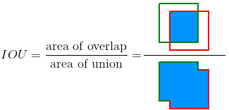

# CV interview Q&A

Q1: ***In CV, what is the difference between semantic segmentation and instance segmentation?***

- **Semantic segmentation** is a technique that detects the object class each pixel belongs to. The model must know all object classes (labels).
- **Instance segmentation** is similar to semantic segmentation but goes a step further: for each pixel it identifies the object instance it belongs to. The main difference from semantic segmentation is that it distinguishes between two objects with the same label, as shown below:

- In the second image, where **semantic segmentation** is applied, the class (chair) is one of the outputs and all chairs have the same color.
- In the third image, **instance segmentation** goes further: besides identifying the class (chair) as in the first step, it also separates the instances (chairs) from each other.

Q2: ***How do you evaluate an object detection model?***

- You can use the **Intersection over Union (IoU)** metric. IoU measures the accuracy of an object detector on a particular dataset. Any algorithm that outputs **predicted bounding boxes** can be evaluated with **IoU**. R-CNN, Faster R-CNN and YOLO are examples of such models.
- For example, in the figure below the predicted bounding box is drawn in red and the ground-truth bounding box in green. The model performance is the IoU between these boxes.

Q3: ***Describe the main processing steps of a standard computer vision system***

- The standard CV pipeline is:
    
    1. Input image: the computer receives visual input from an imaging device (such as a camera). This is usually captured as an image or a sequence of images forming a video.
    2. Preprocessing: each image goes through some preprocessing steps whose purpose is to standardize every image. Common preprocessing steps include resizing, blurring, rotating, changing its shape, or converting the image from one color space to another. Only by standardizing every image can you compare them and analyze them further in the same way.
    3. Feature extraction. Features help us define certain objects; they are usually information about an object's shape or color. For example, features that distinguish the shapes of a motorcycle's wheels, headlights, fenders, etc. The output of this process is a feature vector.
    4. Finally, these features are fed into an ML model, in this example a classification model.
    

Q4: ***In object detection, how do you judge whether a feature is a good feature?***

- A good feature helps us recognize an object in all the different ways it may appear. These features include edges, blobs and regions. A good feature has the following properties:
    
    **Repeatable detection**: given two images of the same scene, most features the detector finds in the two images are the same. These features are robust to changes in viewing conditions and noise; in other words, the feature is consistent across different scales, lighting conditions and viewpoints.
    
    **Distinctiveness**: the neighborhood around the feature center varies enough to allow the feature to be reliably compared with other features.
    
    **Localizable**: the feature has unique location information. Changes in viewing conditions do not affect its location.
    

Q5: **Why CNNs perform well on image processing:**

- CNNs exploit **local correlation**, and image data is locally correlated. Specifically, an image is made of pixels, and each pixel is related to its surrounding pixels; if you shuffle the pixels, the image changes completely.
- CNNs have **spatial invariance**: shallow layers of a CNN extract low-level features such as edges and curves; as the network gets deeper, low-level features are combined into high-level features, while the **spatial invariance** of the features is preserved.

Reference: [https://www.zhihu.com/question/41233373/answer/91113816](https://www.zhihu.com/question/41233373/answer/91113816)

Q6: **The computation and purpose of the BatchNorm layer**

- BatchNorm formula:

$$
y=\gamma\cdot \frac{x-\mu }{\sqrt{\sigma ^2+\varepsilon }}+\beta 
$$

- BatchNorm makes the input/output distribution of each layer more stable, preventing parameter updates and increasing network depth from drastically changing the data distribution, which makes model training more stable.
- The role of the parameters $\beta$,$\gamma$: they preserve what each layer has learned during training, keep the nonlinear expressive power of the activation units, and give the batch normalization module the ability to recover the original output distribution.

Q7: **How to effectively handle the common problem of few foreground and many background samples in object detection**

- Use Focal Loss or OHEM for hard negative mining, increasing the loss weight of hard examples.
- During training, only use the prior boxes around the ground truth and ignore other background regions, only considering hard background regions.

Q8: **The difference between ROIPool and ROIAlign, and a simple implementation of ROIAlign**

- ROIPool has two quantization errors: first, the proposal boundaries are quantized to integer coordinates; second, the quantized region is evenly divided into k x k cells and the boundary of each cell is quantized. ROIAlign avoids quantization with bilinear interpolation, preserving the spatial layout of the original ROI and effectively avoiding the error. When detecting large objects in an image, the two approaches differ little; but if there are many small objects to detect, ROIAlign is preferred because it is more precise.

Reference: [https://github.com/donnyyou/cv-interview](https://github.com/donnyyou/cv-interview)

Q9: ***What is the difference between Batch Norm during training and inference?***

- During training we can compute the batch mean and variance, and they keep changing over the iterations. At inference the mean and variance are fixed: for the mean we directly take the average of all batch means u, and for the standard deviation we use the unbiased estimate of each batch's σB.

Q10: ***Why has the ReLU activation function gradually replaced the sigmoid function? What are its advantages?***

- ReLU has a very simple form, `ReLU = max(0, x)`. It is a nonlinear function made of two linear pieces (the part above 0 is linear, the part below 0 is also linear, but combined they are nonlinear). Although the function looks simple, compositions of ReLUs can approximate any function.
- ReLU solves the **vanishing gradient** problem caused by sigmoid, as can be seen by comparing the graphs of the two functions. ReLU has one-sided suppression: it makes the output of some neurons 0, which makes the network sparse, reduces the interdependence between parameters and mitigates overfitting. This is also more consistent with the behavior of biological neurons.
- ReLU is fast to compute.

Q11: ***ReLU is not differentiable at 0; how is this handled in practice?***

- In practice a pseudo-gradient is provided manually, e.g. the derivative of ReLU at 0 is defined as 0. TensorFlow in fact defines the derivative of ReLU at 0 as 0 in its implementation.

Reference: [https://blog.csdn.net/ningyanggege/article/details/82493023](https://blog.csdn.net/ningyanggege/article/details/82493023)

Q12: ***What is the purpose of adding pooling layers in image processing, and how does backpropagation work through a pooling layer?***

- The role of pooling layers: **adding nonlinearity; keeping the main features while reducing parameters (dimensionality reduction, similar in effect to PCA) and computation, preventing overfitting and improving generalization; invariance, including translation, rotation and scale invariance; specifically, pooling allows the image to undergo small changes**
- In the forward pass, average pooling averages the values in a patch and passes the result to one pixel of the next layer. Therefore, **in backpropagation the value of that pixel is divided evenly into n parts and distributed to the previous layer**.
- In the forward pass, max pooling passes the maximum value in a patch to the next layer and discards the others. Therefore, **in backpropagation the current gradient is passed directly to that one pixel of the previous layer, and the other pixels in the same patch get 0**.

Q13: ***List several common deep learning optimizers and their pros and cons***

- SGD: only considers the first-order gradient and may get stuck in a local optimum.
- Momentum: an improvement over SGD. At each step, in addition to the regular gradient, it also adds the movement from the previous step. The momentum update gives the algorithm a chance to escape local minima while training faster. The update formula is:

$$
\begin{equation}
\begin{split}&delta = -lr * gradient + previous\_delta * decay\_rate
\\&theta += delta
\end{split}
\end{equation}
$$

- Adagrad: by recording the direction and distance of movement in every iteration, it **uses different adaptive learning rates for different parameters**. Parameters with large loss partial derivatives get a correspondingly fast-decreasing learning rate, while parameters with small partial derivatives have a relatively small decrease in learning rate.
- RMSProp: AdaGrad trains slowly because the sum of squared gradients keeps growing, making network updates slow. RMSProp adds a decay factor to Adagrad to fix the slow updates.
- Adam: a combination of Momentum and RMSProp. It gets speed from Momentum and the ability to adapt to gradients in different directions from RMSProp. The combination makes it powerful.

Reference: [https://medium.com/towards-data-science/a-visual-explanation-of-gradient-descent-methods-momentum-adagrad-rmsprop-adam-f898b102325c](https://medium.com/towards-data-science/a-visual-explanation-of-gradient-descent-methods-momentum-adagrad-rmsprop-adam-f898b102325c)

Q14: ***FLOPs and number of parameters of a convolutional layer***

- ****FLOPs: floating point operations, the amount of floating-point computation, which can be used to measure the complexity of an algorithm/model****
- Taking bias into account, the FLOPs of a convolutional layer: $(2C_{in}*k^2)*C_{out}HW$, where $C_{in}$, $C_{out}$ are the input and output channels, k is the kernel size, and H, W are the height and width of the input image.
- Number of parameters of a convolutional layer: $(k^2*C_{int}+1)C_{out}$

Q15: ***What are the advantages of using the F1-Score to evaluate model performance?***

- The F1 score takes both precision and recall into account, and its value leans toward the smaller of Precision and Recall, i.e. the smaller one plays the decisive role in the F1 score. **In many applications the F1 score (harmonic mean) is chosen instead of the arithmetic mean, because we want the result to better reflect the model's performance, rather than averaging and blurring the individual effects of Precision and Recall.**

Q16: ***What is the difference between ROI Pooling and ROI Align?***

- After the region proposal network RPN produces candidate ROIs, a fixed number of features (e.g. 7*7 in Faster R-CNN) must be extracted from each ROI and fed into the fully connected layers of the subsequent classification and box regression networks. Faster R-CNN uses ROI Pooling, while Mask R-CNN, which requires finer pixel-level accuracy, improves ROI Pooling into ROI Align.
- **The biggest difference between ROI Pooling and ROIAlign is that the former uses two quantization operations, while the latter uses no quantization and instead uses bilinear interpolation.**
- **How ROI Pooling works (step by step)**:
    1. Map the ROI coordinates on the original image onto the feature map by dividing by the stride (e.g. 16), and **round to integers** (first quantization);
    2. Divide the mapped region evenly into $k \times k$ bins (e.g. $7\times7$), and **round** the boundary of each bin again (second quantization);
    3. Apply max pooling within each bin to get a feature of fixed size $k\times k\times C$.
- **The role of ROI Pooling**: it turns candidate boxes of different sizes and aspect ratios into features of a fixed size, so they can be fed into the subsequent fully connected layers for classification and regression. At the same time, all ROIs share the convolutional features of the whole image, avoiding the repeated convolution for every proposal in R-CNN, which greatly improves speed.
- **How ROI Align works**: keep the floating-point coordinates without rounding, divide the ROI into $k\times k$ bins, take several (usually 4) regularly spaced sampling points in each bin, obtain each sampling point's value by **bilinear interpolation** from the 4 surrounding feature points, and then apply max/average pooling over the sampling points. In backpropagation, gradients flow back to the surrounding feature points according to the interpolation weights.
- The two quantizations cause **misalignment** between the ROI and the features: a 1-pixel offset on the feature map corresponds to 16 pixels on the original image. This has little effect on classification but a large effect on pixel-level mask prediction and small-object detection, which is why Mask R-CNN uses ROI Align.

Q17: ***In feature fusion, what is the difference between concat and add?***

- add has the following characteristics: it adds the values at the same position in corresponding channels, so the number of channels is unchanged; the number of features describing the image is unchanged, but the information under each feature increases.
- concat merges channels, so the number of channels increases; the number of features describing the image increases, but the information under each feature is unchanged.

Q18: ***Explain depthwise separable convolution***

- Depthwise separable convolution splits a regular convolution into two steps, which greatly reduces the model's **computation** and **number of parameters**.
- The process has two parts: **depthwise convolution** and **pointwise convolution**
;
- Depthwise convolution keeps the number of channels of the input feature map: each channel of the feature map is convolved with one kernel of size $K$, and there are as many such kernels as input channels. The output after depthwise convolution has the same number of channels as the input, and the convolution results of different channels are not summed.
- Pointwise convolution: on top of the previous step, a 1x1 convolution is applied pointwise; this step transforms the channels.

Q19: ***Compute the FLOPs of a depthwise separable convolution***

- Depthwise separable convolution has two parts: per-channel convolution and a 1*1 convolution. The computation of the first part: $(2k^2 )HWC_{int}$; the computation of the second part: $2C_{int}HWC_{out}$

Q20: ***Briefly describe the principle of the LBP algorithm***

- LBP is a local feature descriptor. The original LBP operator uses a 3×3 window and compares each of the 8 neighboring pixels with the center pixel of the window. Positions whose neighbor value is greater than the center value are marked 1, otherwise 0, giving an 8-bit binary value, which is used as the LBP value of the window's center pixel (the 8-bit binary value is usually converted to decimal, giving 256 possible LBP values).
- The LBP operator is rotation invariant, has low-dimensional texture features, and is fast to compute.

Q21: ***Briefly describe the principle of the HOG algorithm***

- HOG (Histogram of Oriented Gradients) builds features by computing and accumulating histograms of gradient orientations over local regions of the image.
- HOG first divides the image into cells, then computes the gradient and edge orientation of each pixel in each cell, and accumulates a histogram of oriented gradients for each cell, forming the feature descriptor of that cell. To obtain better invariance to illumination and shadows, the histograms are contrast-normalized, specifically by normalizing local histograms over larger regions of the image (called blocks). The normalized descriptors of all cells in a block are combined into the block's descriptor. Finally, the descriptors of all blocks are combined into the HOG feature descriptor of the whole image.

Q22: ***What edge detection operators are there, and how do they compare?***

- There are many edge detection methods; most of them fall into two categories: search-based and zero-crossing based. And a third: the Canny operator.
- Search-based methods detect edges by finding the maxima and minima of the image's first derivative, usually locating the edge in the direction of maximum gradient, e.g. the Roberts operator, **Prewitt operator, Sobel operator;**
- Zero-crossing based methods find edges by looking for zero crossings of the image's second derivative, usually zero crossings of the Laplacian or of a nonlinear differential expression.

Q23: ***Common image interpolation methods***

- Nearest-neighbor interpolation: among the four neighbors of the target pixel, assign the gray value of the nearest neighbor to the target pixel.
- Bilinear interpolation: use the gray values of the four neighbors of the target pixel to do linear interpolation in two directions, i.e. two linear transformations.
- Bicubic interpolation: use a cubic polynomial to approximate the theoretically optimal interpolation function; the gray value of the target pixel (x,y)
 is obtained by weighted interpolation of the 16 surrounding gray values.

 

Q24: ***The principle of the FAST algorithm***

- FAST is a corner detection algorithm that mainly considers the 16 pixels on a circular window around a pixel. As shown below, the authors consider that if, among the 16 pixels on the circle around pixel p, there are n consecutive pixels whose gray values are all greater than, or all less than, the gray value of p, then p is a corner.

- FAST corner detection is fast, but it is strongly affected by noise and has neither scale invariance nor rotation invariance.

Q25: **Briefly describe the principle of the BRIEF algorithm**

- The main idea of BRIEF is to randomly select n point pairs within an s×s window around a keypoint, and generate a binary string by comparing these point pairs as the feature descriptor of the keypoint.
- The specific steps are:
    - First extract keypoints from the whole image.
    - To reduce the effect of noise, apply Gaussian filtering to the image (because BRIEF selects point pairs randomly, it is sensitive to noise).
    - For a keypoint, randomly select a point pair in its s×s neighborhood and compare the two points: $T(x,y)=\begin{cases} 1, \quad if\ p(x)<p(y)\\ 0. \quad otherwise\end{cases}$ where p(x), p(y) are the gray values of the random point pair (x,y).
    - Repeat step 3 n times and combine the n comparison results into a binary string as the feature descriptor of the keypoint. n is usually 128, 256 or 512.

Q26: ***Briefly describe the principle of the ORB algorithm***

- ORB uses FAST for feature detection and BRIEF for feature description. ORB mainly fixes the lack of rotation invariance of the BRIEF descriptor. Specifically, it proposes the intensity centroid method: compute the intensity centroid of all pixels in the keypoint's neighborhood; the keypoint and the centroid give a vector, which is used as the keypoint's orientation. When the image rotates, the rotation angle of the main orientation gives the rotation of the image, thus achieving rotation invariance.

Q27: **Briefly describe SIFT features; what is the difference between SIFT and SURF features?**

- SIFT is an algorithm for detecting local features. It is invariant to **rotation, scaling and brightness changes**, and fairly stable under **viewpoint changes, affine transformations and noise**.
- The essence of SIFT is to find keypoints (feature points) in different scale spaces and compute the orientation of the keypoints. It has four steps: **scale-space extremum detection, keypoint localization, orientation assignment, keypoint description**
- SURF is an improvement on SIFT: it is faster to compute and also more robust. The specific differences are:

|  | SIFT | SURF |
| --- | --- | --- |
| Scale space | DoG convolved with images at different scales | Box filters of different scales convolved with the original image |
| Keypoint detection | First non-maximum suppression, then remove low-contrast points, then remove edge points using the Hessian matrix | First determine candidate points using the Hessian matrix, then non-maximum suppression |
| Orientation | In a square region, compute a histogram of gradient magnitudes and take the direction of the max. There can be multiple orientations. | In a circular region, compute the Haar wavelet responses in the x and y directions within each sector, and take the sector direction with the largest magnitude |
| Feature descriptor | 16*16 sample points divided into 4*4 regions; compute the gradient direction and magnitude of the sample points in each region and accumulate an 8-bin histogram, 4*4*8=128 dimensions in total | A 20s20s region divided into 44 sub-regions, 55 sample points in each sub-region; compute the Haar wavelet responses of the sample points and record ∑dx, ∑dy, ∑|dx|,∑|dy|, 44*4=64 dimensions in total |

Reference: [Differences between Sift and Surf (eternity1118_'s blog, CSDN)](https://blog.csdn.net/eternity1118_/article/details/51152162)

Q28: **What losses do you know for image semantic segmentation tasks?**

- ****Cross entropy loss, pixel-level cross entropy.**** This loss examines each pixel one by one, comparing the prediction for each pixel's class (a probability distribution vector) with the one-hot label vector. The loss for each pixel is:

$$
pixel\ \ loss = -\sum_{classes}^{}y_{true}log(y_{pred})
$$

       The loss of the whole image is the average of the per-pixel losses.

- ****Weighted loss: weight each value in the output probability distribution vector, i.e. make the model pay more attention to classes with fewer samples, to alleviate class imbalance in the image****
- **Focal loss**: an improvement of the standard cross-entropy criterion: as the confidence of the correct class increases, the cross-entropy loss is decayed toward zero by a scaling factor. The scaling factor automatically down-weights easy examples during training and **focuses on hard examples**.
- Dice loss: obtained by computing a smoothed Dice coefficient function.
- IOU loss: increases the gradient for high-IoU samples and decreases the gradient for low-IoU samples.

Reference: [Image Segmentation: Architectures, Losses, Datasets, and Frameworks - neptune.ai](https://neptune.ai/blog/image-segmentation)

Q29: **In edge detection, compare the Sobel operator and the Canny operator**

- The main advantage of the Sobel operator is that it is simple and time-efficient. However, the detected edges are coarse. In contrast, because Canny implements non-maximum suppression and double thresholding, the Canny technique produces smoother edges. The disadvantage of Canny is that it is more complex and less time-efficient than Sobel.

Reference: [Microsoft Word - p107.doc (utm.my)](https://engineering.utm.my/comp/wp-content/uploads/sites/2/2013/04/Comparison-of-Canny-and-Sobel-Edge-Detection-in-MRI-Images.pdf)

Q30: **Why normalize images before feeding them into the network?**

- **Eliminate the effect of different scales/units between features**, making different features comparable.
- In models trained with stochastic gradient descent, **it speeds up convergence**.
- **Normalization may also improve accuracy**: some classifiers need to compute distances between samples (e.g. Euclidean distance), such as KNN. If one feature has a very large range, the distance is dominated by that feature, which contradicts reality (e.g. when features with a small range are actually more important).

Q31: ***What problems might you encounter when using YOLO for object detection?***

- Each YOLO grid cell is restricted to detecting a single object. Therefore YOLO has difficulty detecting and localizing small objects that naturally occur in groups, such as a line of ants.
- YOLO is sensitive to changes in lighting or other environmental conditions, so it is not suitable for real-world applications where lighting may vary.
- YOLO consumes considerable computing resources, which makes edge deployment difficult.

Reference: [YOLO Algorithm for Object Detection Explained [+Examples] (v7labs.com)](https://www.v7labs.com/blog/yolo-object-detection)

## Advantages of deep learning in the image domain

Q32: ***Why does deep learning perform so well in image processing and computer vision?***

- **Automatically learns hierarchical features**: traditional methods rely on hand-crafted features (e.g. SIFT, HOG), whereas deep networks learn features directly from pixels end to end: shallow layers learn edges and textures, middle layers learn parts, and deep layers learn object semantics, with far greater expressive power than hand-crafted features.
- **Inductive biases that fit image data**: the **local connectivity** and **weight sharing** of CNNs match the local correlation and stationarity of images, with few parameters and easy training; convolution + pooling provide some **translation invariance** (see Q5).
- **End-to-end optimization**: feature extraction and classification/detection/segmentation are jointly optimized in one network, avoiding error accumulation in multi-stage systems.
- **Large-scale data**: large labeled datasets such as ImageNet and COCO, together with data augmentation, allow large models to be trained fully without overfitting.
- **Advances in compute and engineering**: GPU parallel computing, and techniques such as ReLU, BatchNorm, Dropout, residual connections, better initialization and optimizers, make it possible to train very deep networks.
- **Good transferability**: backbones pretrained on large datasets can be transferred to downstream tasks such as detection, segmentation, face recognition and medical imaging, and work well even with little data.

## CNN basic building blocks

Q33: ***What are the roles of the convolutional layer, the pooling layer and the fully connected layer in a CNN?***

- **Convolutional layer**: slides learnable kernels over the input and computes local weighted sums to extract local features (edges, textures, shapes, etc.).
    - Local connectivity: each neuron only looks at a local receptive field;
    - Weight sharing: the same kernel shares its parameters across the whole image, greatly reducing the number of parameters and making feature detection translation equivariant;
    - Multiple kernels output multiple channels; stacking layers gradually enlarges the receptive field, combining low-level features into high-level semantic features.
- **Pooling layer** (see Q12 for details): max/average downsampling over local regions.
    - Reduces the feature map size, reducing parameters and computation, and enlarges the receptive field of subsequent layers;
    - Keeps the main features, provides some invariance to translation/small deformations, and helps suppress overfitting to some extent.
- **Fully connected layer**: maps the distributed features extracted earlier to the label space, acting as the "classifier".
    - Each output neuron is connected to all neurons of the previous layer, integrating global information;
    - The downsides are a large number of parameters (e.g. in VGG the fully connected layers account for the vast majority of parameters) and the requirement of a fixed input size, so modern networks often replace some fully connected layers with **global average pooling (GAP)**.

Q34: ***Why can a 1×1 convolution reduce or change the number of channels? How does it introduce nonlinearity?***

- A 1×1 convolution only looks at a single pixel spatially; in essence it applies a linear transformation to the $C_{in}$-dimensional channel vector at each spatial location (equivalent to a per-pixel fully connected layer): $y_{i,j} = W x_{i,j} + b$, where $W \in \mathbb{R}^{C_{out}\times C_{in}}$.
- **Changing the number of channels**: the number of output channels equals the number of kernels $C_{out}$; $C_{out}<C_{in}$ reduces dimensionality and $C_{out}>C_{in}$ increases it, while the spatial size $H\times W$ of the feature map is unchanged.
- **Reducing computation**: e.g. in Inception/ResNet bottlenecks, a 1×1 convolution first reduces 256 channels to 64, then a 3×3 convolution is applied, and finally a 1×1 convolution restores 256 channels, greatly reducing both computation and parameters.
- **Introducing nonlinearity**: a 1×1 convolution itself is linear, but it is usually followed by **BN + a nonlinear activation such as ReLU**, which increases the network depth and nonlinear expressive power without changing the receptive field (the idea of Network in Network).
- **Cross-channel information fusion**: it linearly combines features of different channels, enabling information exchange across channels.

## Image classification models (VGG, ResNet, Inception)

Q35: ***Briefly describe the classic image classification networks VGG, ResNet and its variants, and Inception V2/V3***

- **VGG**:
    - Uses only $3\times3$ small kernels and $2\times2$ max pooling, with a regular structure, deepening the network by stacking (VGG16/VGG19);
    - Two $3\times3$ convolutions have the same receptive field as one $5\times5$, and three equal one $7\times7$, but with fewer parameters and more nonlinearity;
    - Downsides: many parameters (about 138 million, mostly in the fully connected layers) and heavy computation.
- **ResNet**:
    - Introduces **residual connections (shortcuts)** and learns the residual $F(x)=H(x)-x$, solving the degradation problem of deep networks and enabling training of hundreds or even thousands of layers (ResNet18/34/50/101/152);
    - ResNet50 and deeper use the **bottleneck** structure: $1\times1$ reduction → $3\times3$ convolution → $1\times1$ expansion.
- **ResNet variants**:
    - **Pre-activation ResNet (ResNet V2)**: moves BN and ReLU before the convolution, making the identity mapping "cleaner" so that information and gradients propagate more smoothly;
    - **ResNeXt**: uses grouped convolution in the bottleneck, introducing a "cardinality" dimension that improves accuracy at the same computational cost;
    - **Wide ResNet**: reduces depth and increases width (number of channels);
    - **DenseNet**: each layer is concatenated along the channel dimension with all previous layers, for more thorough feature reuse;
    - **SE-ResNet**: adds the Squeeze-and-Excitation channel attention module;
    - **Res2Net, ResNeSt**, etc.: further multi-scale or split-attention designs inside the residual block.
- **Inception V1 (GoogLeNet)**: the Inception module applies $1\times1$, $3\times3$, $5\times5$ convolutions and $3\times3$ pooling in parallel and concatenates them along the channels to obtain multi-scale features, using $1\times1$ convolutions for dimensionality reduction to cut computation.
- **Inception V2**:
    - Introduces **Batch Normalization** to speed up convergence;
    - Replaces one $5\times5$ convolution with two $3\times3$ convolutions, reducing parameters and computation.
- **Inception V3**:
    - **Asymmetric convolution factorization**: factorizes an $n\times n$ convolution into a $1\times n$ and an $n\times1$ convolution (e.g. $7\times7 \to 1\times7 + 7\times1$);
    - Improved downsampling modules (convolution and pooling in parallel, then concat) to avoid representational bottlenecks;
    - Uses **Label Smoothing** regularization and an auxiliary classifier with BN, with an input size of $299\times299$.

Q36: ***What is the main innovation of ResNet? What are the structure and principle of the residual block? Why do residual connections improve the training of deep networks, alleviate vanishing gradients, and mitigate performance degradation as depth increases?***

- **Main innovation**: proposes **residual learning** and **identity shortcut connections**, letting the network learn a residual rather than the target mapping directly. This made it possible to train networks with hundreds of layers, and won ImageNet 2015.
- **Residual block structure**:
    - The output is $y = F(x, \{W_i\}) + x$, where $F$ is the residual branch (a basic block has two $3\times3$ convolutions; a bottleneck has $1\times1$-$3\times3$-$1\times1$ convolutions, each convolution followed by BN, with a ReLU applied again after the addition);
    - When the input and output dimensions differ (change in channels or downsampling), the shortcut uses a $1\times1$ convolution (with stride) as a projection: $y = F(x) + W_s x$.
- **Principle**: suppose the optimal mapping is $H(x)$; learning $H(x)$ directly is hard. The residual block instead learns $F(x)=H(x)-x$. If the identity mapping is already optimal, the network only needs to push $F(x)$ toward 0, which is much easier than fitting an identity mapping with a stack of nonlinear layers.
- **Why it alleviates vanishing gradients**:
    - In backpropagation, $\frac{\partial L}{\partial x} = \frac{\partial L}{\partial y}\left(1 + \frac{\partial F}{\partial x}\right)$, where the constant term $1$ guarantees that the gradient can flow back to shallow layers directly through the shortcut without attenuation;
    - When many residual blocks are stacked, $x_L = x_l + \sum_{i=l}^{L-1} F(x_i)$, and the gradient $\frac{\partial L}{\partial x_l} = \frac{\partial L}{\partial x_L}\left(1 + \frac{\partial}{\partial x_l}\sum_{i=l}^{L-1} F(x_i)\right)$ is no longer a product of many terms smaller than 1, so the gradient does not easily vanish.
- **Why it mitigates performance degradation**:
    - The degradation problem refers to the **training error** increasing as the network gets deeper. This is not overfitting but an optimization difficulty: deep plain networks find it hard to learn an identity mapping;
    - In theory, a deeper network could at least learn the extra layers as identity mappings and thus be no worse than a shallower one. The residual structure makes the "identity mapping" the default solution ($F(x)=0$), so added layers will at worst not hurt performance, and only need to learn small perturbations on top of it;
    - In addition, a residual network can be seen as an ensemble of many sub-networks of different depths; information and gradients always have short paths, which makes the optimization landscape smoother, and training more stable and faster to converge.

## Object detection (Faster R-CNN, Mask R-CNN)

Q37: ***How do Faster R-CNN and Mask R-CNN work, and what are the differences between them?***

- **How Faster R-CNN works** (a two-stage detector):
    1. A **backbone** (e.g. VGG16/ResNet) extracts the feature map of the whole image;
    2. The **RPN (Region Proposal Network)** generates candidate boxes (proposals) on the feature map based on anchors, and uses NMS to keep about 2000 (training)/300 (testing) ROIs;
    3. **ROI Pooling** crops and pools the features of each ROI into a fixed size (e.g. $7\times7$);
    4. **Detection head (Fast R-CNN head)**: fully connected layers followed by two branches, one for $K+1$-class classification and one for class-specific box regression; finally NMS gives the detection results.
- **How Mask R-CNN works**: extends Faster R-CNN to instance segmentation:
    1. The backbone is usually ResNet + **FPN**, outputting multi-scale features;
    2. The RPN generates candidate boxes;
    3. **ROI Align** replaces ROI Pooling to extract more precisely aligned ROI features;
    4. Besides the classification and regression branches, the head adds a **parallel** **mask branch** (a small FCN) that outputs $K$ binary masks of size $m\times m$ (e.g. $28\times28$) for each ROI.
- **Main differences**:

|  | Faster R-CNN | Mask R-CNN |
| --- | --- | --- |
| Task | Object detection (class + box) | Object detection + instance segmentation (class + box + pixel-level mask) |
| ROI feature extraction | ROI Pooling (two quantizations) | ROI Align (bilinear interpolation, no quantization) |
| Head branches | Classification + regression | Classification + regression + mask (in parallel) |
| Loss | $L_{cls}+L_{box}$ | $L_{cls}+L_{box}+L_{mask}$ |
| Backbone | VGG/ResNet in the original paper, single scale | Usually ResNet-FPN, multi-scale |

Q38: ***What is the RPN? Describe its network structure in detail***

- The **RPN (Region Proposal Network)**, proposed in Faster R-CNN, is a fully convolutional network that quickly generates high-quality candidate boxes on the shared convolutional feature map. It replaces time-consuming traditional methods such as Selective Search, making proposal generation almost "free" and trainable end to end.
- **Anchor mechanism**: at each position of the feature map, $k$ reference boxes of different scales and aspect ratios are preset. In the original paper there are 3 scales ($128^2, 256^2, 512^2$) × 3 aspect ratios (1:1, 1:2, 2:1), i.e. $k=9$.
- **Network structure**:
    1. Input: the feature map output by the backbone (e.g. VGG16's conv5_3, $H\times W\times512$, stride 16);
    2. One $3\times3$ convolution (512 channels, followed by ReLU), equivalent to sliding a $3\times3$ window over the feature map, giving a 512-dimensional feature at each position;
    3. Two parallel $1\times1$ convolution branches:
        - **Classification branch**: outputs $2k$ channels (two foreground/background scores per anchor, passed through softmax; it can also be implemented as $k$ channels + sigmoid);
        - **Regression branch**: outputs $4k$ channels; each anchor predicts 4 offsets $(t_x, t_y, t_w, t_h)$.
- **Box parameterization**: $t_x=(x-x_a)/w_a,\ t_y=(y-y_a)/h_a,\ t_w=\log(w/w_a),\ t_h=\log(h/h_a)$, where $(x_a, y_a, w_a, h_a)$ are the anchor's center coordinates, width and height.
- **Proposal generation (Proposal Layer)**: apply the regression offsets to the anchors to get candidate boxes → clip to the image boundary and remove boxes that are too small → sort by foreground score and keep the top-N → NMS (IoU threshold 0.7) → output about 2000 (training)/300 (testing) proposals to the subsequent ROI Pooling.
- **Sample assignment during training**: anchors with IoU > 0.7 with any GT (as well as the anchor with the highest IoU for each GT) are positives, anchors with IoU < 0.3 are negatives, and the rest are ignored; 256 anchors are randomly sampled per image, with a positive-to-negative ratio of up to 1:1.
- In FPN, the RPN head is shared across all pyramid levels, and each level only uses anchors of one scale with 3 aspect ratios.

Q39: ***What does the RPN loss consist of, and how is it computed? Is the classification loss binary or multi-class?***

- The RPN loss consists of a **classification loss** and a **box regression loss**:

$$
L(\{p_i\},\{t_i\}) = \frac{1}{N_{cls}}\sum_i L_{cls}(p_i, p_i^*) + \lambda \frac{1}{N_{reg}}\sum_i p_i^* L_{reg}(t_i, t_i^*)
$$

- Here $i$ is the index of an anchor in the mini-batch, $p_i$ is the predicted probability that the anchor is foreground, and $p_i^*$ is the label (1 for positives, 0 for negatives); $t_i$ are the 4 predicted offsets, and $t_i^*$ are the true offsets of the anchor relative to its matched GT.
- **Classification loss $L_{cls}$**: **binary classification** (foreground vs background), using binary cross-entropy (log loss). It only determines whether the anchor contains an object, without distinguishing specific classes. The specific multi-class ($K+1$ classes) classification is done in the second-stage detection head.
- **Regression loss $L_{reg}$**: uses the smooth L1 loss, $L_{reg}(t_i,t_i^*)=\sum_{j\in\{x,y,w,h\}}\mathrm{smooth}_{L1}(t_{i,j}-t_{i,j}^*)$, where

$$
\mathrm{smooth}_{L1}(x)=\begin{cases}0.5x^2, & |x|<1\\ |x|-0.5, & \text{otherwise}\end{cases}
$$

  Smooth L1 is a squared loss with smooth gradients when the error is small and a linear loss that is insensitive to outliers when the error is large, avoiding exploding gradients.
- Multiplying by $p_i^*$ means **the regression loss is only computed for positive samples**; negatives have no corresponding GT box.
- **Normalization and weighting**: $N_{cls}$ is the mini-batch size (256), $N_{reg}$ is the number of anchor locations (about 2400), and $\lambda$ is set to 10 so that the two terms are roughly equally weighted (in practice it is also common to simply normalize by the number of positive samples with $\lambda=1$).

Q40: ***What does the Faster R-CNN loss consist of, and what does each part mean?***

- The total loss of Faster R-CNN consists of the **RPN loss** and the **Fast R-CNN detection head loss**, four terms in total:

$$
L = L_{cls}^{rpn} + L_{reg}^{rpn} + L_{cls}^{det} + L_{reg}^{det}
$$

- **RPN classification loss $L_{cls}^{rpn}$**: binary cross-entropy for anchor foreground/background, teaching the RPN to judge whether an anchor contains an object;
- **RPN regression loss $L_{reg}^{rpn}$**: smooth L1 loss on the offsets from positive anchors to GT boxes, making the RPN's proposals closer to the real objects (see Q39 for the computation);
- **Detection head classification loss $L_{cls}^{det}$**: softmax cross-entropy over $K+1$ classes ($K$ object classes + background) for each ROI, determining the specific class of the ROI;
- **Detection head regression loss $L_{reg}^{det}$**: for foreground ROIs, smooth L1 loss is computed only on the set of box offsets corresponding to its GT class $u$, $[u\geq1]\, L_{reg}(t^u, v)$, further refining the proposals.
- When training the detection head, 128 (or 512) ROIs are sampled per image; those with IoU ≥ 0.5 with a GT are positives and those in [0.1, 0.5) are negatives, with positives making up about 25%.
- Training scheme: the original paper uses 4-step alternating training; later, **approximate joint training (end-to-end)** became standard, simply summing the four losses and backpropagating them together.

Q41: ***What components does Mask R-CNN add compared with Faster R-CNN, and why? What is the basic structure of Mask R-CNN?***

- **Basic structure**: backbone (ResNet-50/101 + FPN) → RPN generates candidate boxes → ROI Align extracts fixed-size features for each ROI ($7\times7$ for the detection branch, $14\times14$ for the mask branch) → three parallel heads: classification, box regression and mask prediction.
- **Added/improved components and why**:
    1. **Mask branch**: a small fully convolutional network (e.g. 4 $3\times3$ convolutions + deconvolution upsampling) that outputs a $K\times m\times m$ ($m=28$) mask for each ROI. An FCN is used instead of fully connected layers to preserve spatial structure and enable pixel-level prediction.
    2. **ROI Align replacing ROI Pooling**: the two quantizations of ROI Pooling cause misalignment between the ROI and the features, which has little effect on classification but a large effect on pixel-level masks; ROI Align keeps floating-point coordinates with bilinear interpolation, significantly improving mask accuracy (especially for small objects).
    3. **FPN feature pyramid**: fuses high-level semantics with low-level details, improving detection and segmentation of multi-scale objects, especially small ones (strictly speaking FPN is not unique to Mask R-CNN, but it is its common configuration).
- **Mask loss $L_{mask}$**: sigmoid + **average binary cross-entropy** over every pixel of the mask output, computed only on the one mask channel corresponding to the GT class $k$. The total loss is $L = L_{cls} + L_{box} + L_{mask}$.
- **Why decouple classification and masks**: each class independently predicts a binary mask, with no competition between classes (no per-pixel softmax), while the class is decided by the classification branch. Experiments show that this decoupling works much better than per-pixel multi-class classification.
- At inference, the detection branch first produces the final detection boxes, then the mask branch runs on these boxes; the mask of the predicted class is taken, resized to the box size and binarized with a threshold of 0.5.
