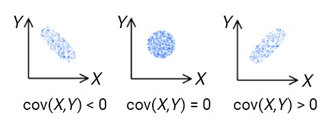

# data processing

Q1: **What is the difference between feature engineering and feature selection?**

- Feature engineering allows us to create new features from existing ones to help machine learning models make more effective and accurate predictions. The tasks of feature engineering are:
    - Filling in missing values in variables.
    - Encoding categorical variables as numbers.
    - Variable transformation.
    - Creating or extracting new features from the features available in the dataset.
- Feature selection allows us to select features from a pool of features, helping machine learning models predict the target variable more effectively.
- In a typical machine learning pipeline, we perform feature selection after completing feature engineering

Q2: **What is the difference between covariance and correlation?**

- Covariance measures whether a change in one variable leads to a change in another variable, and deals only with the linear relationship of variables in the dataset. Its value ranges from negative infinity to positive infinity. Simply put, covariance indicates the direction of the linear relationship between variables

- Correlation measures how strongly two or more variables are related to each other; its value lies between -1 and 1. Correlation also measures the strength and direction of the linear relationship between two variables, and is a function of the covariance.

Q3: **Would you use K-NN on a large dataset? Why?**

- It is not recommended to run **K-NN** on large datasets, because the computational and memory costs increase;
- The computation workflow of KNN
    1. First compute the distances to all vectors in the training set and store them.
    2. Sort the computed distances.
    3. Store the K nearest vectors.
    4. Compute the most frequent class shown by the K nearest vectors.

Q4: **Briefly describe the cross-validation method**

- Cross-validation means reusing the data: the obtained sample data is split and combined into different training and test sets; the training set is used to train the model, and the test set is used to evaluate how good the model's predictions are
- Cross-validation is used when the data is not very plentiful

Q5: **Explain how you understand dimensionality reduction**

- Dimensionality reduction means reducing the dimensionality of the data, using fewer and more discriminative features that can describe most of the variance in the data, thereby retaining most of the relevant information
- There are various techniques for doing this, including but not limited to PCA, ICA and Matrix Feature Factorization.

Q6: **Explain the difference between Normalizing and scaling**

- Normalizing changes the distribution of the data, so that the transformed data is roughly normally distributed
- Scaling means multiplying the data by a constant, which does not change the distribution of the data

Q7: **Under what circumstances does less training data lead to higher model accuracy?**

- Removing redundant data from the data, for example: similar-looking images, semantically similar sentences

Q8: **How do you handle imbalanced data?**

- Imbalanced data means: one or a few labels make up the majority of the dataset, while there are far fewer examples of the other labels
- Common balancing methods are:
    - Downsampling: reduce the number of majority class examples used during model training. Usually combined with the Ensemble pattern for better results.
    - Upsampling: increase the number of minority class examples by duplicating minority class examples and generating additional synthetic examples.
    
    
    
    - Weighted classes: by weighting the classes, tell the model to place more emphasis on the minority label class during training

Q9: **What options are there for feature imputation values?**

- For numerical features:
    - If the data is normally distributed, use the mean.
    - If the data is skewed or has many outliers, use the median.
- For categorical features:
    - If the data is sortable, use the median.
    - If the data is not sortable, use the mode.

Q10: **Briefly describe the workflow of K-fold cross-validation**

- Split the original data into K disjoint groups (K-Fold); each subset serves once as the validation set, with the remaining K-1 subsets as the training set, which yields K models. Each of these K models is evaluated on its validation set, and finally the errors MSE (Mean Squared Error) are summed and averaged to obtain the cross-validation error. Cross-validation makes effective use of limited data, and the evaluation result can be as close as possible to the model's performance on the test set, so it can be used as a metric for model optimization.

Q11: **Why is data sparser in high-dimensional spaces?**

- High-dimensional spaces have a much larger volume, and the number of data points can never keep up with that volume, so high-dimensional data is usually very sparse

Q12: **What is the difference between the *Bagging* and *Boosting* algorithms?**

- **Bagging**: the training sets are drawn from the original set with replacement, and the training sets selected from the original set in each round are independent of each other.
- **Boosting**: the training set stays the same in each round; only the weight of each example in the training set within the classifier changes. The weights are adjusted based on the classification results of the previous round

Q13: **What are the drawbacks of using decision trees as a model? How can they be addressed?**

- Drawbacks of decision trees:
    - As the number of records increases, training a decision tree takes a lot of time; the time complexity is very large.
    - They cannot be used for big data: if the amount of data is too large, a tree may grow many nodes, which can lead to excessive complexity and cause overfitting
- Solutions:
    - Prune the decision tree to alleviate overfitting
    - Use a random forest, i.e. ensemble learning with multiple trees

Q14: **In neural network training, how do you choose a data scaling method?**

- Min-max normalization preserves the original distribution of the scores and transforms all scores into the range [0, 1]. However, this method is highly sensitive to outliers
- Data standardization: the most commonly used technique, computed using the arithmetic mean and standard deviation of the given data
- Median and MAD: the median and the median absolute deviation (MAD) are insensitive to outliers and points in the extreme tails of the distribution, so this approach is robust. However, this technique does not preserve the input distribution, nor does it transform the scores into a common numerical range
