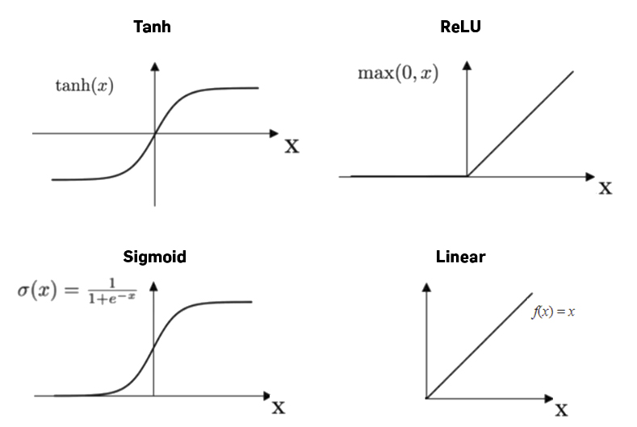

# Deep Learning Fundamental

# Beginner

Q1: ***What is the essential difference between deep learning and machine learning?***

- **The essential difference is where the features come from: traditional machine learning relies on hand-designed and hand-combined features, while deep learning learns features automatically and end to end through many non-linear layers (representation learning).**
- All layers of a deep network are learned jointly by backpropagation from the final task loss: shallow layers learn low-level features such as edges and textures, deeper layers combine them into high-level semantics such as parts and objects.
- Deep learning needs a lot of data to pay off; traditional machine learning depends much less on data volume.

Q2: ***Why does the performance of deep learning improve as the amount of data increases?***

- **With more data the model sees more situations and edge cases, so it learns the real patterns instead of memorizing noise and generalizes better; and because deep networks have large capacity, they don't saturate quickly like simple models and keep benefiting from more data.**

Q3: ***What is ensemble learning, and how is it used in deep learning?***

- **Ensemble learning trains several models and combines their outputs with some rule (voting, averaging, etc.) to improve overall generalization.**
- Typical examples in deep learning are dropout, zoneout and drop-connect, which implicitly ensemble a large number of sub-networks inside one network (more in Q38).

Q4: **In deep learning, how do you choose an activation function**?

- **For hidden layers, ReLU (or a variant) is the default because it is cheap and resists vanishing gradients; for the output layer, choose by task: Sigmoid for binary-class probabilities, Softmax for multi-class, and usually a linear output for regression.**

Q5: ***Compared with machine learning, what are the advantages of deep learning?***

- **Deep learning is end to end and doesn't need heavy manual feature engineering; with large datasets and complex problems (images, speech, text) it is clearly more accurate.**

Q7: ***How do you tell whether a deep learning model suffers from the vanishing gradient problem?***

- **Look at the training loss and the gradients of the early layers: if the loss drops very slowly and is still large after long training, while the layers near the input have tiny gradients and their weights barely change (or shrink toward 0), you have vanishing gradients.**

Q8: ***How do you tell whether a deep learning model suffers from the exploding gradient problem? How do you confirm it?***

- **Warning signs are a loss that stays high, very unstable training (the loss swings wildly from update to update), or a loss that becomes NaN. To confirm, inspect gradients and weights: weights become NaN, or per-layer gradient norms stay very large (for example, consistently above 1.0 and growing).**

Q9: ***What is the role of an Embedding Layer?***

- **An embedding layer maps high-dimensional, sparse one-hot inputs (such as word IDs) to low-dimensional dense vectors, which greatly cuts computation and places semantically similar items close together in vector space.**

Q10: ***What is the early stopping strategy?***

- **Early stopping is a form of regularization: keep monitoring the validation error during training and stop when it stops improving (or starts rising), because training further only fits the training set more closely and hurts generalization.**

Q11: ***What is incremental learning?***

- **Incremental learning means that after a model has been trained on existing data, it can keep learning from newly arriving data and extend its knowledge without forgetting what it already learned.**

Reference: [https://link.springer.com/](https://link.springer.com/)

Q12: ***Explain the principle of the perceptron***

- **The perceptron is a linear model for binary classification: it takes a weighted sum of the input features plus a bias and passes it through a sign function to output +1 or -1; the goal is to find a hyperplane (parameters $w, b$) that separates positive and negative samples.**
- Training: whenever a sample is misclassified, update $w, b$ in the direction that reduces the misclassification; convergence is guaranteed if the data is linearly separable.

# Intermediate

Q13: ***What is a computational graph? Which algorithms are computational graph models?***

- **A computational graph represents a mathematical expression as a directed graph: nodes are variables or operations, edges show how data flows. Deep learning frameworks use it for the forward pass and automatic differentiation (backpropagation sends gradients backward along the graph).**
- The perceptron, deep neural networks and linear regression can all be expressed as computational graph models.

Reference: [https://towardsdatascience.com/evolution-of-graph-computation-and-machine-learning-3211e8682c83](https://towardsdatascience.com/evolution-of-graph-computation-and-machine-learning-3211e8682c83)

Q14: ***What is the difference between linear and nonlinear activation functions?***

- **A linear activation outputs a linear function of its input, so stacking many layers is still equivalent to a single linear transform; non-linear activations (such as ReLU, tanh, sigmoid) let the network represent complex non-linear relationships, which is the key to the expressive power of deep networks.**

Q15: ***Explain the meaning of the 1*1 convolution operation.***

- **A 1x1 convolution leaves the spatial size of the feature map unchanged and only takes linear combinations across channels; it is mainly used to change the number of channels (reduce or increase it).**
- See also: [CNN](cnn.md) Q16; [Computer Vision](cv.md) Q34

Q16: ***When designing a neural network, which is more important, width or depth?***

- **For a standard feed-forward network, depth is usually more valuable than width: going deeper adds more levels of non-linearity and feature composition, representing more complex functions with fewer parameters; but deeper networks are harder to train and overfit more easily.**
- Theoretically, there are functions a deep network represents easily but a shallow one needs exponential width to represent (related research paper: [http://proceedings.mlr.press/v49/eldan16.pdf](http://proceedings.mlr.press/v49/eldan16.pdf)).

Reference: [https://www.quora.com/What-are-the-tradeoffs-of-increasing-the-depth-of-a-neural-network](https://www.quora.com/What-are-the-tradeoffs-of-increasing-the-depth-of-a-neural-network)

Q17: ***What do the hidden layers of a neural network compute?***

- **Hidden layers apply "linear transform + non-linear activation" to their input, turning the raw input layer by layer into feature representations that are more useful for the task, and reshaping the dimension into what the output layer needs.**

Reference: [https://stats.stackexchange.com/](https://stats.stackexchange.com/)

Q18: ***In a neural network, can nonlinear activation functions be replaced with linear ones? Why?***

- **No. With only linear activations, however many layers you stack, the whole network is equivalent to a single linear model and cannot learn complex functions; non-linearity is exactly what separates a neural network from linear regression.**

Q19: ***In a deep learning model, how do you choose the loss function?***

- **The loss must match the task type, and the output layer must be configured to match the loss: MSE/MAE-style losses for regression, binary cross-entropy for binary classification, multi-class cross-entropy (with Softmax) for multi-class.**
- Regression: MSE (sensitive to large errors), MAE (more robust to outliers), mean squared log error (when targets span a wide range).
- Binary classification: cross-entropy (Sigmoid output), hinge loss.
- Multi-class: multi-class cross-entropy; KL divergence when a whole distribution must be matched (e.g. autoencoders, knowledge distillation).

Reference: [https://machinelearningmastery.com/](https://machinelearningmastery.com/)

Q20: ***Introduce the principle of GAN***

- **A GAN (generative adversarial network) consists of a generator G and a discriminator D: G turns random noise into fake samples that try to pass as real; D judges whether its input is real or generated. They are trained against each other, and at equilibrium D can no longer tell real from fake, meaning G has learned the real data distribution.**

Q21: ***What is transfer learning?***

- **Transfer learning applies knowledge learned on one task (the source domain) to another related task (the target domain); the core is finding what the two have in common. In deep learning the most common form is "pre-train + fine-tune".**
- Four types by how knowledge is transferred: instance-based (reweight source samples), feature-based (map both domains into a shared space and shrink the distribution gap), model-based (share source model parameters, then fine-tune), relation-based (carry relationships between concepts from the source over to the target by analogy).

Q22: ***When is a convolutional layer equivalent to a fully connected layer?***

- **When the kernel size equals the spatial size of the input feature map (with no padding) and the number of kernels equals the number of output neurons of the fully connected layer, the convolutional layer is equivalent to the fully connected layer.**

Q23: ***What are the differences and connections between GANs and autoencoders?***

- **Both learn the distribution or a representation of the data, but with different objectives: an autoencoder compresses the input with an encoder and reconstructs it with a decoder, optimizing reconstruction error, and is commonly used for dimensionality reduction, feature extraction and anomaly detection; a GAN learns to generate realistic samples through an adversarial game between generator and discriminator, and is mainly used for image generation.**

Reference: [https://stackoverflow.com](https://stackoverflow.com/)

Q24: ***What are the benefits of pre-training for neural networks?***

- **Pre-training lets the model first learn general knowledge and features from massive (often unlabeled) data, then fine-tune on a small labeled set, so downstream tasks converge faster and perform better, and the need for manually labeled data drops sharply.**

Q25: ***Are there any problems with using Batch-Norm in deep neural networks?***

- **Yes. BN relies on per-batch statistics, so with small batches the statistics are inaccurate and performance drops, training and inference behave differently, and it doesn't suit sequence models; for small batches or sequence tasks, LayerNorm, GroupNorm and similar are used instead.**
- Sensitive to batch size: with tiny batches the mean and variance estimates are noisy and performance degrades.
- Training uses batch statistics while inference uses running averages, so the two differ.
- Hard to compute statistics with variable-length sequences, and storing the statistics costs extra memory and computation.

Reference: [https://medium.com/geekculture](https://medium.com/geekculture)

Q26: ***What is multitask learning? When is it appropriate to use it?***

- **Multitask learning trains one model on several tasks at once, usually sharing the lower layers and parameters with a separate output head per task; the shared information helps the model learn more general, compact representations and improves generalization.**
- It works best when the tasks are related or share underlying patterns; when tasks conflict strongly they can drag each other down.

Reference: [https://towardsdatascience.com/](https://towardsdatascience.com/)

Q27: ***What is the difference between AE and VAE?***

- **An AE encodes the input into a single deterministic vector and decodes it; a VAE encodes the input into a Gaussian distribution (mean and variance), samples from it before decoding, and uses a KL term to keep the latent space close to a standard normal. So the VAE's latent space is regular and continuous and you can sample from it to generate new data, which an AE cannot do.**

Reference: [https://towardsdatascience.com/difference-between-autoencoder-ae-and-variational-autoencoder-vae-ed7be1c038f2](https://towardsdatascience.com/difference-between-autoencoder-ae-and-variational-autoencoder-vae-ed7be1c038f2)

Q28: ***Name some CNN architectures you know***

- **A typical CNN stacks a few convolutional layers (+ReLU) followed by a pooling layer, repeats this, and ends with fully connected layers or global pooling. Classic architectures include LeNet, AlexNet, VGG, GoogLeNet / the Inception family, ResNet, DenseNet, ResNeXt and EfficientNet.**

Reference: [https://www.kaggle.com/general/255114](https://www.kaggle.com/general/255114)

- See also: [Computer Vision](cv.md) Q35, Q36 (VGG/ResNet/Inception and residual connections)

Q29: ***What is a Boltzmann machine?***

- **A Boltzmann machine is a neural network of symmetrically connected binary stochastic nodes; each node decides with some probability whether to turn on, and an energy function describes the probability distribution over network states. It is a generative model.**
- The common form is the restricted Boltzmann machine (RBM); stacking several RBMs gives a deep belief network.
- It can also be used for optimization/search problems, with fixed connection weights encoding the cost function.

Reference: [https://deepai.org/](https://deepai.org/)

Q30: ***Which neural network would you choose for a video classification task?***

- **Video contains spatial information within each frame and temporal information across frames, so choose a network that models both: for example a CNN to extract per-frame features plus an RNN/LSTM to model time (CRNN), or a 3D convolutional network directly (such as C3D or I3D).**

Q31: ***What effect does dropout have on neural network training?***

- **Dropout randomly deactivates some neurons during training, forcing the network not to rely on any individual neuron; it is equivalent to implicitly ensembling many different sub-networks within one model. It is a very cheap yet effective regularizer that reduces overfitting and improves generalization.**

Q32: ***Can an AE model be used for feature generation? If so, how?***

- **Yes. First train the autoencoder to reconstruct its input; after training, discard the decoder and use the encoder's bottleneck output as features for the input data. These features have a fixed dimension and retain most of the input's information.**

Q33: ***What are the differences between Batch Normalization, Instance Normalization, Layer Normalization, and Group Normalization?***

- **The four differ only in which dimensions the mean and variance are computed over: BN computes per channel across the whole batch; LN computes per sample across all channels; IN computes separately for each channel of each sample; GN splits the channels of each sample into groups and computes within each group.**
- BN depends on batch size and suits CNNs with large batches; LN is independent of the batch and suits RNNs / Transformers.
- IN is often used in style transfer; GN suits small-batch detection and segmentation tasks.

Reference: "Group Normalization"

Q34: ***With the same number of parameters, why do deep neural networks perform better than shallow ones?***

- **A deep network is a layer-by-layer composition of many simple functions, and later layers reuse the features learned by earlier ones, so the same number of parameters can represent more complex functions; deep networks use parameters more efficiently.**
- This naturally fits the hierarchical structure of data: in speech recognition, for example, early layers learn low-level features such as manner of articulation and later layers combine them into higher-level features such as phonemes; a shallow network struggles to learn such hierarchical features.

Q35: ***Compare SVM and deep learning***

- **SVM finds a maximum-margin boundary on fixed features: the optimization is convex, has a global optimum and the theory is clear; deep learning stacks layers to learn hierarchical feature representations automatically, which is far more expressive but needs lots of data and the optimization is non-convex.**
- Interpretability: SVM is backed by a complete mathematical derivation; deep networks are closer to a black box.
- Optimization: neural networks use gradient descent, are sensitive to initialization and can get stuck in local optima; SVM converges to the global optimum regardless of initialization.
- Multi-class: a single neural network suffices; SVM needs to combine several binary classifiers.
- Features: SVM performs poorly when there are more features than samples, and needs more manual feature engineering.

Q36: ***In what ways is the ReLU activation function better than sigmoid?***

- **ReLU has a constant gradient of 1 on the positive side and never saturates there, so deep networks are less prone to vanishing gradients and converge faster; it is also cheap to compute (no exponentials) and produces sparse activations. Sigmoid saturates at both ends and its derivative is at most 0.25, so with many layers the gradient vanishes.**
- ReLU's drawback: the gradient is 0 on the negative side, which can cause dead ReLUs (neurons that never activate again); Leaky ReLU, PReLU, ELU and GELU mitigate this.
- Division of labor: Sigmoid is common in output layers (binary probabilities) and gates (such as LSTM gates); ReLU is common in hidden layers.
- Key formula: $\sigma'(x)=\sigma(x)(1-\sigma(x))\le 0.25$, while ReLU's derivative is 1 for $x>0$

Q37: ***How is the Fourier transform used in deep learning?***

- **The classic use is speeding up convolution: by the convolution theorem, convolution in the time (spatial) domain equals element-wise multiplication in the frequency domain, so you can FFT the input and the kernel, multiply them in the frequency domain, and inverse-FFT back, which saves a lot of computation for large kernels.**

Q38: ***How is ensemble learning used in deep learning?***

- **Ensemble learning trains several models and combines their predictions to reduce variance and improve accuracy; in deep learning it can be applied at three levels: the training data, the model itself, and how results are combined.**
- Training data: train k models with k-fold cross-validation, or resample the data (bagging) and train on each resample.
- The model itself: dropout, drop-connect and similar methods ensemble implicitly inside one network.
- Combining results: a weighted-average ensemble with weights tuned on a validation set; averaging the weights of several networks (model weight averaging) to get one better single model.

Reference: [https://machinelearningmastery.com/](https://machinelearningmastery.com/)

Q39: ***How does deep learning mitigate/avoid the curse of dimensionality?***

- **The curse of dimensionality often comes from many redundant and irrelevant (noisy) features. Deep networks learn low-dimensional, useful representations from high-dimensional data, automatically weakening irrelevant features and strengthening relevant ones during learning, which mitigates the curse of dimensionality.**

Reference: [https://www.quora.com/](https://www.quora.com/)

Q40: ***How many skip-connection methods do you know?***

- **Three common ones: ResNet's residual connections (element-wise addition), DenseNet's dense connections (channel concatenation), and U-Net's long skip connections (concatenating encoder features into the matching decoder layer).**
- ResNet: shallow information is added directly to deeper layers with no extra parameters, letting gradients flow straight back.
- DenseNet: each layer's output is concatenated with all subsequent layers instead of summed, encouraging feature reuse.

- U-Net: long skip connections send the encoder's high-resolution details to the decoder, which helps fine-grained segmentation.

Reference: [https://www.analyticsvidhya.com/](https://www.analyticsvidhya.com/)

Q41: What is a ***Deep Recurrent Q-Network*?**

- **DRQN replaces the first fully connected layer after the convolutional layers of a DQN with an LSTM, to handle partially observable environments: even though it sees only one frame per time step, the LSTM lets it integrate information over time.**

Reference: [https://arxiv.org/abs/1507.06527](https://arxiv.org/abs/1507.06527)

Q42: *****What are the differences between the *region-based object detection network* (R-CNN), *Fast R-CNN* and *Faster R-CNN*?**

- **They are a progression of speed-ups: R-CNN runs a CNN separately on every region proposal, which is very slow; Fast R-CNN runs the CNN once over the whole image and uses RoI pooling to take each region's features from the feature map; Faster R-CNN further replaces selective search with a region proposal network (RPN) to generate proposals, making detection nearly end to end.**
- R-CNN extracts about 2000 proposals with selective search and cannot run in real time; Fast R-CNN's RoI pooling turns regions of different sizes into a fixed size before classification and regression; Faster R-CNN's RPN shares features with the detection network.

Q43: ***For sequence problems, compare HMM models and RNN models***

- **An HMM is a generative model built on a strong Markov assumption (the next state depends only on the current state); it is simple and suits small datasets. An RNN is a discriminative model that needs no such assumption, can model longer dependencies, and performs better on large datasets.**

Reference: [https://stats.stackexchange.com/](https://stats.stackexchange.com/)

Q44: ***Which object detection network architectures do you know?***

- **Object detectors fall roughly into two groups: one-stage detectors (YOLO, SSD, RetinaNet, CenterNet) predict boxes and classes directly in a single pass and are fast; two-stage detectors (R-CNN, Fast R-CNN, Faster R-CNN, Mask R-CNN, Cascade R-CNN) first extract regions of interest (RoIs) and then classify and regress them, and are usually more accurate.**

Reference: [https://www.v7labs.com/](https://www.v7labs.com/blog/object-detection-guide)

Q45: ***What are the difficulties in training GANs?***

- **GAN training has three main difficulties: non-convergence (parameters oscillate and are unstable), mode collapse (the generator produces only a few kinds of samples) and vanishing gradients (the discriminator is too strong and the generator learns nothing). Mode collapse is the hardest to solve.**
- Mode collapse example: on MNIST the generator should ideally produce all 10 digits but produces only a few of them.
- One theoretical explanation: neural networks can only represent continuous maps, while the true transport map of the data may be discontinuous; when the target distribution has several separate regions, the output of a continuous map may concentrate on only one of them, which is mode collapse.
- Fixes: empirically, unrolled GAN (the generator's update accounts for the discriminator's reaction over the next K steps) and DRAGAN (avoids bad local Nash equilibria); theoretically, compute the optimal-transport potential via Brenier's theory and locate the singular set to avoid mode collapse.

Reference: [https://jonathan-hui.medium.com/gan-why-it-is-so-hard-to-train-generative-advisory-networks-819a86b3750b](https://jonathan-hui.medium.com/gan-why-it-is-so-hard-to-train-generative-advisory-networks-819a86b3750b)

"Mode Collapse and Regularity of Optimal Transportation Maps"

Q46: ***Suppose you want to train a classifier and you have a large amount of unlabelled training data but only a few thousand labelled instances. How would you proceed?***

- **Use semi-supervised learning. The simplest approach is pseudo-labeling (self-training): train a model on the few thousand labeled samples, use it to label the unlabeled data, add the high-confidence samples to the training set and fine-tune, and repeat.**

Q47: ***How can genetic algorithms be used to optimise neural networks?***

- **The idea is to use a genetic algorithm to search for the network's initial weights and thresholds: encode all of a network's weights as one individual, use the network's prediction error as fitness, evolve the population through selection, crossover and mutation, then initialize the network with the best individual and train it with backpropagation.**
- Three steps: fix the network structure from the inputs and outputs (which fixes the individual's encoding length), optimize the weights with the genetic algorithm, then initialize with the best weights, train, and predict.

Reference: [https://journals.plos.org/plosone/article?id=10.1371/journal.pone.0243030](https://journals.plos.org/plosone/article?id=10.1371/journal.pone.0243030)

Q48: ***Why can neural networks fit arbitrary functions? Using sin and cos as examples, explain the role of nonlinear activation functions. How is the loss computed, and how does it relate to the number of samples and the feature dimension?***

- **The basis is the universal approximation theorem: with enough hidden neurons, a single-hidden-layer network with a non-linear activation can approximate any continuous function to arbitrary precision. Intuitively, each ReLU contributes one "kink", and enough line segments pieced together can approximate any curve.**
- Taking sin and cos as examples: without a non-linear activation, a multi-layer network collapses into one linear function that can only fit a straight line, so no depth will fit a sine wave; with ReLU the output is piecewise linear, and the more neurons, the finer the pieces and the closer it gets to the shape of sin and cos.
- Caveat: the theorem only guarantees such a network exists, not that gradient descent will find it or that it will generalize.
- Loss computation: average the per-sample losses over all samples, typically MSE for regression and cross-entropy for classification; the number of samples doesn't change the scale of the loss, but more samples mean more computation and a more accurate estimate of the true risk.
- The feature dimension sets the number of input-layer parameters and the computation; high dimension with few samples overfits more easily and needs more data or regularization.
- Key formula: $L=\frac{1}{N}\sum_{i=1}^{N}\ell(f(x_i;\theta),y_i)$

Q49: ***What is overfitting? Why can training get stuck in a local optimum?***

- **Overfitting means the model does well on the training set but poorly on the validation and test sets, because its capacity is too large relative to the data and it memorizes noise in the training data. The typical sign is training loss that keeps falling while validation loss starts to rise.**
- **Training gets stuck because a neural network's loss surface is highly non-convex, with many local minima, saddle points and flat regions; gradient descent only sees the local gradient, so it stalls when the gradient is close to 0.**
- In practice, in high-dimensional spaces saddle points are more common than local minima, and most local minima have a loss close to the global optimum.
- Remedies: optimizers such as momentum and Adam; mini-batch noise in SGD helps escape saddle points; sensible initialization and learning-rate schedules (warm-up, cosine); BN and residual connections smooth the loss surface.

Q50: ***How do you reduce overfitting and improve the generalisation ability of a network?***

- **The most effective step is more data (including data augmentation), followed by controlling model complexity and adding regularization, combined with training strategies such as early stopping and ensembling.**
- Data: more data, data augmentation (flips, crops, Mixup, CutMix, back-translation for text, etc.), cleaning noisy labels.
- Model: a smaller model, a suitable structural prior (such as a CNN), pre-training + fine-tuning.
- Regularization: L2 (weight decay), L1 (sparse weights), Dropout, Label Smoothing, BN.
- Training strategy and evaluation: early stopping, model ensembles; monitor generalization and pick hyperparameters with cross-validation or a separate validation set.

Q51: ***What does Batch Normalization do? How is backpropagation performed? How does it behave differently in training and inference?***

- **BN standardizes each channel using the mean and variance of the current mini-batch, then applies a learnable scale $\gamma$ and shift $\beta$ to restore expressive power. It keeps each layer's input distribution more stable and the loss surface smoother, which allows larger learning rates, speeds up convergence, eases vanishing/exploding gradients, and adds some regularization.**
- Backpropagation: the gradients of $\gamma, \beta$ follow directly from the chain rule; because the mean and variance depend on every sample in the batch, the gradient with respect to the input also flows back through the mean and variance paths, so each sample's gradient is affected by the other samples in the batch.
- Training: normalize with the current batch's statistics and accumulate global mean and variance with a running average (PyTorch's momentum defaults to 0.1).
- Inference: batch statistics are no longer computed; the fixed mean and variance accumulated during training are used, so BN becomes a linear transform that can be fused into the preceding convolution; in PyTorch, call `model.eval()` to switch.
- Key formula: $y=\gamma\frac{x-\mu_B}{\sqrt{\sigma_B^2+\epsilon}}+\beta$; related questions: Q25 (drawbacks of BN), Q33 (differences between the normalizations)

Q52: ***What is a mini-batch? Why use it?***

- **A mini-batch means each iteration takes only a small batch of samples (e.g. 32, 64, 256), computes the gradient of their average loss and updates the parameters. It sits between full-batch gradient descent and single-sample SGD, balancing computational efficiency with training stability.**
- Efficiency: the full dataset doesn't fit in GPU memory; small batches make full use of GPU parallelism and allow many updates per epoch.
- Stability: lower gradient variance than single-sample SGD, so training is steadier.
- Generalization: a moderate amount of gradient noise helps escape saddle points and converge to flat minima that generalize better.
- Choosing batch size: too small is unstable, underuses hardware and makes BN statistics inaccurate; too large may hurt generalization and requires scaling up the learning rate proportionally with warm-up.

Q53: ***What are the basic principles of CNN, RNN and LSTM? Which tasks is each suited to?***

- **A CNN extracts local spatial features with locally connected, weight-shared convolution kernels and suits grid data such as images; an RNN processes a sequence step by step, using a hidden state to remember history, and suits short sequences; an LSTM adds a cell state and gates to the RNN, captures long-term dependencies, and suits long-sequence tasks.**
- CNN: convolution + activation + pooling extract features from low to high level layer by layer, with few parameters and translation invariance; used for classification, detection and segmentation, and with 1D convolutions also for speech, text and time series.
- RNN: parameters are shared across time steps and it is trained with BPTT; on long sequences repeated gradient multiplication causes vanishing/exploding gradients, and it can't be parallelized.
- LSTM: the forget, input and output gates control what information is kept and written, and the additive cell-state update lets gradients flow stably over long distances; used for machine translation, speech recognition, text generation and time-series forecasting. GRU is a simplified version with only two gates.
- Key formula: $c_t=f_t\odot c_{t-1}+i_t\odot\tilde{c}_t$
