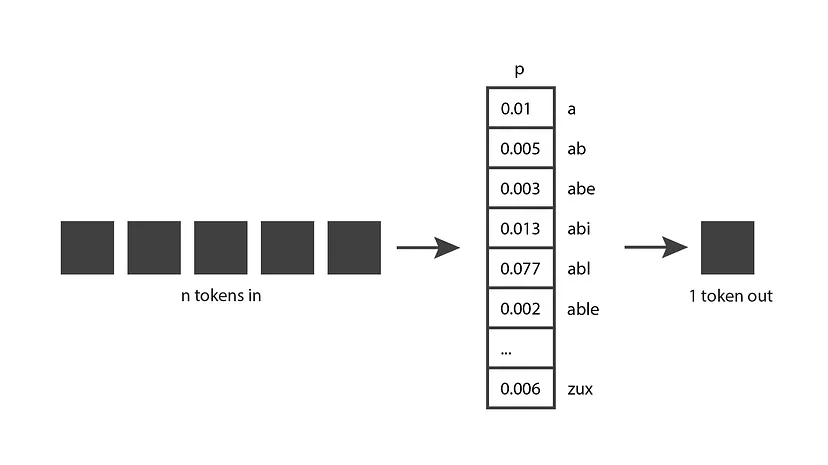

# LLM

**Q1: Explain how a generative language model works**

A generative language model takes N tokens as input and generates one token at a time as output. It then incorporates that output token into the input for the next iteration, produces a new output token, and so on. This pattern repeats until a stopping condition is reached, indicating that it has finished generating all the text you need.

The output of a generative language model is a probability distribution over all possible tokens. In the probability distribution vector, each value represents the probability of selecting a particular token.

This probability distribution comes from the training phase. During training, the model is exposed to a large amount of text and, given a sequence of input tokens, adjusts its weights to predict a good probability distribution.

GPT generative models are trained on a large portion of the internet, so their predictions reflect a mixture of the information they have seen.

**Q2: Explain the concept of a token in LLMs**

An LLM breaks the input text into multiple pieces, each being a character sequence roughly the size of a word or smaller; such a character sequence is a token.

A token can be a word or just a chunk of characters. For example, the word "hamburger" is broken into the tokens "ham", "bur" and "ger", while a short and common word like "pear" is a single token.

**Q3: In NLP tasks, what are the advantages of a Transformer-based architecture compared with an RNN-based one?**

- Before the Transformer appeared, sequence-to-sequence tasks were typically done with LSTMs in an encoder-decoder architecture. LSTM models take the interdependence between words into account, but they have a limitation: training is relatively slow, and the input sequence cannot be passed in parallel. The idea of the Transformer is to maintain the interdependence of words in a sequence without using a recurrent network, relying only on the attention mechanism at the center of its architecture. Attention measures how related two elements of two sequences are.
- Transformer-based architectures use self-attention. The self-attention layer determines the interdependence of different words within the same sequence in order to associate relevant representations with them. Take this sentence as an example: "The dog didn't cross the street because it was too tired." To a human it is obvious that "it" refers to "the dog" and not "the street". The goal of the self-attention process is therefore to detect the link between "dog" and "it". Compared with RNNs, self-attention can be trained in parallel, which makes Transformer training faster, and it has been shown to be more robust to noisy and missing data.
- In addition, with contextual embeddings, the Transformer can extract information from the context to correct missing or noisy data, which other neural networks cannot offer.

**Q4: How do you evaluate the performance of an LLM?**

There are two ways to evaluate an LLM: extrinsic evaluation and intrinsic evaluation.

- **Intrinsic evaluation**
    
    Captures how well the model captures what it is supposed to capture (e.g. probabilities). Examples are perplexity and cross-entropy. Perplexity is the geometric mean of the inverse probabilities of the words predicted by the model. The lower the perplexity, the better the training.
    
- **Extrinsic evaluation (task-based evaluation)**
    
    Captures how useful the model is on a specific task. For example, given the outputs of two different LLMs, have humans compare and score them.
    

**Q5: How are LLMs pre-trained?**

- **MLM, used by bidirectional models such as BERT**: a certain proportion of the words in the training set are masked, and the model's task is to predict these missing words. Note that in this task the model can see the words both before and after the missing word, which is why it is called bidirectional.
- **Autoregressive** (e.g. GPT): these are unidirectional; during pre-training they cannot see the following words and predict the next word. This is because these autoregressive models are specifically designed for better language generation, which makes it necessary to pre-train the model in a unidirectional way.

**Q6: Explain the NSP pre-training task**

- (NSP) is used for language modeling as one half of the BERT training process (the other half being masked language modeling (MLM)). The goal of NSP is to predict whether one sentence logically follows another sentence presented to the model.
- During training, the model is presented with pairs of sentences, some of which are consecutive in the original text and some of which are not. The model is then trained to predict whether a given sentence pair is adjacent. This enables the model to understand long-term dependencies between sentences.

Q7: **Tokenisation techniques in LLMs**

- **Tokenisation** is the process of converting raw text into a sequence of smaller units (called tokens), which can be words, subwords or characters. Some **tokenisation** techniques used in **LLMs** include:
    - **Word-based**: this method splits the text into individual words, treating *each word* as a separate token. Although simple and intuitive, word-based tokenisation can struggle with out-of-vocabulary words and may not handle languages with complex morphology effectively.
    - **Subword-based**: subword-based methods, such as ***Byte Pair Encoding (BPE)*** and ***WordPiece***, split text into *smaller units* that can be combined into whole words. This approach enables LLMs to handle out-of-vocabulary words and better capture the structure of different languages. For example, **BPE merges** the *most frequently* occurring character pairs to create subword units, while WordPiece takes a *data-driven* approach to segment words into subword tokens.
    - **Character-based**: this method treats *individual characters* as tokens. Although it can handle any input text, character-based tokenisation typically requires larger models and more computational resources because it has to process longer token sequences.

Q8: When developing an LLM, how can human-driven methods reduce the LLM's bias?

- **Training data curation**: humans can be involved in curating and annotating high-quality and diverse training data. This may include identifying and correcting biases, ensuring a balance of viewpoints, and reducing the influence of controversial or offensive content.
- **Model fine-tuning**: experts can guide the model fine-tuning process by providing feedback on the model's outputs, helping the model better avoid biased or incorrect responses through RLHF.
- **Evaluation and feedback**: human reviewers can evaluate the model's performance and provide feedback to the developers, who can then iteratively improve the model.
- **Customization and control**: users can be given options to customize the model's behavior and adjust the output according to their preferences or requirements. This approach can help users mitigate bias in model responses by tailoring the model to a specific context or domain.

Q9: ****What factors lead to bias in LLMs?****

LLM bias refers to the presence of systematic misrepresentation, misattribution or distortion of facts, resulting in favoring certain groups or ideas, thereby perpetuating stereotypes, or making incorrect assumptions based on learned patterns. Bias in such models can be caused by several factors:

- **Training data**: if the data used to train the language model contains biases, whether from the source material or from the selection process, these biases can be absorbed by the model and subsequently reflected in its behavior.
- **Algorithms**: bias can also be introduced by the algorithms used to process and learn from the data. For example, if an algorithm places more weight on certain features or data points, it may unintentionally introduce or amplify biases present in the data.

Q10: **In a Transformer, can the same word have different attention weights in different sentences?**

Yes. The Transformer architecture looks at the whole sentence and the positions of the words in the sentence (positional embeddings), then weights them with attention weights, computing the attention weights.

Reference: [https://stats.stackexchange.com/questions/575166/in-a-tranformer-the-same-word-can-have-different-attention-weights-in-different](https://stats.stackexchange.com/questions/575166/in-a-tranformer-the-same-word-can-have-different-attention-weights-in-different)

Q11: ****What is the difference between causal language modeling (CLM) and masked language modeling (MLM) in LLMs?****

- CLM is an autoregressive approach in which the model is trained to predict the next token in a sequence given the previous tokens. CLM is used in models such as GPT-2 and GPT-3 and is well suited to tasks such as text generation and summarization. However, CLM models have unidirectional context, meaning that they only consider the past and not the future context when generating predictions.
- MLM is a training method used for models such as BERT, in which some tokens in the input sequence are masked and the model learns to predict the masked tokens based on the surrounding context. MLM has the advantage of bidirectional context, allowing the model to consider both past and future tokens when making predictions. This approach is particularly useful for tasks such as text classification, sentiment analysis and named entity recognition.

Reference: [https://medium.com/@tom_21755/understanding-causal-llms-masked-llm-s-and-seq2seq-a-guide-to-language-model-training-d4457bbd07fa](https://medium.com/@tom_21755/understanding-causal-llms-masked-llm-s-and-seq2seq-a-guide-to-language-model-training-d4457bbd07fa)

Q12: **What is the complete RLHF training process?**

- **Step 1: Supervised fine-tuning (SFT)** — fine-tune the pre-trained language model on curated human answers to handle a variety of queries;
- **Step 2: Reward model fine-tuning** — train a separate reward model (RW), usually smaller than the SFT model, on a dataset in which humans have scored multiple answers to the same query;
- **Step 3: RLHF training** — use the Proximal Policy Optimization (PPO) algorithm to further fine-tune the SFT model based on the reward feedback from the RW model.

Q13: **How are GPT and BERT different?**

- GPT-3 is an autoregressive model, while BERT is bidirectional. GPT-3 only considers the left context when making predictions, while BERT considers both left and right context. This makes BERT better suited to tasks such as sentiment analysis or NLU.
- GPT-3 was trained on 45TB of data, while BERT was trained on 3TB of data. Therefore, GPT-3 has access to much more information than BERT.

Q14: **What is the difference between WordPiece and BPE?**

- The biggest difference between WordPiece and BPE is how the two subwords to merge are chosen: BPE merges the adjacent subwords with the highest frequency, while WordPiece adds to the vocabulary the adjacent subwords that most increase the language model's likelihood.

Q15: ****What is the difference between word embedding, position embedding and positional encoding in BERT?****

A word embedding is a learnable vector representation. Each word is assigned a one-hot encoding, which then serves as an index; corresponding to that index is a vector of some dimension whose coefficients can be learned while training the model.

A position embedding is similar to a word embedding, except that it uses the position in the sentence as the index instead of a one-hot encoding.

A positional encoding is not learnable; it is a chosen mathematical mapping function.

Q16: **What is Adaptive Softmax useful for in LLMs?**

Softmax is used in most NLP tasks, but for tasks with a very large vocabulary, computing the full softmax every time is very computationally expensive and time-consuming (predicting each token requires O(|V|) time complexity);

Adaptive softmax proposes exploiting the unbalanced word distribution to form clusters, so that computing the softmax avoids a linear dependence on the vocabulary size, reducing computation time;

Q17: **How can the "hallucination" phenomenon in LLMs be mitigated?**

LLM hallucination refers to content generated by an LLM that is inconsistent with the given input or source content, or makes no sense at all. LLM hallucination arises because the training dataset is limited, outdated or contradictory, so that when understanding and answering user questions, the LLM often relies on the statistical regularities or patterns it has learned rather than on facts or logic;

The main methods for mitigating LLM hallucination are the following:

- Human review: after the LLM generates content, humans review and revise it to ensure its correctness and reasonableness. The advantage of this method is that it can effectively avoid or correct hallucinations and improve content quality; the disadvantage is that it costs a great deal of human effort and time, and human errors or biases may be introduced.
- Data filtering: before the LLM generates content, the input or source content is filtered and cleaned to remove irrelevant, inaccurate or inconsistent information. The advantage of this method is that it reduces the likelihood of hallucination and improves the relevance and consistency of the content; the disadvantage is that it requires a lot of computational resources and algorithmic skill, and there is a risk of data loss or oversimplification.
- Knowledge graphs: while the LLM generates content, a structured knowledge base (a knowledge graph) is used to provide factual information and logical reasoning, enhancing the LLM's ability to understand and answer. The advantage of this method is that it improves the meaningfulness and faithfulness of the content and provides richer and deeper information; the disadvantage is that a large-scale, high-quality knowledge graph must be built and maintained, and the knowledge graph may be incomplete or out of date.

Q18: **What methods can reduce GPU memory usage when training LLMs?**

- Mixed precision training, e.g. AMP (Automatic Mixed Precision). This technique aims to maximize the throughput of GPU tensor cores while maintaining convergence.
- Gradient accumulation: in gradient accumulation, each batch computed is smaller, and gradients are accumulated (usually summed or averaged) over multiple iterations instead of updating the model weights immediately after each batch. Once the accumulated gradients reach the target "virtual" batch size, the model weights are updated with the accumulated gradients.
- QLoRA: given the low-rank property of LLM parameters (low intrinsic dimension), instead of doing a full fine-tune, fine-tuning is done with a down-projection matrix A and an up-projection matrix B.

Q19: **Limitations of the LoRA fine-tuning method**

Low-rank fine-tuning may not always work, for example when the gap between fine-tuning and pre-training is too large, such as the difference between Chinese and English; e.g. LLaMA does not perform well when LoRA-tuned on a Chinese corpus.

Q20: **The difference between bf16 and fp16 half-precision training**

bf16 uses 8 bits for the exponent and 7 bits for the fraction; fp16 uses 5 bits for the exponent and 10 bits for the fraction. In other words, bf16 can represent a wider range of numbers but with lower precision; fp16 represents a smaller range but with higher precision.

Although BF16 has lower precision, its representable range is larger, so it is usually the better choice in deep learning. In addition, precisely because its precision is not as high, BF16 also requires fewer hardware resources for its operations.

Q21: **Explain the concrete workflow of mixed precision training**

There are both low-precision and high-precision weights (float16 and float32). The forward pass is computed in low precision, and the gradients in the backward pass are also computed in low precision, but the parameter update is applied to the high-precision parameters. Then, before the next forward pass, the updated high-precision parameters are quantized to low-precision parameters, and the next forward pass begins.

Q22: **During RLHF, if the RM score keeps increasing as training goes on, does that necessarily mean the results are good? Are there extreme cases?**

- **Not necessarily. The reward model is only an imperfect proxy for human preferences, and the policy exploits its loopholes (reward hacking), so the RM score can keep rising while human evaluation first rises and then falls; this is Goodhart's law.**
- Extreme cases: answers grow ever more verbose and pile up phrases and formatting the RM likes; sycophantic agreement with the user, even giving wrong answers; over-refusal and empty answers; mode collapse, with repetitive or even garbled output that the RM still scores highly.
- The cause is that the RM's scores are unreliable on samples far from its training distribution, and the farther the policy drifts from the initial model, the easier it is to exploit.
- Mitigations: add a KL penalty against the reference model to limit drift; regularly evaluate with humans or a stronger model and early-stop on that, rather than looking only at the RM score.
- Improve the RM (more diverse preference data, iteratively updating the RM with samples from the new policy, RM ensembles, length normalization), or switch to DPO, or to rule-based rewards on verifiable tasks (RLVR).
- Key formula: $r = r_{RM}(x,y) - \beta \log\frac{\pi_\theta(y|x)}{\pi_{ref}(y|x)}$

Q23: **Explain how P-tuning works, and describe how it differs from traditional fine-tuning methods.**

- **P-tuning is a soft-prompt method: it inserts the embeddings of several learnable continuous "virtual tokens" into the input, freezes the whole pre-trained model, and trains only these prompt parameters, whereas traditional fine-tuning updates all of the model's parameters.**
- The original P-tuning uses a small prompt encoder (bidirectional LSTM + MLP) to produce the virtual-token embeddings, which makes optimization more stable.
- P-tuning v2 adds learnable prefixes at every Transformer layer (similar to Prefix-tuning) and drops the LSTM, getting close to full fine-tuning across model scales and tasks.
- Compared with full fine-tuning: only about 0.01%–3% of parameters are trainable; each task stores only tiny prompt parameters and can share one backbone; no optimizer states for the backbone, so memory is lower and there is less catastrophic forgetting; but results are usually somewhat worse on small models, and it is more sensitive to initialization and learning rate.
- Compared with LoRA: LoRA modifies the weights, can be merged back into the original model and has no inference overhead; P-tuning modifies the input and consumes part of the context length. LoRA is currently more common for LLM fine-tuning.
