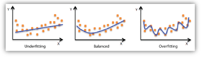

# Model Evaluation

Q1: ***Explain the phenomenon of overfitting in machine learning.***

- **Overfitting** refers to a model that models the training data too well.
- **Overfitting** occurs when a model learns the detail and noise in the training data to the extent that it negatively impacts the model's performance on new data. This means that the noise or random fluctuations in the training data are picked up and learned as concepts by the model; the problem is that these concepts do not apply to new data and negatively impact the model's ability to generalize

Q2: ***Explain the phenomenon of underfitting in machine learning***

- **Underfitting** refers to a model that can neither model the training data well nor generalize to new data. An underfit machine learning model is not a suitable model, because it performs poorly on the training data.
- **Underfitting** is often not discussed, because it is easy to detect given a good performance metric. The remedy for underfitting is to use a more suitable machine learning algorithm

Q3: ***What are hyper-parameters?***

- Every machine learning model has parameters and *can* also have hyperparameters; parameters are updated through model training. **Hyperparameters** are those parameters that cannot be learned directly from the regular training process**.** These parameters represent **high-level** properties of the model, such as its *complexity* **or** *how fast it should learn*.

Q4: ***How do you detect overfitting in machine learning?***

- The common pattern of **overfitting** can be seen on a **learning curve** plot, where the model's performance on the training dataset keeps improving, while its performance on the test or validation set improves up to a point and then starts to get worse. Therefore, an overfit model has **extremely low training error but high test error**.

Q5: ***What is the model learning rate? What effect does a high or low learning rate have on model learning?***

- The **learning rate** is a tuning parameter that determines the step size at each iteration (epoch) during model training. The step size is how fast you update the neuron weights in response to the estimated error. When updating model weights with the error backpropagation method, gradients flow from the model's input nodes through the neurons to the output nodes; the error is then determined and backpropagated to update the weights of the neurons (the model). The speed at which these neuron weights are updated is the learning rate.
- If the learning rate is **high**, the model weights are updated quickly and frequently, and the model converges quickly, but it may overshoot the true error minimum. **This means a model that converges faster but is wrong.**
- If the learning rate is **low**, the model weights are updated slowly, and the model takes a long time to converge, but it will not overshoot the true error minimum. **This means a slower but more accurate model.**

Q6: ***How do you tell whether your model has an exploding gradient problem?***

- The following phenomena indicate that the model you are training may have an exploding gradient problem, for example: the model cannot learn the training data well (the model loss stays high), model training is unstable (the loss changes a lot with each update), or the loss becomes NaN during training;
- When the above phenomena occur, you can dig deeper into the model to see whether there is an exploding gradient problem. The following phenomena confirm that exploding gradients are occurring: the model weights become NaN during the training phase; during training, the error gradient values for each node and layer are consistently above `1.0`;

Q7: **What methods do you know for *Hyperparameters Tuning*?**

- **Random search**: creates a grid of possible values for the hyperparameters. Each iteration tries a random combination of hyperparameters from this grid, records the performance, and finally returns the hyperparameter combination that gives the best performance
- **Grid search**: similar to manual tuning, builds a model for every permutation of all the given hyperparameter values specified in the grid, and evaluates and selects the best model. Finally, it returns the best model with the best hyperparameters
- **Bayesian optimization:** Bayesian optimization uses previous observations of the loss to determine the next (best) parameter point at which to sample the loss

Reference: [https://www.geeksforgeeks.org/hyperparameter-tuning/](https://www.geeksforgeeks.org/hyperparameter-tuning/)

Q8: ***When designing a neural network, what methods are there to prevent overfitting?***

- Simplify the model: to reduce complexity, we can simply remove layers or reduce the number of neurons to make the network smaller.
- Early stopping: a form of regularization. A NN uses gradient descent to update the network parameters, but after a certain point in training, improving the model's fit to the training data leads to an increase in generalization error. Past that point, improving the model's fit to the training data leads to an increase in generalization error. Early stopping specifies the number of iterations for which the network can be trained.

- Data augmentation: increase the number of images in the dataset. Some popular image augmentation techniques include flipping, translation, rotation, scaling, changing brightness and adding noise
- Regularization: L1 regularization and L2 regularization. The goal of L1 regularization is to minimize the absolute values of the weights, and the goal of L2 regularization is to minimize the squared magnitude of the weights
- Use the dropout strategy; dropout randomly removes neurons from the neural network during training in each iteration. When we drop different sets of neurons, it is equivalent to training different neural networks. Different networks overfit in different ways, so the net effect of dropout is to reduce overfitting

Reference: [https://www.kdnuggets.com/2019/12/5-techniques-prevent-overfitting-neural-networks.html](https://www.kdnuggets.com/2019/12/5-techniques-prevent-overfitting-neural-networks.html)

Q9: ***How do you address overfitting in logistic regression?***

- Reduce the number of features used; discard features that provide little information
- Use L2 regularization

Q10: ***What is a confusion matrix?***

- A confusion matrix is a performance measure for machine learning classification problems. It is a table containing the 4 different combinations of predicted and actual values, and it is very useful for measuring recall, precision, specificity, accuracy and, most importantly, the AUC-ROC curve.
- TP means the actual value is true and the predicted value is also true; FP means the actual value is false and the predicted value is true; FN means the actual value is true and the predicted value is false; TN means the actual value is false and the predicted value is also false

Q11: ***Explain the ROC curve***

- First, two concepts: TPR and FPR. $TPR = \frac{TP}{TP+FN}$ represents the proportion of actual positive instances **among the positive class** predicted by the classifier out of all positive instances; $FPR = \frac{FP}{TN+FP}$ represents the proportion of actual negative instances **among the positive class** predicted by the classifier out of all negative instances
- The ROC curve is a probability curve plotted with TPR against FPR, with TPR on the y-axis and FPR on the x-axis.
- The ROC curve has a nice property: when the distribution of positive and negative samples in the test set changes, the ROC curve stays unchanged, which helps in cases of class imbalance

Q12: ***Explain the AUC value***

- AUC (Area under Curve): the area under the ROC curve, between 0.1 and 1. As a number, AUC can intuitively evaluate how good a classifier is; the larger the value, the better. **The meaning of AUC is: when a positive sample and a negative sample are randomly picked, the probability that the score computed by the current classifier ranks the positive sample ahead of the negative sample.**

Q13: ***How do the ROC curve and the AUC value help measure how good a model is?***

- An excellent model has an AUC close to 1, which means it has a good measure of separability. A poor model has an AUC close to 0, which means it has the worst measure of separability. When the AUC is 0, the model classifies in reverse, predicting 0 as 1 and 1 as 0. When the AUC is 0.5, it means the model has no class separation capability at all.

Q14: ***What are the pros and cons of using the AUC value to measure model performance?***

- Pros: when measuring performance with AUC, it is ****not sensitive to whether the positive and negative class samples are balanced****; in addition, AUC inherits the good property of the ROC curve evaluation metric of not requiring a manually set threshold, directly measuring the algorithm's performance as a whole (offline ranking).
- Cons: AUC can only measure the performance of binary classification problems; AUC only reflects the overall performance of the model and does not show the error in different click-through rate intervals; AUC only reflects ranking ability, focusing on the relative magnitude of probability values, independent of the threshold and the absolute magnitude of the probability values, and does not reflect prediction accuracy;

Reference: [https://medium.com/@penggongting/understanding-roc-auc-pros-and-cons-why-is-bier-score-a-great-supplement-c7a0c976b679](https://medium.com/@penggongting/understanding-roc-auc-pros-and-cons-why-is-bier-score-a-great-supplement-c7a0c976b679)

[https://blog.csdn.net/Dby_freedom/article/details/89814644](https://blog.csdn.net/Dby_freedom/article/details/89814644)

Q15: ***Explain what the F1-Score is***

- The F1 score is a metric that measures a model's accuracy on a dataset, and it is used to evaluate binary classification systems. The F1-score is defined as the harmonic mean of the model's precision and recall:

$$
F1=\frac{2*precision*recall}{precision+recall}
$$

Q16: ***When the training data has an imbalanced class distribution, how do you choose evaluation metrics?***

- With imbalanced classes, the accuracy metric (Accuracy) can be misleading, because with imbalanced data, accuracy does not reflect the predictive ability on the minority class
- When data is imbalanced, AUC and F1 Score can be chosen as evaluation metrics

Q17: ***What problems might arise when using the early stopping strategy?***

- When using early stopping, the model may not have fully learned the distribution patterns in the data; one solution is to treat the number of training epochs as a hyperparameter, grid search over a range of different values using k-fold cross-validation, and find the optimal number of training epochs to obtain the final model

Reference: [https://machinelearningmastery.com/early-stopping-to-avoid-overtraining-neural-network-models/](https://machinelearningmastery.com/early-stopping-to-avoid-overtraining-neural-network-models/)

Q18: ***Algorithm A has higher Accuracy and algorithm B has higher Recall. How do you judge which of algorithm A and algorithm B is better?***

- The choice between a high-accuracy and a high-recall algorithm depends on the application scenario of the algorithm
- When predictions that are sensitive to the output are needed, the model needs high recall. For example, predicting cancer or predicting terrorists requires high recall: labeling a non-cancerous tumor as cancerous is acceptable, but a cancerous tumor should not be labeled as non-cancerous
- High precision is needed in places like recommendation engines and spam detection. In these places you do not care about false negatives and pay more attention to true positives and false negatives. It is acceptable if a spam email lands in the inbox folder, but a very important email should not go into the spam folder

Q19: ***What is the AIC metric?***

- AIC stands for the "Akaike Information Criterion". Built on the concept of entropy, it is a standard for measuring the goodness of fit of a statistical model. The smaller the AIC, the better the model. In the formula below, **k is the number of parameters in the fitted model, L is the log-likelihood, and n is the number of observations**. A small k means the model is concise, and a large L means the model is accurate.

$$
AIC=（2k-2L）/n
$$

Q20: ***What is the BIC metric?***

- BIC stands for the "Bayesian Information Criterion". From the fitting perspective, it selects the model that best fits the existing data; in terms of the Bayes factor interpretation, it is the model with the largest marginal likelihood

$$
BIC=ln(n)k-2ln(L)
$$
