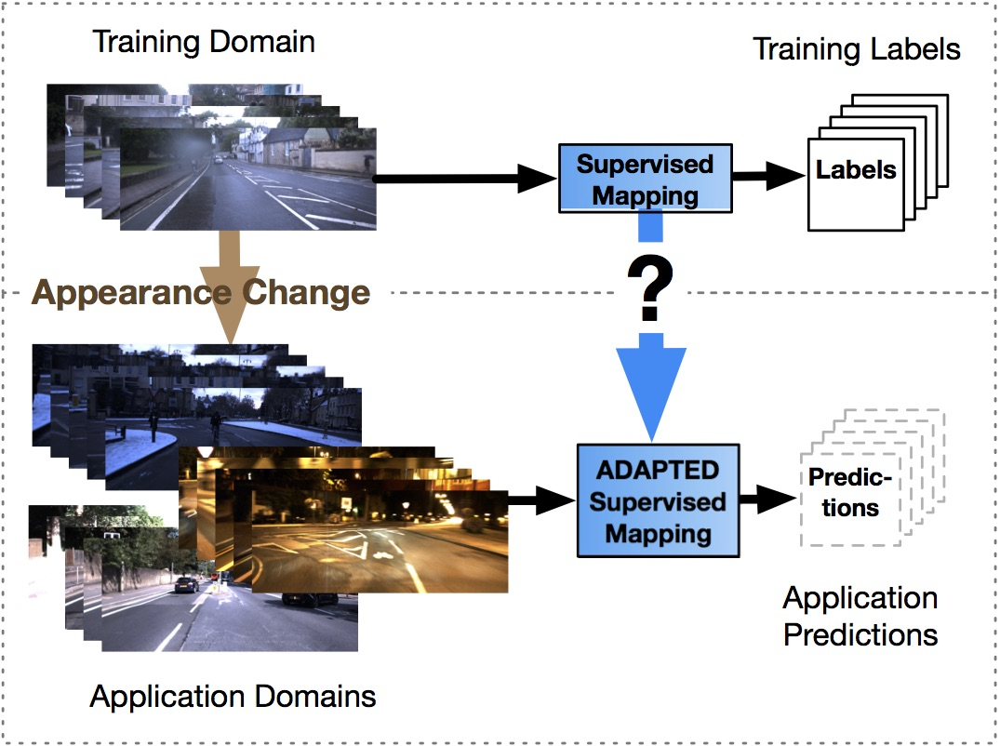

# Multimodal

Q1: **What do you know about multimodality?**

- Multimodal machine learning, Multi Modal Machine Learning (MMML), uses machine learning methods to achieve the ability to process and understand information from multiple modalities. Currently popular research directions are multimodal learning across images, video, audio and semantics (text).
- The goal of multimodal machine learning is to build models that can process and relate information from multiple modalities. In current technical settings, there are mainly the following challenges:
    - How to represent and summarize multimodal data in a way that exploits the complementarity and redundancy of multiple modalities
    - Identifying the direct relationships between elements from two or more different modalities
    - How knowledge learned from one modality can help a computational model trained on a different modality
    . This challenge is especially important when the resources of one modality (e.g. annotated data) are limited

Q2: **What are the methods of multimodal feature fusion?**

- Methods based on simple operations, attention-based methods, and bilinear-pooling-based methods:
    - Simple-operation fusion: concatenate or take a weighted sum of the features of different modalities; the subsequent network layers adapt to this operation automatically.
    - Attention-based fusion, e.g. SAN, and the Dual Attention Network (DAN)
    - Bilinear-pooling-based methods: fuse the visual feature vector and the text feature vector into a joint representation space by computing their outer product; this method can exploit all interactions between the elements of the two vectors

Q3: **What are the multimodal pretraining methods?**

- Pretrained models are pretrained on large-scale unlabeled data; on the one hand, more general knowledge from unlabeled data can be transferred to the target task, improving task performance. The main uses of pretraining in multimodal tasks are:
    - MLM (Masked Language Modeling): mask some of the words; the task is to infer the masked word from the context.
    - MOC (Masked Object Classification): mask part of the image content; the task is to classify it. The classification here still uses object detection techniques, simply taking the class with the highest confidence from object detection as the class label.
    - VLM (Visual-linguistic Matching): use the final hidden state of [CLS] to predict whether the language sentence semantically matches the visual content
    - Image-text alignment (Cross-Modality Matching): with 50% probability, replace the text description corresponding to an image, and have the model judge whether the image and the text description are consistent.

Reference: [https://zhuanlan.zhihu.com/p/412126626](https://zhuanlan.zhihu.com/p/412126626)

Q4: **Do you know the CLIP model?**

- CLIP uses text information to supervise self-training on vision tasks, turning the classification task into an image-text matching task, with results comparable to fully supervised methods;
- CLIP showed that a simple pretraining task, namely predicting which caption matches which image, is an effective and scalable way to learn SOTA image representations from scratch on a dataset of 400 million (image, text) pairs collected from the internet.
- After pretraining, natural language is used to reference the learned visual concepts (or describe new ones), enabling zero-shot transfer of the model to downstream tasks.

Reference: [https://towardsdatascience.com/clip-the-most-influential-ai-model-from-openai-and-how-to-use-it-f8ee408958b1](https://towardsdatascience.com/clip-the-most-influential-ai-model-from-openai-and-how-to-use-it-f8ee408958b1)

Q5: **Briefly describe what co-learning is**

- Co-learning refers to using information from a resource-rich modality to assist learning in another, relatively resource-poor modality. Co-learning is independent of the task to be solved, so it can be used to assist research on multimodal mapping, fusion and alignment.
- Co-learning research currently focuses mostly on domain adaptation, i.e. how to apply a model learned on the train domain to the application domain.

Q6: **What multimodal alignment techniques are there?**

- Modality alignment is one of the key techniques of multimodal fusion; it refers to finding correspondences between sub-components of instances from two or more modalities. Multimodal alignment methods fall into two types: explicit alignment and implicit alignment. Explicit alignment focuses on aligning sub-components between modalities, while implicit alignment performs latent alignment of the data during deep learning model training.
- Explicit alignment:
    - Unsupervised methods: e.g. DTW, where there are no supervised labels for direct alignment between instances of different modalities
    - Supervised methods: inspired by unsupervised sequence alignment techniques, they achieve better performance by adding supervision to the model
- Implicit alignment:
    - Graphical model methods: require large amounts of training data or manual involvement of human expertise
    - Neural network methods: introduce alignment mechanisms during model training, usually considering attention mechanisms
