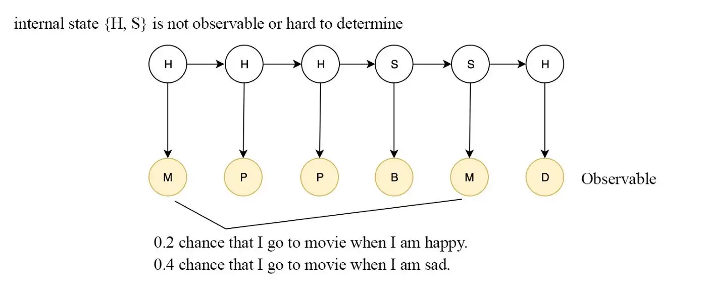

# NLP Algorithm Interview Questions

Q1: ***What is the role of text preprocessing in NLP tasks?***

- Text preprocessing converts text into a form machines can understand, so that machine learning algorithms can perform better. Moreover, in tasks such as sentiment analysis, preprocessing like removing stop words helps improve the accuracy of machine learning models.
- Common text preprocessing techniques include: removing HTML tags, removing stop words, removing numbers, lowercasing all letters, lemmatization, etc.

Q2: *****What is the difference between *lemmatization* and *stemming*?**

- **Stemming** just removes *the last few characters of a word*, often leading to incorrect meanings and spellings, e.g. `eating -> eat, Caring -> Car.`
- **Lemmatization** considers the *context* and converts a word into its meaningful base form, e.g. `Stripes -> Strip (verb) -or- Stripe (noun), better -> good`

Q3: ***When should lemmatization be used? When should stemming be used?***

- Stemming is used more in information retrieval, e.g. Solr, Lucene, etc., for query expansion, with coarser granularity. Lemmatization is used mainly in text mining and natural language processing, for finer-grained, more accurate text analysis and representation.
- Stemming is computationally cheap and suits large datasets; lemmatization is computationally expensive and is often used for small datasets with high accuracy requirements.

Q4: ***What is POS tagging (part-of-speech tagging) used for?***

- **POS tagging** is used to classify each word into its part of speech.
- Parts of speech can be used to find grammatical or lexical patterns.
- In English, the same word can have different parts of speech, and POS tagging helps distinguish them.

Q5: ***What are the advantages of using the Bag of words model to extract features?***

- The bag-of-words model is very simple and flexible: you can design your own vocabulary and extract features from documents in many ways.
- Texts made up of similar content will also be similar in other respects (e.g. meaning), so the bag-of-words model can reflect similarity between sentence meanings.

Q6: ***What is the difference between the TF-IDF method and the TF method?***

- TF-IDF is defined as term frequency-inverse document frequency; TF is defined as term frequency.
- TF-IDF is a statistical method intended to reflect how important a word is to a document in a corpus: the importance of a word increases proportionally with the number of times it appears in the document, but decreases inversely with its frequency in the corpus; TF is a count of the number of times a word appears in a document.
- TF is defined as $tf_{ij}=\frac{n_{ij}}{\sum_{k}^{}n_{k,j}}$, where $n_{ij}$ is the number of times the word appears in the document and the denominator is the total number of occurrences of all words in the document; TF-IDF is defined as $tfidf(t,d)=tf(t,d)*log(\frac{N}{df+1})$, where $N$ is the total number of documents in the corpus and $df$ is the number of documents containing the word.

Q7: ***What is a one-hot vector? How are they used in natural language processing?***

- One-hot vectors can be used to represent a sentence as a matrix of size $L*N$, where $N$ is the number of unique words in the corpus and $L$ is the length of the sentence; the position at the word's index is set to 1 and all other positions to 0.

Q8: ***What methods of text preprocessing are there?***

- There are three main types of text preprocessing:
- **Tokenization**: the process of splitting a body of text into smaller parts, or tokens. Paragraphs are tokenized into sentences, and sentences are tokenized into words.
- **Normalization**: database normalization is converting a database's structure into a series of normal forms. It organizes the data so that it looks similar across all records and fields. Similarly, in NLP, normalization can be the process of converting all words to lowercase. This makes all sentences and tokens look the same and does not complicate the machine learning algorithm.
- **Noise Removal**: the process of cleaning text, e.g. removing unwanted characters such as whitespace, numbers, special characters, etc.

Q9: ***What are the shortcomings of applying one-hot vectors in NLP?***

- **Sparse matrices and the curse of dimensionality.** The one-hot representation sets the position at the word's index to 1 and other positions to 0, but in real life the vocabulary is very large, reaching thousands or even tens of thousands of words, and the dimension of each vector equals the number of words in the vocabulary, so a single word needs thousands or even tens of thousands of dimensions; such large dimensions require huge computing resources in subsequent computation. In addition, only one dimension in a vector is non-zero, which is clearly far too sparse.
- **Lack of semantics.** In our language, words have certain similarities to each other; for example, the similarity between "i" and "you", or "apple" and "banana", is relatively high, while that between "i" and "apple" is relatively low. As numerical feature representations of words, word vectors should preserve the semantic similarity between words. However, the vector of every word obtained by one-hot is orthogonal to the vectors of all other words, i.e. the cosine similarity between any two words is 0, and the Euclidean distance between every pair of words is the same. So this vector representation loses the similarity between words.

Reference: https://www.jianshu.com/p/9948c5764302

Q10: ***In what ways is the TF-IDF method better than the TF method?***

- The TF method only counts the frequency of words in a sentence: the more a word appears, the more important it is; TF-IDF, by contrast, takes into account that a word's importance decreases inversely with its frequency in the corpus, which helps identify the keywords and reduces the importance of words that appear frequently but carry little importance, such as the Chinese particle "的" (de, a possessive/attributive particle).

Q11: ***Compare the TF-IDF method and the Bag of words model***

- Bag of Words just creates a set of vectors containing the counts of word occurrences in documents (reviews), while the TF-IDF model contains information about which words are more important and which are less important.
- The bag-of-words model is easy to interpret; however, TF-IDF usually performs better in machine learning models.

Q12: ***Explain what the BLEU score is***

- BLEU (*bilingual evaluation understudy*) is a metric for evaluating the difference between **the sentence generated by the model (candidate)** and **the actual sentence (reference)**, used to evaluate the quality of *machine-translated* text. BLEU is computed by building the **N-grams** of the **candidate sentence** and the **reference sentence** separately, and then counting the number of matches.

Q13: ***What kinds of ambiguity are encountered in NLP processing?***

- Lexical ambiguity: words that have more than one meaning.
- Syntactic ambiguity: the grammar used in a sentence is ambiguous; for a sentence under a given grammar, more than one parse tree is correct.
- Semantic ambiguity: more than one semantic interpretation of a sentence.
- Pragmatic ambiguity: this occurs when a statement is not specific and the context does not provide the information needed to clarify it.

Q14: ***What types of ambiguity are encountered in Chinese word segmentation?***

- In summary, there are two main types of ambiguity in Chinese word segmentation: **overlapping (crossing) ambiguity** and **combinational ambiguity**.
- Overlapping ambiguity: ABC can be segmented either as AB/C or as A/BC.
- Combinational ambiguity: AB can be treated either as one word AB or split into A/B.

Reference: [https://juejin.cn/post/7175781946767704121](https://juejin.cn/post/7175781946767704121)

Q15: ***Which loss would you choose for a text sentiment analysis task?***

- A sentiment analysis model can be built with a simple *positive/* negative output, or with a *positive/neutral/negative* output, or with a 5 stage output, where 0 is the most negative and 4 the most positive.
- If the output is simply *positive/negative*, binary **cross-entropy loss** can be used. If the output has more than `2` classes, **categorical cross-entropy** can be used.

Q16: ***Explain what the ROUGE metric is. How does ROUGE differ from BLEU?***

- ROUGE computes a score by comparing the summary or answer generated by the model with reference answers (usually human-generated). The ROUGE metric is very similar to the BLEU metric; both can be used to measure how well the generated result matches the reference. The difference is that ROUGE is recall-based, while BLEU focuses more on precision.
- ROUGE is divided into Rouge-N, Rouge-L and Rouge-S. Rouge-N actually splits the model output and the reference into N-grams and computes recall; Rouge-L uses the longest common subsequence; Rouge-S is an extension of Rouge-N that allows skipping some words in between when matching.

Q17: ***In machine translation, why did encoder-decoder RNNs replace seq2seq RNNs?***

- A seq2seq RNN can only translate one word at a time, while an encoder-decoder RNN can handle variable-length inputs/outputs and translate an entire sentence in one network inference.

Reference: [https://quizlet.com/284587332/deep-learning-midterm-2-flash-cards/](https://quizlet.com/284587332/deep-learning-midterm-2-flash-cards/)

Q18: ***Explain word embedding***

- Word embeddings, or word vectors, are a way of representing documents and words. A word embedding is a numerical vector that allows words with similar meanings to have similar representations. Word embedding maps word representations into a low-dimensional space, encoding semantic-space information.

Q19: ***What are the advantages of word embedding?***

- Compared with one-hot embedding, word embeddings are low-dimensional, continuous vectors, which makes them convenient for machine learning models to process.
- Word embeddings have a natural clustering effect: semantically similar words are also close to each other in the vector space.
- It is an unsupervised method, making it easy to apply to massive data.

Q20: ***What are the applications of CNNs in NLP? What is the intuition behind applying CNNs to NLP tasks?***

- CNNs were originally developed for computer vision tasks and therefore have translation invariance (for example, if we want to classify an image into categories such as cat, dog, airplane, then if you find a cat in the image, you do not care where the cat is located in the image); in text tasks, however, the order of phrases affects the overall semantics. Therefore, CNNs are applied mostly in NLP tasks where word order has little impact, such as sentiment classification.

Reference: [https://dennybritz.com/posts/wildml/understanding-convolutional-neural-networks-for-nlp/](https://dennybritz.com/posts/wildml/understanding-convolutional-neural-networks-for-nlp/)

[https://lena-voita.github.io/nlp_course/models/convolutional.html](https://lena-voita.github.io/nlp_course/models/convolutional.html)

Q21: ***Explain the word2vec method***

- word2vec is one of the methods for extracting word embeddings; it is a model that learns semantic knowledge from large text corpora in an unsupervised way. The model structure is fairly simple, consisting of an input layer, a hidden layer and an output layer. Depending on the inputs and outputs, the framework mainly includes the **CBOW** and **Skip-gram** models. CBOW predicts the current word given its context, while Skip-gram predicts the context of a word given the word.

Q22: ***What are the similarities and differences between word2vec and the GloVe algorithm?***

- GloVe and word2vec are both algorithms for extracting word embeddings; both models can encode words into vectors based on word "co-occurrence" information (how often words appear together in the corpus).
- word2vec uses a neural network to learn the word-embedding representation and is a predictive model; the GloVe algorithm is essentially SVD dimensionality reduction of the word co-occurrence matrix and is a count-based model.
- For larger data, GloVe is easier to parallelize and computes faster.

Q23: ***Explain the hidden Markov model (HMM)***

- A hidden Markov model uses a Markov process to model sequence-based problems. The model parameters $\lambda$ include the initial state distribution $\pi$, the transition probability matrix $A$ from one hidden state to another, and the observation probability (likelihood) matrix $B$ given the hidden state.

- HMM has two main assumptions: the hidden state at any time depends only on the previous hidden state; the observed state at any time depends only on the hidden state at the current time.
- HMM involves three problems: evaluation, learning and decoding;
    - The evaluation problem: given the model $\lambda$ and the observation sequence $O$, compute the probability of the observation sequence under this model;
    - The learning problem: given the observation sequence $O$, estimate the model parameters $\lambda$; it can be **solved with the Baum-Welch algorithm**.
    - The decoding problem: given the model and the observation sequence, find the most likely state sequence. It can be solved with the Viterbi algorithm.

Q24: ***What is BERT's architecture, what is its objective, what do its inputs include, and how are the three embedding inputs combined?***

- BERT's structure is mainly the encoder part of the Transformer. Bert_base has 12 layers, an output dimension of 768 and 110M parameters; Bert_large has 24 layers, an output dimension of 1024 and 340M parameters in total.
- BERT's objective is to train on large-scale unlabeled corpora to obtain text representations containing rich semantic information.
- BERT's inputs: token embedding, segment embedding, position embedding; the three vectors are summed to form the model input.

Q25: ***What are the differences between the decoder and the encoder in a Seq2seq model?***

- The encoder encodes the input sequence; when encoding it can consider not only the current state but also the preceding and following states. When decoding, the decoder cannot see information after the current state; it considers the encoder's context vector and the decoder's information from the previous time step.

Q26: ***Describe the model architecture of the Transformer.***

- The Transformer itself is a typical encoder-decoder model, with 6 Blocks on both the Encoder side and the Decoder side. An Encoder Block includes two modules: a multi-head self-attention module and a feed-forward neural network module; a Decoder Block includes three modules: a multi-head self-attention module, a multi-head Encoder-Decoder attention interaction module, and a feed-forward neural network module. Note: every module on both the Encoder and Decoder sides has a residual connection and a Layer Normalization layer.

Q26: ***What aspects of the BERT model could be improved?***

- Problem: Chinese BERT is trained with individual Chinese characters as units, and a single Chinese character cannot express the rich semantics that words or phrases have.
- Improvement: the ERNIE model feeds knowledge entities to the model and, when masking, masks all the characters of an entity, so that the model learns knowledge entities. BERT-WWM is trained with phrase-level masking.
- Problem: the NSP task harms the quality of the original word vectors.
- Improvement: RoBERTa removes the NSP task and uses dynamic masking instead of BERT's static mask.

Reference: [https://juejin.cn/post/7032813935619211295](https://juejin.cn/post/7032813935619211295)

Q27: ***Describe the BPE model***

- BPE (byte pair) encoding is a simple form of data compression used to represent variable-length subwords with a fixed-size vocabulary. BPE first splits words into individual characters, then repeatedly replaces the most frequent **pair of characters** with another character, until the number of iterations is reached. The BPE method can effectively balance vocabulary size and the number of steps (the number of tokens needed to encode a sentence).

Q28: ***What is the difference between the BPE model and the Wordpiece model?***

- Both BPE and Wordpiece first initialize a small vocabulary and then merge different subwords according to some criterion. The vocabulary grows from small to large.
- The biggest difference between BPE and Wordpiece lies in how two subwords are chosen for merging: BPE merges the adjacent subwords with the highest frequency, while WordPiece adds to the vocabulary the adjacent subwords that maximally increase the language model probability.

Q29: ***In the BERT model, what is the role of $\sqrt{d_{k}}$ in the self-attention operation?***

- After the dot product of Q and K, the variance between values is large, i.e. the differences in magnitude are large; passing them directly through Softmax makes the large ones larger and the small ones smaller. $\sqrt{d_{k}}$ is an empirically set value; scaling by dividing by $\sqrt{d_{k}}$ makes the values smoother and gives better training results.

Q30: ***Why is the attention mechanism effective?***

- Before attention appeared, models such as RNNs (LSTMs) were typically used to capture temporal information; these models read the whole sentence and compress all information into a fixed-length vector, which leads to problems such as information loss when processing long sentences.
- The attention mechanism is based on the human visual attention mechanism: when processing long sentences, instead of going through each word or character in order, it subconsciously focuses on the parts with the highest information density and filters out the rest; it captures contextual information more effectively.

Q31: ***Analyze the shortcomings of the BERT model***

- BERT cannot handle long texts, because the transformer model itself is autoregressive, and performance drops significantly when the number of tokens > 512; moreover, the complexity of the transformer model is $O(n^{2})$, which consumes a huge amount of computation when processing long texts.
- The input noise [MASK] causes a discrepancy between the pre-training and fine-tuning stages.
- Poor performance on generation tasks: the inconsistency between the pre-training process and the generation process leads to poor results on generation tasks.
- Positional encoding uses absolute encoding.

Q32: ***The role of the residual structure in the Transformer***

- It reduces the problems of vanishing and exploding gradients, and also solves the degradation problem. The degradation problem refers to: as the number of hidden layers in a network increases, the network's accuracy saturates and then degrades rapidly, and this degradation is not caused by overfitting.

Q33: ***Does the Transformer use post-norm or pre-norm? Why?***

- Pre-norm normalizes before the residual, x+F(Norm(x)); this makes the residual effect stronger and the training computation lower, but weakens the gain brought by model depth. Post-norm is what standard BERT uses, adding the norm after the residual, Norm(x+F(x)); the effect brought by depth is more pronounced, but the computation is larger. Currently post-norm is considered more suitable for deep transformers.

Q34: ***Why does BERT use character granularity instead of word granularity?***

- Because in the MLM pre-training task, the final word prediction is done with softmax. With character granularity, the total number of characters is around 20k, whereas with word granularity there are over a hundred thousand words, and GPU memory would explode during training.

Q35: ***What are the principles of and differences between the HMM and CRF algorithms?***

- HMM is a generative model; CRF is a discriminative model.
- HMM is a directed probabilistic graph; CRF is an undirected probabilistic graph.
- HMM's solution may be a local optimum; CRF can reach the global optimum.
- HMM makes the Markov assumption, whereas CRF has the Markov property, because the Markov property is the condition that guarantees or determines whether a probabilistic graph is an undirected probabilistic graph.

Q36: ***What is the role of the CRF layer in the BiLSTM+CRF model?***

- The CRF layer can add some constraints to the final predicted labels to ensure the predicted labels are valid. These constraints can be learned automatically by the CRF layer during training on the training data.
- CRF has transition features, i.e. it considers the ordering between output labels, and also learns some constraint rules.

Q37: ***What data augmentation methods are there in NLP?***

- Adding noise. Noise is mainly about removing information (Dropout). For example, randomly dropping words (one class of words at a time, or one word at a time), or randomly applying dropout on the Embedding (almost every Neural Model does this). Structured Dropout is the so-called Mask, i.e. using a weighted mask to cover some words.
- Synonym replacement. We can randomly choose synonyms of some words to replace them, e.g.: "她非常美丽" ("she is very beautiful") changed to "她非常漂亮" ("she is very pretty"). But a major limitation of this method is that synonyms usually have fairly similar word vectors in NLP, so for the model it does not serve as very effective data augmentation.
- Back-translation. This is a very commonly used data augmentation method in machine translation. The main idea is to have a machine translate a sentence into another language and then translate it back into the original language, obtaining a sentence with a similar meaning but possibly a different expression. This method not only has the capabilities of synonym replacement and word insertion/deletion, but also adjusts sentence structure and word order while keeping the meaning close to the original sentence; it is a very effective data augmentation method.
- Using generative networks. Use generative networks such as GANs or VAEs to generate some data. But the difficulty of this method is that the GAN model must be trained fairly well in order to generate high-quality data effectively, which involves a relatively large amount of work and is rather complex.

Q38: ***How does NLP solve the OOV problem?***

- UNK handling: if the training data is sufficient and the OOV words are all rare words, all OOV words can be replaced with an UNK token.
- Word PIece Model: the word-splitting rules can be learned automatically from corpus statistics; the commonly used one is BPE (Byte Pair Encode) encoding;
- Character Model: split all OOV words into characters; a simple brute-force approach, whose downside is that text sequences become very long, which is an unacceptable growth in dimension for performance-sensitive systems.
- Enlarging the vocabulary.

Q39: ***Analyzing BERT: which NLP tasks do different layers target?***

- **POS, constituent parsing, DEPS, Entities, SRL, COREF, relation classification: from top to bottom, the further down the list, the more the knowledge leans toward high-level semantics.** POS tagging is a simple task that leans toward surface features, while relation classification is a purely semantic task that cannot be solved well without understanding semantics; from top to bottom the tasks gradually become semantic tasks.

Reference: [https://cloud.tencent.com/developer/article/1526735](https://cloud.tencent.com/developer/article/1526735)

Q40: ***Why is SOP in ALBERT effective?***

- ALBERT argues that NSP (next sentence prediction) conflates topic prediction with coherence prediction. For reference, NSP uses two sentences — a positive example is when the second sentence comes from the same document, and a negative example is when the second sentence comes from another document. In contrast, the authors of ALBERT argue that inter-sentence coherence is the task/loss that really deserves attention, rather than topic prediction, so SOP does the following: it uses two sentences, both from the same document. The positive test case is when the two sentences are in the correct order. The negative example is when the order of the two sentences is reversed.

Q41: ***Why can BERT's three embeddings be summed?***

- The three embeddings are position embedding, token embedding and segment embedding; summing the three features is a common feature-interaction method in DL, crossing the features token, position and segment. Higher-order crossing brings stronger personalized expressive power, i.e. richer semantic variation. It avoids the loss of contextual semantic awareness that the transformer would suffer from losing positional information.

Q42: **What are the differences and connections between the Word2vec and LDA models?**

- LDA uses the co-occurrence relationships of words in documents to cluster words by topic, which can also be understood as factorizing the "document-word" matrix to obtain two probability distributions, "document-topic" and "topic-word"; whereas Word2Vec actually learns from the "context-word" matrix, where the context consists of several surrounding words, so the resulting word vector representation incorporates more of the context co-occurrence features. That is, if the Word2Vec vectors of two words have high similarity, they very likely often appear in the same contexts.
- The biggest difference between topic models and word embedding methods actually lies in the models themselves: a topic model is a generative model based on probabilistic graphical models, whose likelihood function can be written as a product of several conditional probabilities, including the latent variables to be inferred (i.e. the topics); whereas word embedding models are generally expressed as neural networks, with the likelihood function defined on the network's output, and the dense vector representations of words must be obtained by learning the network's weights.

Q43: **What is the difference between relative position encoding and absolute position encoding?**

- Absolute position encodings include the trigonometric (sinusoidal) position encoding; BERT and GPT also use absolute position encodings, but theirs are learnable absolute position encodings. Absolute position encoding has two major flaws:
    - **Trigonometric absolute position encoding only considers distance, not direction.**
    - **The distance expression also disappears after the vector projection.**
- The purpose of relative position encoding is to model the **relative meaning** of positions, e.g. Sinusoidal Position Encoding and Complex embedding.
    - Sinusoidal Position Encoding uses sine and cosine functions to represent absolute positions, and obtains relative positions through their product.
    - Complex embedding uses continuous functions in the complex domain to encode the representation of words at different positions.

Q44: **What is the idea behind ELMo?**

- During pre-training, a language model is used to learn a word's emb (**cannot resolve polysemy**);
- During use, words have a specific context, and a word's emb representation can be adjusted according to the semantics of the context words (**can resolve polysemy**).
    - Understanding: because during pre-training the LSTM in ELMo learns the context information corresponding to each word and stores it in the network, during fine-tuning the downstream task can fine-tune this network so it learns new features;

Q45: **What is the Huffman tree in word2vec?**

- HS uses a Huffman tree, changing the prediction of a one-hot code into the prediction of a sequence of 0/1 codes, performing hierarchical classification.
    - Input and output:
        - Input: n nodes with weights (w1,w2,...wn)
        - Output: the corresponding Huffman tree
- Steps:
    1. Treat (w1,w2,...wn) as a forest of n trees, each with only one node.
    2. In the forest, select the two trees whose root nodes have the smallest weights and merge them into a new tree, with these two trees as the left and right subtrees of the new tree. The weight of the new tree's root is the sum of the root weights of the left and right subtrees.
    3. Remove the two trees with the smallest root weights from the forest, and add the new tree to the forest.
    4. Repeat steps 2) and 3) until only one tree remains in the forest.
    

Q46: **Why is a Huffman tree used in Word2vec?**

- Usually, after obtaining the Huffman tree, we Huffman-encode the leaf nodes. Since leaf nodes with higher weights are closer to the root and leaf nodes with lower weights are farther from it, high-weight nodes get shorter codes and low-weight nodes get longer codes. This guarantees the tree's weighted path length is minimal, and it also agrees with information theory, i.e. we want more frequently used words to have shorter codes. How is the encoding done? Generally, for a node of a Huffman tree (except the root), we can agree that the left subtree is coded 0 and the right subtree 1. In word2vec, the convention is the opposite of the above, i.e. the left subtree is coded 1 and the right subtree 0, and it is also agreed that the weight of the left subtree is not less than that of the right subtree.
- Using a binary Huffman tree, the computation that was previously $V$ now becomes $log_{2}V$.

Q47: **What are the differences between word2vec and NNLM?**

- NNLM: the neural network language model, which uses the previous n - 1 words to predict the n-th word;
- word2vec: a neural network model that uses the (n - 1)-th word to predict the n-th word. But word2vec focuses more on its intermediate product, the word vectors, so it makes many computational optimizations. The optimizations are:
    - The input word vectors are directly summed column-wise and then averaged column-wise. This way, the multiple input word vectors become a single word vector.
    - It uses hierarchical softmax, which is essentially a Huffman tree.
    - It uses negative sampling, sampling a specified number of words from all words, without needing to use all words.
    

Q48: **What is the difference between word2vec and tf-idf in similarity computation?**

1. word2vec vectors are dense, while tf-idf vectors are sparse;
2. word2vec vector dimensions are generally much smaller than tf-idf vector dimensions, so computation is faster;
3. word2vec vectors can express semantic information, but tf-idf vectors cannot;
4. word2vec can obtain the similarity of two vectors by computing cosine similarity, but tf-idf cannot;

Q49: **What does negative sampling in word2vec do?**

- It greatly reduces computation and speeds up model training.
- It preserves training quality, because the target word is related only to nearby words, so there is no need to use all words as negative examples to update their weights.

Q50: **What are the differences between ELMo, GPT and BERT?**

- ELMo is a deep contextualized word representation model. It first trains a bidirectional language model on large-scale text (here, the outputs of two unidirectional LSTM models are concatenated, which differs somewhat from the usual definition of a bidirectional LSTM), i.e. it uses the previous word to predict the next word (of course, the difference from word2vec here is that the input is a sentence and the prediction is also a sentence, but essentially it uses the previous word to predict the next word). When using the word vectors, the whole sentence containing the target word is fed into ELMO, and the obtained sentence vectors are summed column-wise to get the target word's vector, and this word vector can handle polysemy.
- GPT is a model pre-trained using the Decoder part of the Transformer; it trains word vectors by training a generative model on large-scale text. GPT is not bidirectional, because during training the inputs of the nodes after the current node are masked.
- BERT is a model pre-trained using the Encoder part of the Transformer; it trains word vectors by training a generative model on large-scale text. But by masking the input, BERT can use left-to-right and right-to-left bidirectional neural network layers: since the target word is already masked, there is no need to worry about the bidirectional layers leaking the target word.

Reference: [https://github.com/km1994/NLP-Interview-Notes/tree/main/NLPinterview](https://github.com/km1994/NLP-Interview-Notes/tree/main/NLPinterview)

[https://github.com/laddie132/NLP-Interview](https://github.com/laddie132/NLP-Interview)

Created BY SUPRE IDOL
