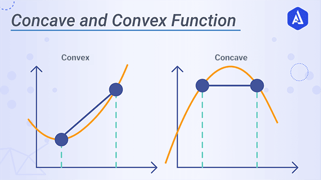

# Optimisation

## Easy

Q1: **Explain what Bayesian optimization is.**

- Bayesian optimization is a black-box optimization algorithm used to find the extremum of a function whose analytical expression is unknown. Based on the function values at a set of sampled points, the algorithm predicts the probability distribution of the function value at any point; this is achieved through Gaussian process regression. Based on the results of the Gaussian process regression, an acquisition function is constructed to measure how worthwhile each point is to explore, and the extremum of the acquisition function is solved to determine the next sampling point. Finally, the extremum among this set of sampled points is returned as the extremum of the function.
- In machine learning, Bayesian optimization is used in AutoML algorithms to automatically determine the hyperparameters of machine learning algorithms. Some NAS algorithms also use Bayesian optimization.

Q2: **Explain convex optimization in machine learning.**

- In machine learning, if the problem to be optimized is proven to be a convex optimization problem, then it can be solved relatively well with methods such as gradient descent
- Convex optimization is faster, simpler and less computationally expensive

Reference: [https://stats.stackexchange.com/](https://stats.stackexchange.com/)

Q3: Which hyperparameter tuning methods do you know?

- **Random search**: a grid of possible values is created for the hyperparameters. Each iteration tries a random combination of hyperparameters from this grid and records the performance; finally the hyperparameter combination giving the best performance is returned.
- **Grid search:** the search space is defined as a grid of hyperparameter values, and the algorithm's performance is evaluated at every position in the grid (exhaustive traversal); finally the hyperparameter combination giving the best performance is returned.
- **Bayesian optimization**: assumes a functional relationship between the hyperparameters and the loss function we ultimately need to optimize; this function is minimized via algorithms such as SMBO to obtain the optimal parameter combination

Q4: **Explain the Adam optimizer.**

- Adam: Adaptive Moment Estimation uses first-moment and second-moment estimates of the gradient to dynamically adjust the learning rate of each parameter;
- The Adam algorithm combines Momentum + RMSProp

Q5: **What are the limitations of the Adam algorithm?**

- Although training with Adam helps converge quickly, the generalization performance of the resulting model is often worse than that obtained by training with SGD with momentum.
- Another problem is that even though Adam has adaptive learning rates, its performance still improves when a good learning-rate schedule is used. In particular, early in training it is beneficial to use a lower learning rate to avoid divergence. This is because at the start the model weights are random, so the resulting gradients are not very reliable. If the learning rate is too large, the model may take steps that are too large before settling on suitable weights. Once the model has overcome these initial stability issues, the learning rate can be increased to speed up convergence.

Q6: **How does *Batch Size* affect the convergence of gradient descent? Why?**

- Large-batch training tends to converge to minima close to the initial parameter values rather than exploring the whole parameter space.
- Large-batch training tends to converge to sharper minima, while small-batch training tends to converge to flatter minima.

As shown in the figure, both minima reach the same loss value, but the flat minimum is less sensitive to perturbations in parameter space. The experimental evidence they provide shows that large-batch training is more likely to converge to sharp minima and to minima close to the starting point. The inherent noise in small-batch training helps push the parameters out of sharp basins.

Reference:

Q7: **In which situations would you choose a genetic algorithm as the optimization algorithm?**

- When many processors can be used in parallel
- When the objective function is highly multimodal (many local optima)

Reference: [https://stats.stackexchange.com/questions/249471/when-are-genetic-algorithms-a-good-choice-for-optimization](https://stats.stackexchange.com/questions/249471/when-are-genetic-algorithms-a-good-choice-for-optimization)

Q8: **How does the Adagrad algorithm adjust the learning rate?**

- AdaGrad is a gradient-based optimization algorithm whose main characteristic is that it adapts the learning rate for different parameters; specifically, it makes large updates for infrequently occurring parameters and small updates for frequently occurring parameters. Therefore it is well suited to sparse data. The computation proceeds as follows:
- Compute the gradient:

$$
g_t = \nabla_\theta J(\theta_{t-1})
$$

- Accumulate the squared gradient:

$$
r_t = r_{t-1} + g_t \odot g_t
$$

- Compute the update:

$$
\Delta \theta = {\eta \over \epsilon + \sqrt{r_t}} \odot g_t
$$

- Update the parameters:

$$
\theta_t=\theta_{t-1} - \Delta \theta
$$

Q9: **Compare Newton's method and gradient descent.**

- Gradient descent is an optimization algorithm based on first-order derivative information; at each step it updates the parameters in the direction opposite to the gradient. Because gradient descent only considers first-order information, it can be disturbed by noise and local minima. Newton's method is an optimization algorithm based on second-order derivative information; it uses a local quadratic approximation of the objective function and updates the parameters at each step by solving a system of linear equations.
- Differences:
    - Gradient descent is a first-order optimization algorithm; Newton's method is a second-order optimization algorithm
    - Newton's method often converges faster than gradient descent
    - Newton's method must update a two-dimensional matrix at every step, which is very expensive; in practice quasi-Newton methods are often used
    - Newton's method has certain requirements on the initial value; in non-convex optimization problems (such as neural network training), Newton's method easily gets stuck at saddle points (its step size becomes smaller and smaller), while gradient descent escapes saddle points easily (which is why gradient descent is generally used for neural network training; high-dimensional neural networks contain a large number of saddle points)
    - Gradient descent oscillates near the optimum, so step-size adjustment is necessary in gradient descent; specific examples are the family of adaptive learning-rate methods such as adagrad, adadelta, rmsprop and adam

Q10: **How is Bayesian optimization used in hyperparameter optimization?**

- In hyperparameter optimization, Bayesian optimization can use a Gaussian process model to model the hyperparameters. At each iteration, the model predicts the performance of the next hyperparameter combination based on previous results and performs a new function evaluation at that combination. In this way the model is continuously updated until the best hyperparameter combination is found.

Q11: **Are pruning methods applicable to neural network optimization?**

- Pruning methods can be used for neural network optimization to reduce the model's computational burden and the risk of overfitting. Pruning methods determine which neurons can be removed by evaluating the importance of each neuron. This can be achieved by using regularization techniques during training, or by applying specific pruning algorithms after training.

Q12: **In a random forest model, how do you optimize the number of trees in the forest?**

- In a random forest model, the optimal number of trees can be determined via cross-validation. By evaluating different numbers of trees, the optimal number can be found to maximize the model's accuracy. In practice, 10 to 1000 trees are typically evaluated and the best number is chosen.

Q13: ****If a CNN is very large and runs inefficiently on a mobile phone, which model compression methods do you know?****

- Low-rank approximation: convolution is essentially matrix computation; low-rank approximation reconstructs the weight matrix from a series of small matrices, thereby reducing computation and storage overhead. Two approaches are **singular value decomposition and Toeplitz matrix reconstruction**
- Model pruning and sparsity constraints: model pruning measures the importance of neurons, removes some unimportant neurons, and then fine-tunes the network, repeating this process; the idea of sparsity constraints is to add regularization to the network's optimization objective so that some weights of the trained network tend to 0, and these zero elements are the objects to be pruned; the advantage of sparsity constraints is that pruning can be completed with a single training run
- Parameter quantization: compared with pruning, parameter quantization is a commonly used back-end compression technique. Quantization summarizes a number of representative weights from the weights, and these representatives are used to represent the specific values of a class of weights. These "representatives" are stored in a codebook, and the original weight matrix only needs to record the index of its respective "representative", greatly reducing storage overhead.
- Knowledge distillation: use a larger, already-trained network to teach a smaller network; convert a high-accuracy but cumbersome teacher network into a more compact student network

Q14: **Describe the principle and procedure of model distillation.**

- Model distillation: tune the hyperparameters of the teacher model's softmax layer to obtain a suitable set of soft targets ("soft labels" refer to the feature maps output by the large network after each convolutional layer), then, for the student model to be trained, use the same hyperparameter values to approximate the teacher model's soft targets as closely as possible, as part of the student model's overall objective function, to guide the training of the student model and achieve knowledge transfer.

Reference: [https://blog.csdn.net/weixin_46838716/article/details](https://blog.csdn.net/weixin_46838716/article/details)

Q15: **Why can gradient descent reduce the loss? What is its mathematical principle?**

- The gradient $\nabla L(\theta)$ is the direction in which the function **increases fastest** at that point; the negative gradient direction is the direction of steepest descent
- Mathematical principle (first-order Taylor expansion): $L(\theta+\Delta\theta)\approx L(\theta)+\nabla L(\theta)^T\Delta\theta$; taking $\Delta\theta=-\eta\nabla L(\theta)$ ($\eta>0$ is the learning rate) gives $L(\theta-\eta\nabla L)\approx L(\theta)-\eta\lVert\nabla L(\theta)\rVert^2\le L(\theta)$, so as long as the gradient is nonzero and the step size is small enough, the loss decreases
- By the Cauchy-Schwarz inequality, $\nabla L^T\Delta\theta\ge-\lVert\nabla L\rVert\lVert\Delta\theta\rVert$; for a fixed step length, the decrease is largest when $\Delta\theta$ points in the same direction as the negative gradient, which is why the negative gradient is the "steepest descent" direction
- Update rule: $\theta_{t+1}=\theta_t-\eta\nabla_\theta L(\theta_t)$
- Role of the learning rate: the Taylor expansion only holds locally; if the gradient of $L$ is $L$-Lipschitz (smooth), then $\eta<\frac{2}{L}$ guarantees that the loss decreases at every step; a learning rate that is too large causes oscillation or even divergence, while one that is too small converges very slowly
- Limitations: for convex functions it converges to the global optimum; for non-convex functions such as neural networks, it is only guaranteed to converge to a stationary point (a local minimum or a saddle point)

Q16: **What are the principles of the Adam and SGD optimizers, and how do they differ?**

- **SGD**: each step updates with the gradient of one mini-batch, $\theta_{t+1}=\theta_t-\eta g_t$; it is often combined with momentum (SGD with Momentum): $v_t=\mu v_{t-1}+g_t$, $\theta_{t+1}=\theta_t-\eta v_t$; momentum accumulates the historical gradient direction, damping oscillations and accelerating progress through flat regions
- **Adam**: combines Momentum (first moment) and RMSProp (second moment) to adapt the learning rate for each parameter:

$$
m_t=\beta_1 m_{t-1}+(1-\beta_1)g_t,\quad v_t=\beta_2 v_{t-1}+(1-\beta_2)g_t^2
$$

$$
\hat{m}_t=\frac{m_t}{1-\beta_1^t},\quad \hat{v}_t=\frac{v_t}{1-\beta_2^t},\quad \theta_{t+1}=\theta_t-\frac{\eta\,\hat{m}_t}{\sqrt{\hat{v}_t}+\epsilon}
$$

- The bias correction compensates for $m_t,v_t$ being too small early on because they are initialized to 0; defaults are $\beta_1=0.9,\beta_2=0.999,\epsilon=10^{-8}$
- Differences:
    - Learning rate: SGD uses the same global learning rate for all parameters; Adam scales the step size of each parameter adaptively according to the second moment of its gradient, giving smaller steps to parameters with large gradients and larger steps to sparse/small-gradient parameters
    - Convergence speed and tuning: Adam converges quickly and is insensitive to the learning rate, suiting sparse gradients and tasks such as NLP/Transformers; SGD converges slowly, is sensitive to the learning rate and its schedule, and needs careful tuning
    - Generalization: SGD (+Momentum) tends to converge to flatter minima and usually generalizes better on CV tasks (e.g. ResNet on ImageNet); Adam may generalize slightly worse (see Q5)
    - Memory: Adam must store two extra states $m_t,v_t$ per parameter, roughly 3x the memory of SGD (in terms of parameter count); SGD+Momentum only stores one momentum buffer
    - Weight decay: in Adam, L2 regularization is coupled with the adaptive learning rate and works poorly; AdamW decouples weight decay ($\theta\leftarrow\theta-\eta\lambda\theta$) and is currently the common choice for training large models
