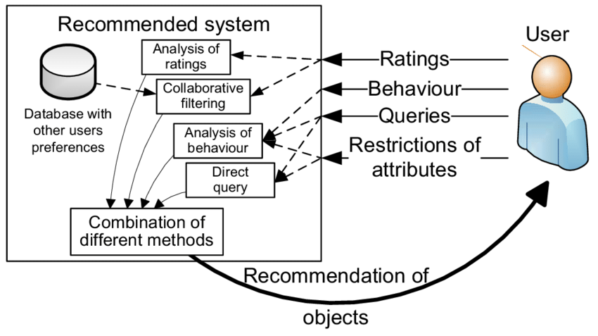

# Recommender Systems

# Easy

Q1: **Describe a recommender system.**

- A recommender system is a subclass of information filtering systems that tries to predict the rating or preference a user would give to an item.
- Recommender systems typically use one or both of collaborative filtering and content-based filtering, as well as other systems such as knowledge-based systems.

Q2: ****How do knowledge-based recommender systems differ from collaborative and content-based recommender systems?****

- Recommendations from content-based and collaborative systems are mainly based on historical data.
- Recommendations from knowledge-based systems are based on the users' direct specification of what they want. An important distinguishing feature of knowledge-based systems is a high degree of customization to a specific domain. This customization is achieved through a knowledge base that encodes relevant domain knowledge in the form of constraints or similarity metrics.

Q3: **What is the difference between collaborative and content-based recommender systems?**

- [Collaborative filtering] uses the user behavior recorded by the system: it characterizes items by the users who consumed them and computes similarity. It generally performs better than content-based approaches, because it is essentially based on co-occurrence and can uncover similarity relationships between items at some level that are hard to capture from the content dimension; whereas [content-based recommendation] focuses on the content information of objects, modeling their attributes to perform matching and thereby find similar users or products.

Q4: ****What are the scenario-specific challenges in recommender systems?****

- In different domains such as temporal data, location-based data and social data, the context of the recommendation plays a crucial role. The concept of contextual recommender systems was developed to handle the additional information that arises in these domains.
- Some domain-specific applications are context-based recommender systems, time-sensitive recommender systems, location-based recommender systems and social recommender systems.

Q5: **What is a model-based collaborative approach?**

- Model-based collaborative approaches rely only on user-item interaction information and assume a latent model that explains these interactions.
- For example, matrix factorization algorithms decompose the huge and sparse user-item interaction matrix into the product of two smaller and dense matrices: a user-factor matrix (containing the user representations) multiplied by a factor-item matrix.

Q6: **Describe the basic components of a content-based recommender system**

- Preprocessing and feature extraction: content-based systems are widely used in various domains, such as web pages, product descriptions, news, music features, etc. In most cases, features are extracted from these different sources and converted into a keyword-based vector space representation. This is the first step of any content-based recommender system, and it is highly domain-specific.
- Content-based user profile learning: a content-based model is specific to a given user. Therefore, a user-specific model is built to predict the user's interest in items based on the user's history of purchasing or rating items. To achieve this, user feedback is leveraged, which may manifest as previously specified ratings (explicit feedback) or user activity (implicit feedback). This feedback is used together with the item attributes to construct the training data. A learning model is built on this training data. The resulting model is called the user profile, because it conceptually relates user interests to item attributes.
- Filtering and recommendation: in this step, the model learned in the previous steps is used to recommend items to a specific user. This step needs to be very efficient, because predictions need to be made in real time.

# medium

Q7: **How do you understand graph convolution algorithms?**

1. GCN is a natural generalization of convolutional neural networks to the graph domain

2. It can learn node feature information and structural information end-to-end at the same time, and is currently the best choice for graph data learning tasks

3. Graph convolution is extremely widely applicable, suitable for nodes and graphs of arbitrary topology

4. On tasks such as node classification and edge prediction, it performs far better than other methods on public datasets

Q8: **Briefly describe the DeepFM model.**

- The DeepFM algorithm effectively combines the strengths of factorization machines and neural networks in feature learning: it extracts both low-order and high-order combined features at the same time, so it is increasingly widely used. In DeepFM, the FM component is responsible for extracting first-order features and second-order features formed by pairwise combinations of first-order features; the DNN component is responsible for extracting high-order features formed by applying fully connected operations etc. to the input first-order features. DeepFM has the following characteristics:
1. It combines the strengths of wide and deep models, jointly training the FM model and the DNN model to learn low-order and high-order feature combinations simultaneously.
2. It is an end-to-end model that requires no feature engineering.
3. DeepFM shares the same input and embedding vector, making training more efficient.

Q9: **How can knowledge graphs be introduced into recommender systems?**

- Feature-based knowledge-graph-assisted recommendation, whose core is the introduction of knowledge graph feature learning. Generally speaking, a knowledge graph is a heterogeneous network composed of triples <head node, relation, tail node>. Because of the inherent high dimensionality and heterogeneity of knowledge graphs, knowledge graph feature learning is first used to process it, obtaining low-dimensional dense vector representations of entities and relations. These low-dimensional vector representations can be combined and interact with the recommender system fairly naturally.
- Structure-based recommendation models use the structural features of the knowledge graph more directly. Specifically, for each entity in the knowledge graph, we perform a breadth-first search to obtain its multiple associated entities in the knowledge graph and derive recommendation results from them.

Q10: **Can ordinary logistic regression be used directly for large-scale ad click-through rate prediction?**

- No. First, the amount of data is too large. Traditional logistic regression parameter training relies on algorithms such as Newton's Method or L-BFGS. These algorithms are not easy to apply on large-scale data. Second, it is not easy to obtain a fairly sparse solution. That is, although the total number of features in the data is large, for a single data point the effective features are limited and sparse.

Q11: **What tricks does FTRL use when preparing training data (feature engineering) and training the model?**

- Feature engineering
    - Feature preprocessing: ID-ization, discretization, normalization, etc.;
    - Feature selection: variance, coefficient of variation, correlation coefficient, Information Gain, Information Gain-Ratio, IV value, etc.;
    - Feature crossing and combined features: cross features according to their business attributes, use the FM algorithm or GBDT algorithm to build high-dimensional combined features, etc.
- Subsampling Training Data
    - Sample all positive samples, sample negative samples at a rate r, and during model training multiply the update gradient of negative samples by a weight of 1/r;
    - Negative sampling methods: random negative sampling, Negative sampling, nearby negative sampling, skip-above negative sampling, etc.
- Online discarding of features that rarely appear in the training data (probabilistic feature inclusion)
    - Poisson Inclusion: for training samples arriving with a given feature dimension, accept them and update the model with probability p;
    - Bloom Filter Inclusion: use a bloom filter to probabilistically update only after a feature has appeared k times.

Q12: **Data-driven machine learning and optimization techniques are known to achieve good results in single-scenario A/B tests on click-through rate, conversion rate, GMV and unit price. However, currently each scenario is optimized completely independently. What serious problems does this cause?**

- When the product ranking of each scenario only considers itself, the user's shopping experience becomes incoherent or repetitive. For example: entering a store from a refrigerator's detail page but being shown phones; all scenarios converge in what they display, all containing too many U2I items (products previously clicked or purchased);
- Multiple scenarios are in a game-theoretic (competitive) relationship, and there is no guarantee that improving each scenario brings an overall improvement. It is quite possible that improving one scenario causes others to decline; worse, the gain from one scenario may even be smaller than a larger decline in other scenarios. This is not impossible, and in that case single-scenario A/B tests become less meaningful, and single-scenario optimization also has obvious problems.

Reference: [https://www.sohu.com/](https://www.sohu.com/a/445953351_100205241)

Q13: **Describe neighborhood-based algorithms in recommender systems**

- **Neighborhood-based algorithms fall into two main categories: user-based collaborative filtering and item-based collaborative filtering;** the basic idea is to use user-user similarity or item-item similarity to make recommendations from the rating matrix. The notion of a neighborhood means that we need to identify similar users or similar items in order to make predictions.

Reference: [https://link.springer.com](https://link.springer.com/chapter/10.1007/978-3-319-29659-3_2)

Q14: **What are the advantages of recommender systems using neighborhood-based methods?**

- Simplicity, efficiency, and the ability to produce accurate and personalized recommendations

Q15: **How do you choose between user-based and item-based neighborhood recommender systems?**

- UserCF recommends to a user the items liked by users who share common interests with them. ItemCF recommends to a user items similar to those they liked before. So UserCF's recommendations focus on reflecting what is popular among a small group of users with similar interests, i.e. socialization, while ItemCF's recommendations focus on maintaining the user's historical interests, i.e. personalization.
- **Use UserCF in news recommendation, because users' interests are not particularly fine-grained, most users like to read popular news, and items are updated faster than users; use ItemCF on book, e-commerce and movie websites, because users' interests are relatively fixed and long-lasting, i.e. not that sensitive to item popularity**

Q16: *****What is the basic structure of a content-based recommender system*?**

- The three main components are:
    - A content analyzer, which provides item classification.
    - A Profile Learner, which creates a profile representing each user's preferences.
    - A filtering component, which takes all the inputs and generates a recommendation list for each user.

Reference: [https://www.geeksforgeeks.org/ml-content-based-recommender-system/](https://www.geeksforgeeks.org/ml-content-based-recommender-system/)

Q17: **How do you create a recommender system for text input?**

- A text-based recommender system is usually designed in the following steps:
    - First, ****data preprocessing: remove stop words, punctuation and whitespace, and convert all words to lowercase****
    - Second, ****merge column attributes into a new column Bag_of_words to create the vocabulary representation****
    - ****Create a vector representation for Bag_of_words and create a similarity matrix****
    - The final step is to create a function that takes a movie title as input and returns the 10 most similar movies. The function matches the input movie title to the corresponding index of the similarity matrix and extracts the row of similarity values in descending order. Extracting the top 11 values and dropping the first index (i.e. the input movie itself) gives the top 10 most similar movies.

Q18: **How do you maintain user privacy when collecting data for a recommender system?**

- Privacy protection in recommender systems has been studied for a long time. Early research mainly protected private information through cryptographic methods or obfuscation methods. In recent years, with the introduction of federated learning, federated learning, which protects information through distributed data storage and distributed computation, has become the mainstream method for privacy-preserving recommender systems
    - Cryptographic methods: cryptographic methods study data encryption algorithms based on mathematical theory, the most classic and widely used being **homomorphic encryption; that is, using encryption algorithms that satisfy the homomorphic property on ciphertexts to make data "computable but not visible"**
    - Obfuscation: perturb the user's information (such as profiles and browsing history) to prevent identification of individual users, while preserving recommendation accuracy as much as possible
    - Federated learning: build distributed machine learning models based on datasets distributed across multiple devices while preventing data leakage. Since federated learning does not require centralized storage of training data, it has significant advantages in privacy protection

Q19: **How do you design a collaborative filtering recommender system using a Naive Bayes model?**

- A Naive Bayes-based collaborative filtering recommender system (Naive Bayes Collaborative Filtering) **turns the rating prediction problem in recommender systems into a classification problem. The following two points need to be considered:**
    - Users' ratings of items (e.g. products, movies) must be representative numbers (i.e. ordinal data such as 1-5 points) or reviews (such as like, dislike, neutral)
    - Users (or items) are approximately conditionally independent of each other

Q20: ****How should a recommender system work in a constantly changing environment?****

- Use incremental, online or dynamic versions of classic recommender system algorithms, such as the time-aware model time-SVD++
- Another option is reinforcement learning. The reinforcement learning framework can also model changes over time

Reference: [https://datascience.stackexchange.com/](https://datascience.stackexchange.com/)

Q21: ****What is the difference between computational advertising and recommender systems?****

- Recommendation aims to optimize your experience by providing the best items according to your personal taste; computational advertising involves third parties and aims to optimize the profits of advertisers, publishers and third parties based on your browsing history

Reference: [https://medium.com/crossing-minds/advertising-vs-recommendation-db608f2fb5eb](https://medium.com/crossing-minds/advertising-vs-recommendation-db608f2fb5eb)

Q22: **What is the importance of multi-armed bandit methods for computational advertising?**

- Recommender systems have two persistent problems: one is cold start, and the other is the exploration-exploitation problem (the Exploit-Explore problem). Bandit algorithms can effectively solve both of these problems.

Reference: [https://www.kukuxiaai.com/blog/2019-07/recommender-systems-multi-armed-bandits/](https://www.kukuxiaai.com/blog/2019-07/%E6%8E%A8%E8%8D%90%E7%B3%BB%E7%BB%9F-%E5%A4%9A%E8%87%82%E8%B5%8C%E5%8D%9A%E6%9C%BA/)

Q23: **What is the difference between content-based recommendation algorithms and collaborative-filtering-based recommendation algorithms?**

- In content-based recommendation methods, no latent model is assumed. These algorithms work directly with user-item interactions: for example, users are represented by their interactions with items, and nearest-neighbor search over these representations is used to produce suggestions. Since no latent model is assumed, these methods theoretically have low bias but high variance.
- In model-based recommendation methods, some latent interaction model is assumed. The model is trained to reconstruct user-item interaction values from its own user and item representations. New suggestions can then be made based on this model. The latent representations extracted by the model have a mathematical meaning that is hard for humans to interpret. Since an interaction model is assumed, this approach theoretically has higher bias but lower variance compared with methods that assume no latent model.

Q24: **Can SVD be used in recommender systems?**

- Yes. In collaborative filtering recommender systems, users' rating data is a sparse matrix. SVD can be used to map the data into a low-dimensional space, then compute the similarity between items in the low-dimensional space, predict ratings for items the user has not rated, and finally recommend to the user the items with high predicted ratings.

Q25: **How is SVD used in collaborative filtering recommender systems?**

- In the context of recommender systems, SVD is used as a collaborative filtering technique. It uses a matrix structure in which each row represents a user and each column represents an item. The elements of this matrix are the users' ratings of the items

$$
A=USV^{T}
$$

- It finds the factors of the matrix from the factorization of the high-level (user-item rating) matrix; SVD reduces the dimensionality of the utility matrix A by extracting its latent factors. Here *A* is the *m x n* utility matrix, *U* is the *m x r* orthogonal left singular matrix, representing the relationship between users and latent factors, *S* is an *r x r* diagonal matrix describing the strength of each latent factor, and *V* is an *r x n* diagonal right singular matrix, representing the similarity between items and latent factors. It maps each user and each item into an r-dimensional latent space. This mapping helps clearly represent the relationship between users and items.

Reference: [https://analyticsindiamag.com/](https://analyticsindiamag.com/)
