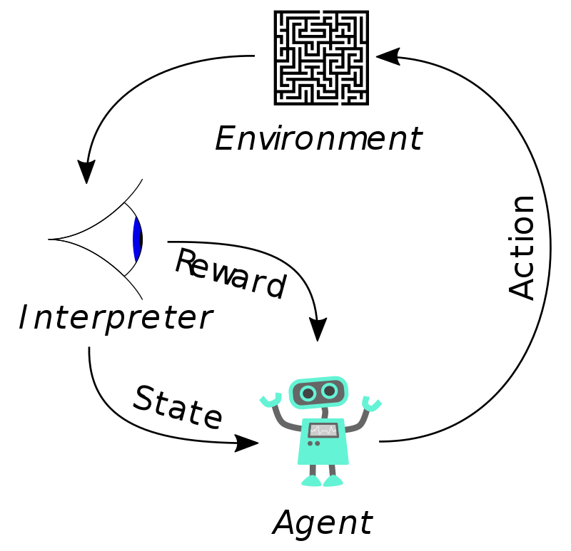

# Reinforcement Learning Interview Questions

# Easy

Q1: ****What is reinforcement learning? How does it differ from other machine learning techniques?****

- Reinforcement learning (RL) is a subset of machine learning that allows AI-driven systems to learn through trial and error using feedback from their actions. This feedback is either negative or positive, expressed as a penalty or a reward, and of course the goal is to maximize the reward function.
- In terms of learning method, RL is similar to supervised learning in that it learns using a mapping between inputs and outputs, but that is the only thing they have in common. RL differs from supervised learning in that, in supervised learning, the training data comes with answers (labels), so the model itself is trained with the correct answers; whereas in reinforcement learning there are no answers, and the agent decides by itself what to do in order to perform the task correctly.
- Compared with unsupervised learning, RL has a different goal. The goal of unsupervised learning is to find similarities or differences between data points. The goal of RL is to find the most suitable action model that maximizes the total cumulative reward of the RL agent. Without a training dataset, the RL problem is solved through the agent's own actions and input from the environment.

Reference: [https://www.geeksforgeeks.org/what-is-reinforcement-learning/](https://www.geeksforgeeks.org/what-is-reinforcement-learning/)

Q2: **What is a Markov decision process?**

- A state being a Markov decision process means the current state depends only on the previous state and not on any states before that.

$$
P(S_{t+1}|S_{t})=P(S_{t+1}|S_{1},...,S_{t})
$$

Q3: ****Intuitively explain what a policy is in reinforcement learning****

- A typical reinforcement learning (RL) problem has some basic elements, such as:
    - Environment: the physical world in which the agent operates.
    - State: the current situation of the agent.
    - Reward: feedback from the environment.
    - Policy: the method that maps the agent's state to actions.
- We can think of the policy as the way the agent behaves. For example, imagine a world where a robot moves through a room, and the task is to reach a target point (x, y), where it receives a reward. Here:
    - The room is the environment.
    - The robot's current position is a state.
    - The policy is what the agent (robot) does to accomplish this task. The robot has several options:
        - Policy 1: a dumb robot just wanders around randomly until it accidentally ends up in the right place.
        - Policy 2: for some reason, other robots may learn to follow the walls for most of the route.
        - Policy 3: a smart robot plans the route in its "head" and heads straight for the goal.
    
    Obviously, some policies are better than others, and there are many ways to evaluate them; the goal of RL is to learn the best policy. In this example, the best policy is option 3. A policy defines how the learning agent behaves at a given time, and is generally used by the agent to decide which action should be taken.
    

Q4: **What is the role of the discount factor in reinforcement learning?**

- The discount factor 𝛾 is a real value ∈ [0, 1] that concerns the rewards the agent receives in the past, present and future. In other words, it relates rewards to the time domain. Let us explore the following two cases:
    - Setting the discount factor 𝛾 = 1 means we take into account all future rewards. The agent would then learn forever, looking for all future rewards, which may lead to infinity.
    - Setting the discount factor 𝛾 = 0 means we only consider immediate rewards and not rewards obtained from future time steps. Then the agent will never learn, since it will only consider immediate rewards.
    - Therefore, the optimal value of the discount factor lies between 0.2 and 0.8; it sets the importance of immediate and future rewards depending on the task. In some tasks future rewards are preferable to immediate rewards, and vice versa.
    
    For example, in chess the goal is to checkmate the opponent's king. If we give more importance to immediate rewards, i.e. the rewards obtained from actions such as capturing any opponent piece with our pieces, then the agent will learn to pursue this sub-goal instead of learning the actual goal. So in this case we value future rewards more than immediate rewards, while in some cases we prefer immediate rewards over future rewards. For example, you might prefer eating a fresh piece of chocolate today rather than a few days later.
    

Q5: ****Name some methods or algorithms you know for solving reinforcement learning problems****

- Dynamic Programming (DP): when the model is fully known, following the Bellman equations we can use DP to iteratively evaluate value functions and improve the policy.
- Monte Carlo (MC) methods: they learn from episodes of raw experience without modeling the environment dynamics, and compute the observed mean return as an approximation of the expected return. An important point here is that episodes must be complete, meaning all episodes must eventually terminate.
- Temporal-Difference (TD) learning: similar to Monte Carlo methods, TD learning is model-free and learns from experience. However, TD learning can learn from incomplete episodes, so we do not need to track an episode until it terminates.
- Policy Gradient: all the previous methods aim to learn state/action value functions and then select actions accordingly. Policy Gradient methods directly learn the policy function with respect to some parameters `θ`, so our goal is to find the `θ` that produces the highest return.
- Evolution Strategies (ES): it learns the optimal solution by imitating Darwin's theory of species evolution through natural selection. Two prerequisites for applying ES: (i) our solutions can freely interact with the environment to see whether they can solve the problem; (ii) we can compute a fitness score for each solution. We do not need to know the environment configuration to solve the problem.

Q6: ****How do you define the state in reinforcement learning?****

- The **state representation** problem in reinforcement learning (RL) is similar to feature representation, feature selection and feature engineering in supervised or unsupervised learning.
- A common approach to modeling complex problems is **discretization**. At a basic level, this is splitting a complex and continuous space into a grid. You can then use any classic RL technique designed for discrete, linear spaces.
- Using **tabular learning algorithms** is another good way to define states, since they have reasonable theoretical convergence guarantees, which means that if you can simplify your problem so that it has fewer than a few million states, it is worth a try.
- Even if you discretize them, most interesting control problems do not fit into that many states. This is due to the **curse of dimensionality**. For these problems, you will usually represent your state as a **vector** of different features — for example, for a robot learning to walk, the various positions, angles and velocities of its mechanical parts. As with supervised learning, you may want to process these for the specific learning procedure. For example, you will usually want them all to be numeric, and if you want to use a neural network you should also normalize them to a standard range (e.g. `-1` to `1`).

Q7: **What is the difference between the reward and the value of a state?**

- A **reward** is a number returned at **a certain step** of a Markov decision process. If $r,s,a,s^{'}$ denote the reward, state, action and next state, the reward depends on the state, the action and the next state: $r=R(s,a,s^{'})$
- Value is a way of measuring **the long-term benefit** of being in a state; values are also called the expected return the agent gets starting from that state and following a particular policy.
- Hence, we can see that the **state value** is made up of many **rewards**, which are **weighted by the probability** of their occurring in the future.

Q8: **How do you tell when the Q-Learning algorithm has converged?**

- A reinforcement learning algorithm is considered converged when the learning curve becomes flat and no longer increases. However, because the exploration parameter ε is not gradually increased, Q-Learning can converge prematurely before reaching the optimal policy.
- Therefore, two conditions must be satisfied to guarantee convergence in the limit:
    - **The learning rate approaches zero, but not too quickly.** Formally, this requires that the sum of the learning rates diverges, while the sum of their squares converges. An example sequence with these properties is 1/1, 1/2, 1/3, 1/4, ....
    - **Every state-action pair must be visited infinitely often.** This has a precise mathematical definition: every action must have a non-zero probability of being selected by the policy in every state, i.e. π(s, a) > 0 for all (s, a). In practice, using an ε-greedy policy (where ε > 0) ensures this condition is met.

Reference: [https://stats.stackexchange.com/](https://stats.stackexchange.com/)

Q9: ****The relationship between Monte Carlo, TD and dynamic programming****

- Similarities: all three are used to describe and update value functions; Monte Carlo and TD algorithms are model-free, while dynamic programming is model-based; since TD and Monte Carlo are both model-free, their knowledge of subsequent states is obtained through trials; TD and dynamic-programming policy evaluation can both update the value function of the current state based on the predicted next step from the current state.
- The difference between TD and Monte Carlo is: TD does not need to wait until the trial ends to compute and update the value function of the current state, whereas Monte Carlo requires trial interaction that produces a complete Markov chain (up to the terminal state) before it can update.

Q10: ****Pros and cons of off-policy and on-policy****

- The advantage of on-policy is that it updates purely according to the interaction data, so it is straightforward. But it is not necessarily fast. After all, there is also the issue of sample efficiency during trial interaction: off-policy can use previous experience, while on-policy can only resample, so it is not necessarily fast. Its disadvantage is also that it does not necessarily find the optimal policy.
- The advantage of off-policy is stronger generality. It guarantees exploration; its power comes from ensuring data comprehensiveness, so all behaviors can be covered. (When choosing the action for $s_{next}$, off-policy needs to pick the max one, which requires the Q-values of all actions and thus covers all actions; in contrast, on-policy simply picks one action according to the policy.) But the disadvantage is also obvious: every estimate of a state's value function is an overestimate. Also, since it is sampling-based, some states will not be sampled, which produces bias.

Q11: ***What *steps* are involved in a typical reinforcement learning* algorithm?***

- First, the agent interacts with the environment by performing an action.
- The agent performs an action and moves from one state to another.
- Then the agent receives a reward based on the action it performed.
- Based on the reward, the agent learns whether the action was good or bad.
- If the action was good, i.e. if the agent received a positive reward, the agent will prefer performing that action; otherwise the agent will try performing other actions that can yield a positive reward. So reinforcement learning is basically a trial-and-error learning process.

Q12: *****What do *Stationary Dynamics* and *Stationary Policy* mean?**

- A Stationary Policy is a policy that does not depend on time. This means that as long as certain conditions are met, the agent will make the same decision. Such a fixed policy may be probabilistic, meaning the probability of choosing an action stays the same. It may make different decisions, but the probabilities remain unchanged. This usually means the policy is not being updated by a learning algorithm.
- Stationary Dynamics refers to the environment: the assumption that the environment's rules do not change over time. The environment's rules are usually represented as a Markov decision process model, which consists of all the state transition probabilities and reward distributions. So in this case, the reward function and transition probabilities stay the same, or change slowly enough that the agent has enough training time to learn the changes happening in the environment.

Q13: ****What do the *Alpha* and *Gamma* parameters represent in Q Learning?**

- alpha is a quantity that trades off what was learned previously against what is learned this time, i.e.: `Q = (1-alpha)*Q_old + alpha*Q_current.` Setting alpha too low makes the robot care only about previous knowledge and unable to accumulate new reward. It is usually set to 0.5 to balance previous knowledge and new reward.
- gamma is the factor that accounts for the influence of future rewards on the present; it is a value in (0,1). We usually take 0.9, which fully accounts for future rewards. In fact, if you make it smaller, you will find that the positive reward at the goal cannot "diffuse" to its surroundings, i.e. the robot will very likely fail to learn a policy that reaches the goal.

Q14: ***How does the *Q function* differ from the *value function* in reinforcement learning?***

- Like the value function, the Q function is a measure of quality. Unlike the value function, the Q function measures the expected discounted reward of taking a particular action in a given state, while the value function measures the expected total value of state s under policy π.

Reference: [https://core-robotics.gatech.edu/](https://core-robotics.gatech.edu/)

Q15: **What changes does DQN make compared with Q-learning?**

- DQN uses a deep convolutional neural network for value function approximation. The reason for choosing a CNN is that the original paper used Atari games as the environment, with input states being 84x84 images. Thanks to sparse connectivity and parameter sharing, a CNN greatly reduces computation and the number of stored parameters compared with an FCN; in addition, its inherent local features and translation equivariance make CNNs well suited to processing images. Of course, despite all this, it is nothing new; but adding the second point makes it completely different, solving a pain point in RL;
- It adds experience replay to train the reinforcement learner; data generated directly by RL interaction is inherently correlated, whereas a basic requirement for data in neural networks is that it be independent and identically distributed. Hence experience replay is introduced to break the correlation between data. Concretely: when the agent interacts with the environment, it stores the interaction data in a buffer, and during training it randomly samples data from it for training;
- It adds the concept of a target network to handle the TD error in the TD algorithm separately.

Q16: **What is the difference between *Q-Learning* and *SARSA*?**

- Q-L is an off-policy method that uses a greedy approach and learns the optimal policy directly,
- whereas SARSA is an on-policy method that learns Q-values using the actions taken by the current policy, learning a "near"-optimal policy.
- QL is a more aggressive agent, while SARSA is more conservative.

Q17: **What is the loss function of reinforcement learning? How does it relate to the loss function in deep learning?**

- The cumulative return. Depending on the problem setting, the cumulative return takes different forms. For example, for finite-horizon MDP problems the sum of rewards is used directly as the optimization objective. For infinite-horizon problems, to make the sum meaningful, the discounted cumulative return or the average return is needed. The loss function in deep learning is generally the error between predictions and labels over multiple i.i.d. samples, which is to be minimized. The loss function of reinforcement learning is the cumulative sum along a trajectory, which is to be maximized.

Q18: **What is a POMDP? What is a Markov process? What is a Markov decision process? What property does "Markov" reflect in them?**

- A POMDP is a partially observable Markov decision problem. A Markov process represents a sequence of states, where each state is a random variable and the variables satisfy the Markov property; it is represented as a tuple <S, P>, where S is the state and P is the transition probability. An MDP is represented as a 5-tuple $<S,A,P,R,\gamma>$, where S is the set of states, A is the set of actions, P is the transition probability, i.e. the model, R is the reward function, and $\gamma$ is the discount factor. "Markov" reflects the memoryless (no after-effect) property, i.e. future decisions depend only on the current state and not on historical states.

# Medium:

Q19: **Why are the optimal value function and the optimal policy equivalent?**

- The optimal value function uniquely determines how favorable a state or state-action pair is relative to other states and state-action pairs; we can rely on this value to uniquely determine the current action. They correspond to each other, hence they are equivalent.

Q20: **What is the difference between value iteration and policy iteration?**

- Policy iteration has two loops: one is in policy evaluation, where many iterations are needed to obtain the value function of the current policy; the other is the outer loop of policy evaluation and policy improvement. Value iteration does it in one step, directly estimating the optimal value function, so it has no policy-improvement step.

Q21: **If the Markov property does not hold and the current state depends on many, many previous states, how should the problem be handled?**

- If the Markov property does not hold, forcing decisions based only on the current state will inevitably make decisions one-sided and yield a poor policy. To solve this, an RNN can be used to model historical information and obtain a state representation that contains historical information. The representation process can use techniques such as the attention mechanism. Finally, the MDP problem is solved in the representation state space.

Q22: **Briefly describe the Monte Carlo (MC) value function estimation algorithm**

- The Monte Carlo method is sampling-based simulation; Monte Carlo value function estimation uses the collected data and the definition of the value function to update the value function. Assuming a tabular problem, the steps are:
    - Initialization: initialize a Return(s) list for each state. Think of each element in the list as one cumulative return.
    - Generate trajectories according to policy pi.
    - Using the trajectory, compute the subsequent cumulative return for each state and append this value to that state's Return(s) list.
    - Repeat several times, each time adding new values to the return lists of the states that appear. Finally, by definition, the mean of the numbers in each state's return list is its value estimate.

Reference: [https://zhuanlan.zhihu.com/p/55487868](https://zhuanlan.zhihu.com/p/55487868)

Q23: **Briefly describe the temporal-difference (TD) algorithm**

- TD, MC and DP algorithms all use generalized policy iteration to solve for the policy; they differ only in how the value function is estimated. DP uses the Bellman equation, MC uses sampling, and the core of the TD method is bootstrapping, i.e. the value function update is: $V(s_t) <-- r_t + \gamma V(s_next)$, using the value function of the next state to estimate the value of the current state.

Q24: **Briefly describe Q-Learning and write its Q(s,a) update formula. Is it on-policy or off-policy, and why?**

- Q-learning is an algorithm that obtains the policy by computing the optimal action-value function; the update formula is:

$$
Q(s_t, a_t) <--- Q(s_t, a_t) + \alpha [R_{t+1} + \gamma \max_a Q(s_{t+1}, a) - Q(s_t, a_t)]
$$

It is off-policy: since the value update uses argmax_a Q at the next time step, we only care about which action maximizes Q(s_{t+1}, a), and do not care which action was actually taken (the behavior policy). This shows that the optimization of the policy does not use data from the behavior policy, so it is off-policy.

Q25: **What is the difference between value-based and policy-based?**

- Value-based methods solve for the optimal policy indirectly by solving for the optimal value function; policy-based methods parameterize the policy directly and update the policy parameters through policy search, policy gradient or evolutionary methods to maximize the return. Value-function-based methods do not extend easily to continuous action spaces, and they have convergence problems when nonlinear approximation, bootstrapping and off-policy learning are used together. Policy gradient has good convergence proofs.

Q26: **What are the two key tricks of DQN?**

- Using a target network to alleviate training instability; experience replay;
- In DQN, the update of one action-value depends on other action-values. If we keep updating the parameters of the value network, the update target keeps changing, i.e. we are chasing a constantly moving target, which is bound to be unstable. Introducing a target network means freezing the constantly changing values in the update target for a while, updating the parameters, and then updating the target network. This way, the target is fixed within a certain period and training is more stable.
- Experience replay is used to eliminate correlations between samples.

Q27: **Describe the characteristics of stochastic and deterministic policies.**

- A stochastic policy is represented as a distribution over action values in a given state, while a deterministic policy has only one definite action to choose in each state. From the entropy perspective, a deterministic policy has entropy 0, with no randomness at all. A stochastic policy helps us explore moderately, while exploration is a more serious problem for deterministic policies.

Q28: **What are the respective advantages of Policy Iteration and Value Iteration?**

- Policy iteration performs policy improvement after policy evaluation, waiting until the value function converges, whereas value iteration performs policy improvement directly during policy evaluation as soon as the value function changes.
- Value iteration: removes the need for hyperparameters in policy iteration; policy evaluation needs only one iteration, requires less computation, and should converge faster than policy iteration.
- Policy iteration: when the policy meets the termination condition, since the value function corresponding to the policy has converged, the policy is guaranteed to be optimal.

Q29: **Is the Monte Carlo method applicable to all tasks?**

- Monte Carlo methods compute the value function and the Q function by taking the average return of states and the average return of state-action pairs, respectively. But one problem with Monte Carlo methods is that they only apply to episodic tasks.

Q30: **How does the Monte Carlo prediction method compute the value function?**

- There are two Monte Carlo methods for computing the value function: first-visit MC and every-visit MC.
- The most classic way to compute the value function is to sample each first visit to a state and then compute the average, i.e. first-visit MC prediction.
- The other is every-visit MC prediction, which computes the average over all visits to s; although the two differ slightly, likewise, if the number of visits is large enough, they eventually converge to similar values.

Q31: **How do you distinguish episodic tasks from continuing tasks?**

- A continuing task can go on forever, while an episodic task has at least one terminal state (i.e. game over). Mathematically, in an episodic task the terminal state has a transition probability of 1 to itself and 0 to anywhere else.

Reference: [https://stats.stackexchange.com/](https://stats.stackexchange.com/)

Q32: **What are the respective advantages of using temporal-difference (TD) methods versus Monte Carlo methods for reinforcement learning?**

- 

| Monte Carlo methods | Temporal-difference learning |
| --- | --- |
| MC must wait until the episode ends. | TD can learn online after every step, without waiting for the episode to end. |
| MC has high variance and low bias. | TD has low variance and some decent bias. |
| MC does not exploit the Markov property. | TD exploits the Markov property. |

Reference: [https://www.oreilly.com/library/view](https://www.oreilly.com/library/view)

Q33: **What are the differences between using dynamic programming methods and Monte Carlo methods for reinforcement learning?**

- Dynamic programming requires complete knowledge of the environment, or of all possible transitions, whereas Monte Carlo methods work on sampled state-action trajectories of an episode. DP includes only one-step transitions, while MC goes all the way to the end of the episode, to the terminal node.

Q34: **What is the difference between an episode and an epoch in Deep Q-Learning?**

- An episode represents a sequence of states, actions and rewards ending in a terminal state. For example, playing an entire game can be considered an episode, with the terminal state reached when a player loses/wins/draws; an epoch represents one forward pass and one backward pass over all training examples. An epoch can be viewed as an outer loop over multiple episodes.

Reference: [https://stats.stackexchange.com/](https://stats.stackexchange.com/)

Q35: **What is the difference between a Deep Q-network and a Categorical Deep Q-Network?**

- The main goal of a categorical deep Q-network is to learn the distribution of Q-values, unlike other variants of deep Q-networks, whose goal is to approximate the expectation of the Q-values as closely as possible. In complex environments Q-values can be stochastic, and in that case merely learning the expectation of the Q-values cannot capture all the information needed (e.g. the variance of the distribution) to make the best decision.

Reference: [https://genrl.readthedocs.io/](https://genrl.readthedocs.io/)

Q36: **When should a Deep Recurrent Q-network be used?**

- Deep recurrent Q-learning uses a recurrent neural network, allowing the Q function to learn hidden states. This is useful for partially observable MDPs. These are MDPs with partial observations or highly temporally correlated states, similar to games like poker (where part of the hands are hidden).

Q37: **If the environment is also stochastic, is the optimal policy always stochastic?**

- No; the optimal policy is usually deterministic, unless:
    - Important state information is missing (POMDP). For example, in a map where the agent is not allowed to know its exact location or remember previous states, and the given state is not enough to disambiguate between locations. If the goal is to reach a particular terminal location, the optimal policy may include some random moves to avoid getting stuck. Note that in this case the environment may be deterministic (from the perspective of someone who can see the whole state), yet still lead to needing a stochastic policy to solve it.
    - There is some kind of minimax game-theoretic scenario, in which a deterministic policy may be punished by the environment or by other agents.
- In a stochastic environment, any environment that can be modeled as an MDP and solved by value-based methods (e.g. value iteration, Q-learning) has a deterministic optimal policy.

Reference: [https://ai.stackexchange.com/](https://ai.stackexchange.com/)

Q38: ****What is the impact of parallel environments in reinforcement learning?****

- Parallel environments improve the agent's learning in the following two ways:
    - Collecting data from multiple trajectories at once reduces correlation in the dataset. This improves the convergence of online learning systems such as neural networks.
    - Data collection is faster overall, shortening the time needed to obtain the same results. This also allows better use of other resources.
- Parallel environments need to guarantee training stability; common measures are using policy methods, or using function approximators for the policy function or value function.

Q39: **What is the difference between deep Q-learning and policy gradient methods?**

- Deep-Q learning is a value-based method that computes the Q-value of every action in the action space and selects the maximum value and its corresponding action; whereas policy gradient is a policy-based method.
- The advantage of policy gradient methods is that they can learn stochastic policies (outputting the probability of each action), and the policy function **π** is usually simpler than V or Q.

Reference: [Ch:13: Deep Reinforcement learning — Deep Q-learning and Policy Gradients ( towards AGI ). | by Madhu Sanjeevi ( Mady ) | Deep Math Machine learning.ai | Medium](https://medium.com/deep-math-machine-learning-ai/ch-13-deep-reinforcement-learning-deep-q-learning-and-policy-gradients-towards-agi-a2a0b611617e)

Q40: **Why do we need a target network in deep Q-networks?**

- The role of the target network is to stabilize learning. In Q-learning the agent's brain is the Q value, but in DQN the agent's brain is a deep neural network.

Reference: [deepmellow.pdf (brown.edu)](https://cs.brown.edu/people/gdk/pubs/deepmellow.pdf)

# HARD

Q41: **Why do regular *Q-learning* and *DQN* overestimate Q-values?**

- The overestimation is caused by the positive bias introduced by the random initialization of the Q-value estimates, because Q-learning uses the maximum action value as an approximation of the maximum expected action value.
- Q-values are very noisy, so when you take the max over all actions you may get an overestimated value:

$$
Q(s, a) = r + \gamma \text{max}_{a'}[Q(s', a')]
$$

- The solution (double Q-learning) is to use two different function approximators trained on different samples, one to select the best action and the other to compute the value of that action; since the two function approximators see different samples, they are unlikely to overestimate the same action.

Q42: ****Can SARSA be used for partially observable Markov decision processes? Why (or why not)?****

- The SARSA algorithm uses and updates state $s$ and $a,Q(s,a)$; the algorithm assumes that the current state $s$ is known; however, in a POMDP, at each time step the agent does not know the current state but maintains a "belief" about the current state (mathematically represented as a probability distribution), so it cannot optimize $Q(s,a)$; therefore, the SARSA algorithm cannot be applied directly to partially observable Markov processes.

Reference: [https://ai.stackexchange.com/](https://ai.stackexchange.com/)

Q43: **What is the difference between Advantage Actor-Critic (A2C) and Asynchronous Advantage Actor-Critic (A3C)?**

- The main difference between (A3C) and A2C lies in the asynchronous part. A3C consists of multiple independent agents (networks) with their own weights, which interact in parallel with different copies of the environment.
