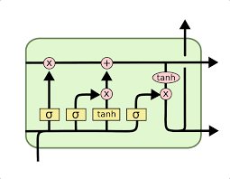

# RNN

# Beginner

Q1: ***What is the difference between RNNs and CNNs? In which situations is each used?***

- A CNN performs convolution operations on the data to extract features from it; CNNs are best suited to situations that require positional invariance (you want to capture similar features no matter where the target is in the input sample)
- An RNN is a neural network that maintains state between input samples; an RNN can use information from previous input samples to help classify the current input sample; RNNs are better suited to processing sequential/time-series data

Q2: ***What are the applications of RNNs in the NLP field?***

- RNNs have the following main applications in NLP: sequence labeling, such as part-of-speech tagging and named entity recognition, commonly using the BiLSTM-CRF model; classification tasks, such as sentiment analysis; relation judgment, such as inference and reading comprehension; generative tasks, such as translation, dialogue and text summarization, i.e. tasks that generate one piece of text from another

Q3: ***Why do RNNs outperform MLPs on time-series problems?***

- When an MLP processes a time series, it does not consider the temporal relationships between inputs; the data at times $t-1，t，t+1$ are treated equally, and contextual information cannot be used;
- In an RNN, the output of the state at the previous time step is passed as input to the state at the current time step, so the RNN can make better use of the historical information in the time series.

Q4: ***How many dimensions does the input of an RNN have? What does each dimension represent? What about the output of the RNN?***

- The input of an RNN has three dimensions, representing batch_size, seq_len and input_dim respectively: batch_size is the batch size, seq_len is the length of the sequence, and input_dim is the dimension of the input data
- The output layer also has three dimensions, with essentially the same meaning as the input, except that input_dim becomes output_dim

Q5: ***What is the difference between an RNN and a traditional fully connected network?***

- An MLP is the simplest DNN; each of its layers is actually an fc layer (fully connected layer)
- Compared with an MLP, an RNN adds temporal prior knowledge, i.e. an RNN can learn the temporal correlations in the data. For example, in a piece of text, if the preceding character is "上" ("up/go to"), the following character is more likely to be "学" ("study", forming 上学 "go to school") and very unlikely to be "狗" ("dog"). The input to an RNN neuron has multiple time steps, and the inputs of each time step share parameters as they enter the neuron; an RNN can be viewed as a DNN that encodes temporal correlation

Q6: ***What difficulties are encountered when training RNNs? How are they solved?***

- For hidden layers far from the current time step, RNNs are prone to exploding or vanishing gradients; this is because during backpropagation to compute the gradients, the parameters of the hidden layers are multiplied cumulatively. When the eigenvalues are less than 1, repeated multiplication causes them to decay towards 0; when the eigenvalues are greater than 1, they grow towards positive infinity; as a result, gradients cannot be used to adjust time steps that are far away
- The solution is the LSTM network, which, through gates, keeps the product of repeatedly multiplied gradients close to 1, so that long sequences can still be trained

Q7: ***In machine translation, why did encoder-decoder RNNs replace seq2seq RNNs?***

- A seq2seq RNN can only translate one word at a time, whereas an encoder-decoder RNN can handle variable-length inputs/outputs and can translate an entire sentence in one network inference

Reference: [https://quizlet.com/284587332/deep-learning-midterm-2-flash-cards/](https://quizlet.com/284587332/deep-learning-midterm-2-flash-cards/)

Q8: ***What is the difference between a Stateful RNN and a Stateless RNN? What are the pros and cons of the two RNN structures?***

- In a stateless RNN, every time a new batch is received and processed, the RNN's initial state is reset to zero, so the already learned internal activations (states) are not used, which causes the model to forget what it learned from previous batches;
- In a Stateful RNN, the LSTM cell and hidden states of each batch are initialized with the learned states of the previous batch, allowing the model to learn dependencies across batches
- If the training corpus consists of mutually independent sentences, a stateless RNN can be used; if the corpus is interconnected, use a stateful RNN; as the batch size increases, a Stateless LSTM tends to emulate a Stateful LSTM

Reference: [https://towardsai.net/p/l/stateless-vs-stateful-lstms](https://towardsai.net/p/l/stateless-vs-stateful-lstms)

Q9: ***When do you choose an MLP, a CNN or an RNN?***

- An MLP learns a mapping from inputs to outputs; it is suitable for classification prediction problems in which inputs are assigned a class or label, and also for regression prediction problems
- A CNN maps image data to abstract features; CNNs are suited to data with spatial relationships and achieve good results on image tasks and document classification tasks
- The strength of RNNs is handling sequence prediction problems; RNNs are generally used for temporal prediction problems such as sequences of words and paragraphs

Reference: [https://machinelearningmastery.com/when-to-use-mlp-cnn-and-rnn-neural-networks/](https://machinelearningmastery.com/when-to-use-mlp-cnn-and-rnn-neural-networks/)

Q10: ***Explain the cause of vanishing gradients in RNNs.***

- Along the time dimension, an RNN is equivalent to a deep MLP network. The RNN's gradients must be backpropagated along the time steps, and the gradient with respect to the parameters at a given time step must trace back through the information of all earlier time steps; the longer the time series, the less significant the fed-back gradient signal becomes, and eventually it may have no effect at all, which means the RNN loses its ability to capture long-distance semantics

Q11: ***Describe the basic structure of the LSTM. What improvements does it make over the RNN?***

- The LSTM introduces a gating mechanism, including a forget gate, an input gate and an output gate. The input gate decides when to let input enter the cell; the forget gate decides when the information from the previous time step should be remembered; the output gate decides when to let the memory flow to the next time step. Whereas an RNN has only one passed-on state, an LSTM has two transmitted states $c_{t}$ and $h_{t}$; the gradient of $c_{t}$ is passed losslessly to $c_{t-1}$, alleviating the problem of vanishing gradients over long distances
- Through the gating mechanism, the LSTM combines short-term memory and long-term memory, solving the vanishing gradient problem to a certain extent.

# Intermediate

Q12: ***What are the structural differences between LSTM and GRU?***

- Number of gating units.
The LSTM contains three main gating units: the input gate, the forget gate and the output gate, which control the input, forgetting and output of information respectively. In addition, the LSTM has a separate memory cell for storing long-term information.
The GRU merges the input and forget functions, directly controlling the update of the memory state through the update gate, and uses the reset gate to regulate the influence of new information. This structure has no separate memory cell; instead, the hidden state serves as the only state representation.

- How the state is represented.
In the LSTM, the state is made up jointly of the hidden state and a separate memory cell. The memory cell helps the model maintain and pass long-term dependency information across time steps.
The GRU uses only a single hidden state, which takes on both information storage and transmission functions, thereby simplifying the network structure.

- Parameters and computational complexity.
Because the LSTM contains more gates and a separate memory cell, it has more parameters and is relatively more complex to compute.
The GRU has a simpler structure, fewer parameters and lower computational complexity, which may bring advantages in certain tasks or resource-constrained environments.

- Model performance and applications.
Although both can effectively capture temporal relationships in many sequence learning tasks, in practical applications the GRU, thanks to its simple structure, may have certain advantages in training speed and hyperparameter tuning, while the LSTM, thanks to its separate memory cell, is more robust in capturing longer dependencies.

Q13: *****What other methods are there for addressing vanishing or exploding gradients?*****
- Weight initialization
Using an appropriate weight initialization method (e.g. Xavier initialization or He initialization) can, to a certain extent, balance the numerical scale during forward and backward propagation, reducing the risk of vanishing or exploding gradients.

- Normalization techniques

Batch normalization: performs normalization on the output of each layer, keeping the data distribution stable;

Layer normalization: suitable for recurrent neural networks; it improves training stability by normalizing the hidden layer states.

- Gradient clipping
Sets an upper bound on the gradients during backpropagation; when the gradient norm exceeds a preset threshold, it is rescaled, thereby preventing exploding gradients.

- Residual structures
Introducing residual connections or skip connections in deep networks lets signals pass directly through the network, which helps maintain gradient flow in deeper networks. 

- Appropriate activation functions
Avoid activation functions that saturate easily (such as sigmoid and tanh) and choose ReLU and its variants instead, which helps alleviate the vanishing gradient problem.

- Changing the network structure
Improve the network structure, e.g. replace simple RNNs with gated recurrent networks (LSTM, GRU), or introduce an attention mechanism, so that the model is more stable when capturing long-term dependencies.

- Choice of optimization algorithm
Adopting adaptive learning rate methods (such as Adam, RMSprop) or second-order optimization methods can improve convergence speed and training stability, thereby indirectly alleviating gradient problems.

- Regularization
Introducing Dropout or other regularization techniques can, to a certain extent, improve the model's generalization ability and indirectly have a positive effect on the backpropagation process.

Q14: ***The LSTM model contains sigmoid and tanh functions. Where is each used?***

- Sigmoid function
Used in each gating unit (i.e. the forget gate, input gate and output gate); its output is between 0 and 1. This property allows the model to decide, based on the gate values, what proportion of information to keep or discard, thereby regulating the flow of information and state updates.

- Tanh function
Used to generate the candidate state, typically applying a nonlinear squashing to the result of a linear transformation of the current input and the previous state, with an output range between -1 and 1. In addition, tanh is commonly used to process the memory cell state, making the output state values smoother, as further processing when computing the hidden state.

Q15: ***Why does the LSTM have long-term memory capability?***

-  Memory cell (Cell State)
The LSTM introduces a memory cell that allows information to be passed directly between time steps with few modifications. This mechanism helps retain information over long periods, enabling the network to capture long-term dependencies.

- Gating mechanism
The LSTM uses the input gate, forget gate and output gate to regulate the flow of information. The forget gate decides what proportion of previous memory to keep, and the input and output gates control the updating and output of information respectively. Through these gates, the model can retain important information or clear data that is no longer needed when necessary, thereby maintaining the stability of long-term memory.

- Stability of gradient propagation
The linear transmission path of the memory cell and the gating structure effectively alleviate the problem of rapid gradient decay (vanishing gradients) in traditional RNNs, allowing error signals to propagate well to earlier time steps during training on long sequences, supporting the learning of long-term dependencies.
Q16: **Draw the structure of the LSTM**

