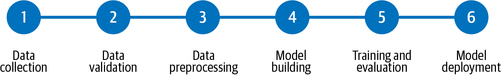

# SYSTEM DESIGN

# Beginner

Q1: **Describe some commonly used methods for rebalancing a dataset**

- **Rebalancing design pattern:** handles imbalanced datasets, i.e. datasets in which one label makes up the majority of the dataset, leaving far fewer examples of the other labels
    - **Downsampling**: reduce the number of examples from the majority class used during model training. Usually combined with ensemble learning for better results.
    - **Upsampling**: we over-represent our minority class by duplicating minority class examples and generating additional synthetic examples.
    - **Weighted classes**: by weighting the classes, we tell our model to place more emphasis on the minority label class during training; the weight coefficients are tuned as hyperparameters
    

Q2: **What data representation methods do you know?**

For numerical inputs:

1. Scale the input to the range `[-1, 1]`: this helps faster convergence, so the model trains faster/more cheaply. There are four ways to achieve this:
    - With min-max scaling, the drawback is that the minimum and maximum are determined directly by the training set.
    - Clipping (used together with min-max scaling): unlike min-max scaling, the minimum and maximum here are reasonable estimates. This technique works for uniformly distributed data.
    - Z-score normalization: transform the data into unitless Z-scores via (x-μ)/σ
    - For skewed data, we need to transform the data before scaling. Some commonly used transformation techniques include log transformation, bucketizing the input, etc.
2. When the input is an array of numbers, we can also represent it by:
    - Its statistics (such as mean, median, etc.)
    - Its empirical distribution
    - A fixed number of items from the array, if the array is sorted in some way
3. Treat the numerical input as categorical and map it to one-hot columns. This is useful when:
    - The numerical input is just an index, e.g. the days of the week.
    - The relationship between the input and the label is not continuous.

For categorical inputs:

1. When the inputs are linearly independent, one-hot or dummy encoding can be used.
2. Count the number of occurrences of each item in the array.
3. Use relative frequencies instead of counts to avoid large numbers.
4. If the array is sorted, represent the input array by a fixed number of items.

Q3: **Describe the workflow for building a machine learning system**

- A machine learning system can be built by following the steps outlined in the figure below
- The benefit of abstracting and isolating the individual steps is that validation can be inserted between steps to monitor quality and status. So if there is data drift or model quality degradation, it is easier to identify and remediate faster

Q4: **Tell us about the model hyperparameter tuning methods you know**

- **Random search**: the hyperparameters form a grid of possible values. Each iteration tries a random combination of hyperparameters from this grid, records the performance, and finally returns the hyperparameter combination that gives the best performance.
- **Grid search:** defines the search space as a grid of hyperparameter values, evaluates the algorithm's performance at every position in the grid (exhaustively), and finally returns the hyperparameter combination that gives the best performance.
- **Bayesian optimization**: assumes there is a functional relationship between the hyperparameters and the loss function we ultimately need to optimize; minimizes the function with algorithms such as SMBO to obtain the optimal parameter combination

Q5: **What are the benefits of the embeddings used in machine learning?**

- An embedding is a way of converting discrete variables into continuous vector representations; embeddings can reduce the spatial dimensionality of discrete variables while also representing the variable meaningfully.

Q6: **In what scenarios is the idea of transfer learning suitable?**

- The use case for transfer learning is as follows: suppose there are two task systems A and B; task A has massive data resources and has already been trained, but task B is our target task. This is a typical application scenario for transfer learning. The new task system and the old task system must have some similarity in terms of data, task and model.

Q7: **When splitting training data into training, validation and test sets, what problems can arise if you do not randomize?**

- **If you do not split randomly, the training and test splits may end up biased**. For example, if you have 100 samples in two classes, with the first 80 samples from class 1 and the rest from class 0, an 80/20 split will leave all of class 0 in the training set and all of class 1 in the test set, causing severe class imbalance

Q8: **In transfer learning, what is the difference between fine-tuning and feature extraction?**

- In fine-tuning, we start from a pre-trained model and update all of the model's parameters for our new task, essentially retraining the whole model; in feature extraction, we start from a pre-trained model and only update the weights of the final layer from which we derive predictions.

Q9: **When training a model, what problems might the early stopping strategy have?**

- One problem with early stopping is that the model may not make use of all the available training data; this is more pronounced when the dataset is small

Q10: **How do you test a model that is about to go live, offline and online?**

- **Offline evaluation:** measure the model's performance on held-out samples. During dataset collection, the data is split into training, test and validation subsets. K-fold cross-validation can also be performed to find out the performance under different data subsets. The model that performs well on the chosen KPIs is selected for implementation and deployment.
- **Online evaluation:** the first step in deploying a trained model to a real scenario (after offline evaluation) is to run an A/B test. The trained model is not exposed to a large amount of real-world data right away. Instead, the model is deployed in a small subset of scenarios. For example, suppose the model is designed to match drivers and riders. In the A/B test, the model would be deployed only in a smaller geographic region rather than in all scenarios. The beta version of the model is then compared with the existing model over a longer period of time, and if it leads to improvements in business-related KPIs (e.g. DAU/MAU, better user retention, and ultimately higher Uber revenue), it is then rolled out on a larger scale.

Q11: **What are the solutions when a model suffers from vanishing gradients?**

1.  **Pre-training plus fine-tuning**
2. **Use different activation functions, replacing sigmoid and tanh with relu**
3. **Use batchnorm**
4. **Use residual structures**
5. Check whether an RNN is used; **use an LSTM network**

# Intermediate

Q12: **Explain the AUC criterion**

- AUC is the area under the ROC curve; randomly pick one sample from all the 1 samples and one sample from all the 0 samples, then have your classifier predict on the two random samples. Let p1 be the predicted probability that the 1 sample is 1, and p2 the predicted probability that the 0 sample is 1; the probability that p1>p2 is the AUC

- **In addition, AUC is not sensitive to whether the sample classes are balanced, which is why AUC is commonly used to evaluate classification performance on imbalanced samples**

Q13: **How do you handle machine learning problems with imbalanced data?**

- Resample the training set, using undersampling and oversampling
- Use K-fold cross-validation; cross-validation should be applied properly when using oversampling to address the imbalance problem
- Multi-model Bagging
- Use a semi-supervised scheme to augment the minority class data
- Adjust the loss function to increase the loss for misclassifying minority class samples

Q14: **Approaches for accelerating deep learning model training**

- Use multi-machine multi-GPU training:
    - Data parallelism: each compute unit keeps a full copy of the model and trains on different data; after one or several iterations, the models on all compute units are synchronized
    - Model parallelism: each compute unit stores a different part of the same layer's model data and trains on the same data
    
    
    
    - Pipeline parallelism: each compute unit stores the model data of different layers and trains on the same data. As shown in the figure above, GPU1 is only responsible for computing the first layer of the neural network, GPU2 only for layers 2-5, and GPU3 only for layer 6. The benefit of pipeline parallelism is that communication and computation between compute units overlap; if configured properly, hardware resources can be utilized very fully
    

Q15: ****In multi-machine multi-GPU training, how are error gradients communicated between different devices?****

- At the end of each GPU training step, the loss gradients from each GPU are averaged

Q16: ****How is BN synchronized across different devices?****

- The property of BN is: the larger the batch_size, the closer the mean and variance are to those of the entire dataset, and the better the result. When using multiple GPUs, the mean and variance of the inputs to each BN layer across all devices are computed

Q17: ****The difference between DataParallel and DistributedDataParallel****

- DataParallel is single-process multi-threaded and can only work on a single machine with multiple GPUs. DistributedDataParallel is multi-process and can work on a single machine or multiple machines
- DistributedDataParallel runs faster than DataParallel, and GPU memory is allocated more evenly

Q18: **Describe the single-machine multi-GPU training workflow (DataParallel)**

1. Designate the host node
2. The host node partitions the data, splitting one batch evenly across the devices
3. The model is copied from the host to each device
4. Each device performs the forward pass
5. Each device computes the loss
6. The host collects all the loss results and updates the parameters
7. The updated parameter model is copied to each device

Q19: **Describe the multi-machine multi-GPU training workflow (DistributedDataParallel)**

1. Multiple processes are launched from the start (the number of processes equals the number of GPUs); each process has exclusive use of one GPU, and each process executes the code independently. This means each process independently initializes the model and trains; of course, in each iteration the gradients are shared and aggregated via inter-process communication, and then each process updates the parameters independently.
2. Each process initializes a copy of the training dataset, though they use different records of the dataset for training. This amounts to feeding different data into the same model for training, which is the so-called data parallelism
3. Processes identify themselves via the `local_rank` variable; the one with `local_rank` 0 is the master and the others are slaves
4. Because each process initializes its own copy of the model, a random seed must be set to ensure the random weights generated during model initialization are the same.
5. Saving and loading the model differs from the single-GPU approach. Here all parameters are saved to storage as CPU tensors, because if parameters on the GPU are saved, the pth file records which GPU the parameters belong to, and on loading they will be loaded onto the corresponding GPU, which causes an error when loading the model if you do not have enough GPUs

Reference: [https://juejin.cn/post/7082591377581670431](https://juejin.cn/post/7082591377581670431)

Q20: ****Pros and cons of single-machine multi-GPU training with DataParallel****

- Simple code: only one line of code needs to be changed
- Communication bottleneck: the GPU acting as the reducer updates the model parameters and then distributes them to the other GPUs, so there is large communication overhead.
- Unbalanced GPU load: the GPU acting as the reducer is responsible for gathering outputs, computing the loss and updating weights, so its memory and utilization are higher than those of the other GPUs.

Q21: ****Pros and cons of multi-machine multi-GPU training with DistributedDataParallel****

- **Faster communication**: communication is faster compared with DP
- **Relatively balanced load**: GPU load is relatively more balanced compared with DP
- **Fast execution**: because communication time is shorter and efficiency is higher, training tasks can be completed faster

Created By 苏坡爱豆
