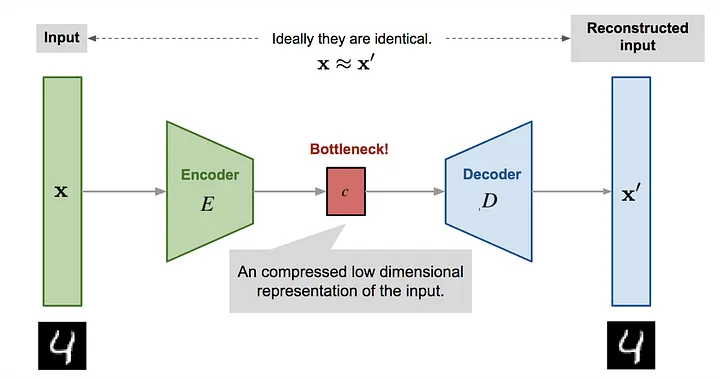

# Unsupervised learning

# Beginner:

Q1: **What problems can unsupervised learning help solve?**

- Data-scarce tasks: supervised learning requires a large amount of labeled data for the model to perform well. Unsupervised learning can automatically label unlabeled examples. This works by clustering all the data points and then applying the labels of the labeled ones to the unlabeled ones.
- Overfitting: machine learning algorithms sometimes overfit the training data by extracting too much information from the noise in the data. When this happens, the algorithm is memorizing the training data rather than learning how to generalize the knowledge in the training data. Unsupervised learning can be introduced as a regularizer. Regularization is a process that helps reduce the complexity of a machine learning algorithm, helping it capture the signal in the data without adjusting too much to the noise.
- Outliers: the quality of the data is very important. If machine learning algorithms are trained on outliers (very rare cases), their generalization error will be lower than if they ignore them. Unsupervised learning can use dimensionality reduction to perform outlier detection, and create a solution specifically for the outliers and a separate solution for the normal data.
- Feature engineering: feature engineering is an important task performed by data scientists, but it is very labor-intensive and requires humans to design features creatively. Representation learning from unsupervised learning can be used to automatically learn the right types of features to help with the task at hand.

Q2: **How can unsupervised learning be applied to solve the curse of dimensionality?**

- Using unsupervised dimensionality reduction methods (such as PCA, SVD), the most salient features in the original feature set can be found. The dimensionality of this feature set is then reduced to an acceptable range while losing very little information in the process. This helps the algorithm find the best model for learning the dataset.

Q3: **How is PCA applied to dimensionality reduction?**

- The idea of PCA (principal component analysis) is that we can select the "most important" directions of the data distribution, determining the dimensions of the most important features in the data; the direction of a principal component is the direction that maximizes the variance of the projected data, which retains as much of the information in the data as possible

Q4: **The difference between unsupervised learning and self-supervised learning**

- Unsupervised learning: unsupervised learning does not rely on any label values; it finds relationships between samples by mining the intrinsic features of the data, as in clustering-related tasks.
- Self-supervised learning: unlike unsupervised learning, self-supervised learning mainly uses auxiliary tasks (pretext tasks) to mine its own supervisory signals from large-scale unlabeled data, and trains the network with this constructed supervisory information, so that it can learn representations valuable for downstream tasks.

Q5: **How can unsupervised learning be implemented with neural networks?**

- Neural networks use unsupervised learning to better represent the input data; for example, the autoencoder;
- A neural network can learn a mapping from documents to embeddings such that the embeddings can express the information of the documents; this can be implemented with an autoencoder. The autoencoder's training objective is to reconstruct the original vector, using the reconstruction error as the cost function and the bottleneck features as the extracted data representation.

Q6: **Explain the Denoising Autoencoder (DAE) algorithm**

- In a Denoising Autoencoder, noise is randomly added to the data. The model is then trained to predict the original, uncorrupted data points as its output. Compared with an AE, a DAE learns the reconstruction process of the data, is more robust than an ordinary AE, and can learn more diverse feature patterns

Q7: **Why does the K-means algorithm have higher model bias than the GMM algorithm?**

- K-means has higher bias than GMM because it is actually a special case of GMM. K-means assumes that the cluster surfaces are spherical (K-means assumes that every dimension is equally important), while GMM's cluster surfaces are ellipsoidal; moreover, the clustering problem is a hard clustering problem (it assumes each data point can belong to only one label). Therefore, in theory, K-means should perform the same as GMM (under specific conditions) or worse

Reference: [https://ai.stackexchange.com/questions](https://sakigami-yang.me/2017/10/23/kmeans-is-a-gmm/)

[https://sakigami-yang.me/2017/10/23/kmeans-is-a-gmm/](https://sakigami-yang.me/2017/10/23/kmeans-is-a-gmm/)

Q8**: Explain CAE; in what scenarios is CAE used?**

- CAE is the convolutional autoencoder; in this case, the encoder is a regular CNN network that reduces the spatial dimensions of the input by increasing the depth. The decoder must perform the reverse operation, ensuring that the output dimensions match the input dimensions, so the decoder generally uses deconvolution layers;
- CAE is generally used in image tasks; in image tasks, densely connected AEs consume too much computation and are not sufficient for learning image features

Q9: **What are the differences and connections between clustering and dimensionality reduction algorithms?**

- Clustering operates on data points, while dimensionality reduction operates on the features of the data;
- Both clustering and dimensionality reduction can serve as preprocessing steps for problems such as classification; both are unsupervised learning;

Q10: **How is PCA used for anomaly detection?**

- Map the data into a low-dimensional feature space, then look at the deviation of each data point from the other data along the different dimensions of the feature space
- Another approach is to map the data into a low-dimensional feature space, then map it back from the low-dimensional feature space to the original space, attempting to reconstruct the original data from the low-dimensional features, and look at the size of the reconstruction error

# Intermediate:

Q11: **Explain the LDA algorithm**

- LDA is a supervised machine learning technique that can be used to identify latent hidden topic information in large-scale document collections or corpora; this method assumes that each word is drawn from an underlying latent hidden topic.
- Suppose there are 20 topics; the goal of the LDA topic model is to find a 20-dimensional vector for each article, where the 20 values in the vector represent the probability that the article belongs to each topic. It is an operation similar to clustering.
- For each document in the corpus, LDA defines the following generative process:
    - For each document, draw a topic from the topic distribution
    - Draw a word from the word distribution corresponding to the topic drawn above
    - Repeat the above process until every word in the document has been traversed.

Reference: [https://cloud.tencent.com/developer/article/1170675](https://cloud.tencent.com/developer/article/1170675)

Q12: **How are the parameters of the LDA topic model solved?**

- Gibbs sampling or the variational inference EM algorithm

Q13: **What is the relationship and difference between PCA and LDA?**

- Similarities:
    - Both can perform dimensionality reduction on data.
    - Both use the idea of matrix eigendecomposition when reducing dimensionality.
    - Both assume the data follows a Gaussian distribution.
- Differences:
    - LDA is a supervised dimensionality reduction method, while PCA is an unsupervised dimensionality reduction method
    - LDA can reduce dimensionality to at most k-1 dimensions, where k is the number of classes, while PCA has no such limit.
    - Besides dimensionality reduction, LDA can also be used for classification. Clustering
    - LDA selects the projection direction with the best classification performance, while PCA selects the direction in which the projected sample points have the largest variance.

Created By 苏坡爱豆
