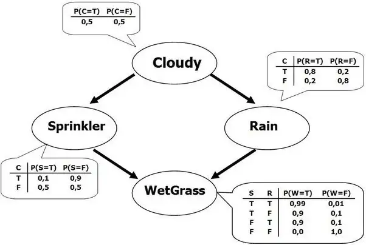

# Bayes

Q1: ***What is a Naive Bayes classifier?***

- A Naive Bayes classifier is a family of simple probabilistic classifiers based on Bayes' theorem and the assumption of independence between features.
- Bayes' theorem is given by the following formula:
    
    $$
    P(A|B)=\frac{P(B|A)P(A)}{P(B)}
    $$
    
- Using Bayes' theorem, we can infer the probability that event A occurs given that event B has occurred.

Q2: ***What are the assumptions of the Naive Bayes classifier?***

- The Naive Bayes classifier assumes that the features are mutually independent, i.e., the conditional probability distribution satisfies conditional independence.
- **The Naive Bayes model assumes the features are mutually independent; this assumption often does not hold in practice, and when there are many features or the features are highly correlated, classification performance is poor.**

Q3: ***How do you understand Bayes' theorem?***

- Bayes' theorem is used to determine conditional probability; conditional probability is the likelihood of an event occurring given that some conditions are known.
- Bayes' formula is given below, where A and B are random events and $P(A|B)$ is the conditional probability of event A occurring given that event B has occurred; Bayes' formula infers the posterior probability from the prior probabilities of events A and B and the likelihood $P(B|A)$.

$$
P(A|B)=\frac{P(B|A)P(A)}{P(B)}
$$

Q4: ***How do you choose a classifier based on the size of the training set? (system design)***

- For a small training set, a model with high bias and low variance is better, because it is less likely to overfit. For example, Naive Bayes.
- For a large training set, a model with low bias and high variance is better, because it can represent more complex relationships. For example, logistic regression.

Q5: **How do you use a *Naive Bayes* classifier to handle categorical features? What if some features are numerical?**

- For categorical features, first convert them into one-hot features; if there are N categories, create N corresponding features for the Bayes classifier, each taking the value 0 or 1; when handling numerical features, you can discretize the values into several categories and then process them with one-hot vectors.

Reference: [https://stats.stackexchange.com/](https://stats.stackexchange.com/)

Q6: ***What is the difference between generative and discriminative models? Give an example of each***

- A discriminative classifier learns a decision boundary in the data space that separates data of different classes; a generative classifier learns how the entire data space is generated;
- Mathematically, a discriminative model learns the conditional probability $P(Y|X)$, and a generative model learns the joint probability $P(X,Y)$.
- Discriminative models include logistic regression, SVM, CRF, MLP, decision trees, etc.; generative models include Naive Bayes, HMM, GAN, LDA.

Reference: [https://www.analyticsvidhya.com/](https://www.analyticsvidhya.com/)

Q7: ***Describe the workflow of the Naive Bayes classifier***

- The workflow of the Naive Bayes classifier roughly consists of the following two steps: 1. Compute the prior probabilities and the likelihood function by counting the frequencies of events in the dataset. 2. Compute the posterior probabilities according to Bayes' theorem; the class with the highest posterior probability is the predicted result.

Q8: ***What are the advantages of the Naive Bayes classifier?***

- Prediction is both simple and fast, and it also performs well in multi-class prediction.
- When the independence assumption holds, the Naive Bayes classifier performs better than other models such as logistic regression and requires less training data.

Reference: [https://www.analyticsvidhya.com/](https://www.analyticsvidhya.com/)

Q9: ***What are the disadvantages of the Naive Bayes classifier?***

- If a categorical variable is not observed in the training dataset (prior probability of 0), the Bayes classification model will be unable to make a prediction. This is often called "zero frequency". To solve this problem, smoothing techniques can be used; the simplest smoothing technique is Laplace estimation.
- Naive Bayes assumes the features are mutually independent; when the features are closely related, classification performance can be very poor.

Q10: ***Compare the Naive Bayes algorithm and the logistic regression algorithm***

- Naive Bayes is a generative model, while LR is a discriminative model.
- Naive Bayes is suited to small datasets; LR + regularization can achieve similar performance.
- LR performs better than Naive Bayes with respect to collinearity, because Naive Bayes expects all features to be independent.

Reference: [https://towardsdatascience.com/](https://towardsdatascience.com/)

Q11: ***What effect does noisy data have on a Bayesian model?***

- Noisy data affects the prior probabilities and likelihoods computed in the Bayesian model, and therefore reduces the accuracy of the Bayesian model.

Q12: ***What is a Bayesian network?***

- A **Bayesian network** is a probabilistic graphical model that uses Bayesian inference for probability computations. Bayesian networks aim to model causal relationships by representing conditional dependencies as edges in a directed graph. Through these relationships, one can efficiently perform inference on the random variables in the graph by using factors.
- A Bayesian network is a **directed acyclic graph,** in which each edge corresponds to a conditional dependency and each node corresponds to a unique random variable.
- Through Bayesian network inference, the joint probability of specific values of each variable (or subset) in the network can be evaluated.

Q13: ***What problems might you encounter when using a Bayesian model for classification? How do you solve them?***

- One of the drawbacks of Naive Bayes is that it estimates prior probabilities based on frequencies of occurrence in the data; if a certain class label and a particular attribute value have never appeared together in the data, the frequency-based prior estimate will be zero, the denominator of Bayes' formula will be 0, and it cannot be computed;
- The way to overcome this "zero-frequency problem" in a Bayesian setting is to add one to the count of every attribute value-class combination (**Laplace smoothing**).

Q14: ***In Bayesian statistics, what is the difference between "likelihood" and "posterior probability"?***

- In statistics, the likelihood function is a function of the parameters of a statistical model; **"likelihood" describes the plausibility of the model parameters given specific observed values**
- The posterior probability is a function of the outcome; **given the model parameters, it describes the plausibility of the outcome**
- Posterior equals likelihood * prior; if the prior probability function is flat, the posterior is numerically the same as the likelihood.

Reference: [https://stats.stackexchange.com/](https://stats.stackexchange.com/)

Q15: ***In Bayesian statistics, what is the difference between "prior probability" and "posterior probability"?***

- The prior probability is the probability of an event occurring, a distribution that is independent of other factors.
- The posterior probability is a conditional probability: the probability of an event occurring after some related factor has occurred.
