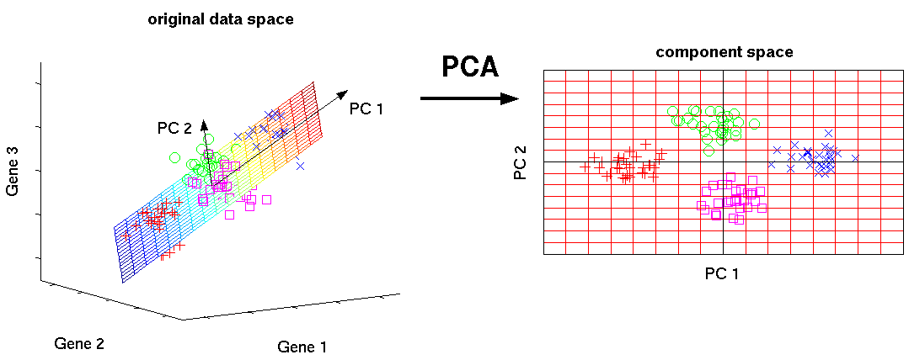

# Dimensionality Reduction

Q1: **Explain what the curse of dimensionality is and how to address it?**

- As the amount of data required to train a model increases, the learning process of machine learning algorithms becomes increasingly difficult. In a very high-dimensional space, supervised algorithms struggle to learn to separate points and to build function approximations that make good predictions. Moreover, as the number of features increases, this search becomes expensive in terms of both time and computation. It may not be possible to find a good solution quickly enough. This is the curse of dimensionality.
- Using dimensionality reduction techniques (such as PCA, ICA, SVD), the most salient features can be discovered in the original feature set. The dimensionality of this feature set is then reduced to a more manageable number while losing very little information in the process. This helps supervised learning find the best function that approximates the dataset.

Q2: **Explain what PCA is?**

- **PCA** is commonly used for dimensionality reduction. For a high-dimensional dataset, it finds as few orthogonal vectors (principal components) as possible to represent the informative characteristics of the data.
- The principal components are a series of unit vectors, and the direction of each principal component is the direction that maximizes the variance of the projected data (representing the largest amount of information).

Q3: **Explain why data is sparser in high-dimensional spaces?**

- Suppose you have a dataset about people. If you only have people's ages, you can basically make four or five groups: very young people, young people, middle-aged people, older people, elderly people. If you now add another dimension, say, gender, the number of possible combinations doubles. If you add a third one, such as height, and we consider grouping people as small, normal and tall, then your number of possible groups triples.
- More dimensions make the differences between our data points larger, which is why the data becomes **sparser**. The distance between two random points increases as the dimension increases: each data point becomes more and more isolated and different from the other data points.

Reference: [towardsdatascience.com](https://towardsdatascience.com/the-surprising-behaviour-of-distance-metrics-in-high-dimensions-c2cb72779ea6)

Q4: **How is the first principal component axis chosen in *PCA*?**

- In Principal Component Analysis (PCA), we want to summarize a large number of correlated variables into a smaller number of representative variables, called principal components, which explain most of the *variability in the original set.*
- The first principal component axis is chosen so that it explains most of the variation in the data and is closest to all *n* observations. Mathematically, it is the direction of maximum variance in the original data

Reference: [https://builtin.com/data-science/step-step-explanation-principal-component-analysis](https://builtin.com/data-science/step-step-explanation-principal-component-analysis)

Q5: **What impact does the curse of dimensionality have on training machine learning models?**

- As the number of dimensions increases, the data becomes sparser; each new dimension increases the volume of the feature space, giving our data more opportunity to spread out, so it is more likely to be spread out in a high-dimensional space than in a low-dimensional one. This means more data samples are needed to train the model
- As the dimension increases, especially for parametric models, we increase the time needed to train them.
- The curse of dimensionality means the data contains a large number of noisy and irrelevant features; the model learns from these noisy or irrelevant features, which may degrade its performance.
- More features and dimensions make models more complex and harder to interpret than models with fewer features.

Reference: [https://towardsdatascience.com/the-surprising-behaviour-of-distance-metrics-in-high-dimensions-c2cb72779ea6](https://towardsdatascience.com/the-surprising-behaviour-of-distance-metrics-in-high-dimensions-c2cb72779ea6)

Q6: **Which methods for hyperparameter tuning do you know?**

- **Random search**: a grid of possible values is created for the hyperparameters. Each iteration tries a random combination of hyperparameters from this grid, records the performance, and finally returns the combination of hyperparameters that gave the best performance.
- **Grid search: a grid of possible values is created for the hyperparameters, and in each iteration,** it tries combining the hyperparameters in a specific order, fits the model on every possible combination of hyperparameters, and records the model performance. Finally, it returns the best model with the best hyperparameters.

- **Bayesian optimization**: uses various surrogate functions to fit the relationship between the hyperparameters and the model evaluation, then selects promising hyperparameter combinations to iterate on, and finally arrives at the best-performing hyperparameter combination. This method can help us find the minimum in the fewest steps.

Q7: **Compared with PCA, what are the advantages of using LLE (Locally Linear Embedding)?**

- Compared with traditional dimensionality reduction methods such as PCA and LDA that focus on sample variance, LLE focuses on preserving the local linear characteristics of the samples during dimensionality reduction;
- LLE is more efficient than other algorithms in terms of computational space and time, because it tends to accumulate sparse matrices.

Q8: **Why is it important to center and scale the data before performing PCA?**

- Standardizing the data puts the features on the same order of magnitude. Features whose values have different orders of magnitude affect PCA's computation of the best principal components, because PCA is very sensitive to the variance of variables; PCA determines the principal components based on the variance of the data

Q9: **Explain what SVD dimensionality reduction is**

- Singular value decomposition, full name Singular Value Decomposition, abbreviated as SVD, is a matrix factorization. By computing the singular values and singular vectors, it produces an approximate matrix that can replace the original matrix, ranks the singular-value representation of the dataset by importance, and discards unimportant feature vectors. It can be used to achieve **dimensionality reduction**, thereby finding the principal components in the data.

Q10: *****PCA* vs. *random projection*: what is the difference?**

- PCA computes the vectors or directions that maximize the variance, so the least amount of information is lost during projection;
- Random Projection simply picks arbitrary vectors and then performs the projection. This is very effective in high-dimensional spaces and computationally efficient.
- The theoretical basis of Random Projection is the so-called Johnson-Lindenstrauss lemma: a dataset of N points in a high-dimensional Euclidean space can be mapped into a much lower-dimensional space in a way that largely preserves the distances between the points.

Q11: **Is the KNN algorithm affected by the curse of dimensionality? Describe in detail;**

- The biggest flaw of K-NN is that it easily suffers from the curse of dimensionality. In a high-dimensional space, data becomes extremely sparse, \so that even for the nearest neighbor data points, the computed distances between data points become extremely large. As the number of variables increases, the amount of data required for the training set grows exponentially, and the amount of computation also becomes extremely large.

Q12: **What are the differences and connections between clustering and dimensionality reduction?**

- Dimensionality reduction is a method commonly used during data preprocessing to prevent overfitting and avoid the curse of dimensionality; clustering is the process of grouping the whole dataset according to a defined topological distance. A key difference between clustering and dimensionality reduction is that clustering is usually done to reveal the structure of the data, whereas dimensionality reduction is usually done mainly for computational reasons, to alleviate the curse of dimensionality.
- What they have in common is that both methods belong to unsupervised learning

Q13: *****PCA* vs. *t-SNE*: what is the difference?**

- PCA tries to preserve the global structure of the data, while T-SNE preserves the local structure
- Both PCA and T-SNE produce features that are hard to interpret
- PCA works well when there are linear relationships between features, while T-SNE performs well on both linear and non-linear datasets.
- PCA is a deterministic algorithm (it produces the same output every time), while T-SNE is inherently non-deterministic (it may produce different outputs each time)

Reference: [https://medium.com/analytics-vidhya/understanding-pca-and-t-sne-intuitively-f8f0e196aee4](https://medium.com/analytics-vidhya/understanding-pca-and-t-sne-intuitively-f8f0e196aee4)

Q14: ****Explain the Locally Linear Embedding (LLE) algorithm for dimensionality reduction****

- LLE first finds the k nearest neighbors of each point. Then, it approximates each data vector as a weighted linear combination of its k nearest neighbors. Finally, it computes the weights that best reconstruct each vector from its neighbors, and then produces the low-dimensional vectors that are best reconstructed by these weights;
- The advantage of LLE is that it preserves the local characteristics of the samples during dimensionality reduction; and because LLE tends to accumulate sparse matrices, it is more efficient than other algorithms in terms of computational space and time.

Q15: **How do deep neural networks mitigate the effects of the curse of dimensionality?**

- The curse of dimensionality arises because the data contains correlated features or too many noisy features; deep neural networks mitigate the curse of dimensionality through **better data modeling**, i.e. modeling the data in a lower-dimensional space; for example, using word2vec, bottleneck features (hidden layers with lower dimension), and so on

Q16: **Explain what the t-SNE (t-Distributed Stochastic Neighbour Embedding) method is**

- The main goal of t-SNE is to transform a multi-dimensional dataset into a low-dimensional one; it is mainly used for **data exploration and visualizing high-dimensional data;**
- t-SNE uses a T-distribution with one degree of freedom, rather than a Gaussian distribution, to compute the similarity between two points in the low-dimensional space. The T-distribution creates the probability distribution of points in the low-dimensional space, which helps reduce the crowding problem.

Reference: [https://towardsdatascience.com/t-distributed-stochastic-neighbor-embedding-t-sne-bb60ff109561](https://towardsdatascience.com/t-distributed-stochastic-neighbor-embedding-t-sne-bb60ff109561)

Q17: ****Does a linear SVM suffer from the curse of dimensionality?****

- SVM also runs into problems with high-dimensional data; in the high-dimension + small-sample-size setting, many data points will simultaneously become support vectors, so the SVM will overfit.

Q18: **How does the curse of dimensionality affect the K-means algorithm?**

- Due to the curse of dimensionality, Euclidean distance measures lose their meaning in high-dimensional spaces. As the dimension tends to infinity, the distances between any two points in the dataset tend to converge, and the maximum and minimum distances between any two points become the same. Therefore, the k-means algorithm, which is based on Euclidean distance, becomes unable to cluster (

Q19: **Explain the ICA algorithm and analyze how it differs from PCA**

- ICA, Independent Component Analysis, is an analysis process that separates, or approximately separates, the source signals when only the mixed signals are known and the source signals, noise and mixing mechanism are unknown; it is a powerful method in the field of blind signal analysis;
- Differences between ICA and PCA:
    - PCA reduces the dimensionality of the original data and extracts uncorrelated attributes, while ICA reduces the dimensionality of the original data and extracts mutually independent attributes.
    - The goal of PCA is to find a set of component representations that minimizes the reconstruction error, i.e. the features that best represent the original object. The goal of ICA is to find a set of component representations such that each component is maximally independent, which can uncover some hidden factors. Thus, ICA's condition is stronger than PCA's.
    - ICA requires finding the directions of maximum independence, with each component being independent; PCA requires finding the directions of maximum variance, with each component being orthogonal.
    - ICA assumes the observed signals are linear combinations of several statistically independent components, and what ICA does is an unmixing process. PCA, on the other hand, is a process of information extraction that reduces the dimensionality of the original data, and it has now become the preprocessing step that ICA uses to standardize the data.

Reference: [https://cloud.tencent.com](https://cloud.tencent.com/developer/article/1477409)
