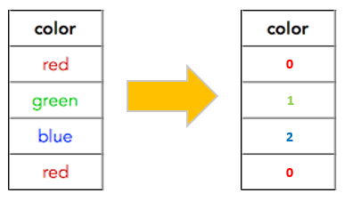

# Feature Engineering

Q1: **What is the difference between feature engineering and feature selection?**

- **Feature engineering builds or transforms new features from existing data; feature selection picks the most useful subset from all features (including the new ones). Feature engineering usually comes first, then feature selection.**
- Typical feature engineering tasks: imputing missing values, encoding categorical variables as numbers, transforming variables, and constructing or extracting new features.
- Feature selection generally needs labels, and the chosen subset is evaluated by model performance on a validation set.

Q2: **Which common machine learning problems can unsupervised learning help solve?**

- **Unsupervised learning mainly helps with three problems: scarce labels, outliers, and laborious manual feature engineering.**
- Data scarcity: use clustering and similar methods to pseudo-label unlabeled samples.
- Outliers: use dimensionality reduction or clustering to detect and remove anomalies.
- Feature engineering: use representation learning to learn useful features automatically instead of designing them by hand.

Q3: ***Feature selection*: name some of its benefits**

- **Feature selection reduces overfitting, speeds up training and makes the model easier to understand.**
- Many features with few samples introduce noise and make overfitting more likely.
- Fewer features run faster, and the saved compute can go into more complex models or larger hyperparameter searches.
- A small feature set is easier to interpret, helping you focus on the main sources of predictive power.

Q4: **Explain One-Hot encoding and label encoding. Does the dimensionality of the dataset increase or decrease after applying these techniques?**

- **Label encoding assigns each category an integer and leaves the dimensionality unchanged; One-Hot encoding turns each category into a 0/1 vector with a single 1, so the dimensionality increases (to the number of categories).**
- Label encoding gives e.g. "red=0, green=1, blue=2", but it introduces an order that does not really exist, so it suits ordinal categories or tree models.

- One-Hot has no spurious ordering and suits linear models and neural networks, but becomes high-dimensional and sparse when there are many categories.

**Q5: Describe the main steps that a machine learning workflow should include?**

- **A typical machine learning pipeline consists of data preprocessing, feature selection, model training (classification/regression) and post-processing, in that order.**
- For example, a classification pipeline: Scaler (standardize to zero mean, unit variance) -> feature selector (drop strongly correlated, redundant features) -> model.

Q6: **Can PCA be used for feature selection?**

- **Not really. Feature selection picks a subset of the original features, whereas PCA's principal components are linear combinations of all original features, so PCA is feature extraction / dimensionality reduction.**

Q7: **How do you use the F-test to select features?**

- **The F-test is a statistical test: it compares the least-squares error of a "constant-only model" with that of a "constant plus one feature" model and checks whether adding the feature lowers the error significantly; significant features are kept.**
- It measures the linear relationship between a feature and the target and is insensitive to non-linear relationships.

Reference: [https://towardsdatascience.com](https://towardsdatascience.com/why-how-and-when-to-apply-feature-selection-e9c69adfabf2)

Q8: **Which feature selection methods do you know?**

- **They split into unsupervised and supervised methods, and supervised methods further split into Filter, Wrapper and Embedded.**
- Unsupervised: drop features with near-zero variance, many missing values, or high mutual correlation.
- Filter: score each feature on its own with statistics such as correlation or mutual information; fast.
- Wrapper: train a model on different feature subsets and score them on a validation set, choosing the best subset; effective but very time-consuming.
- Embedded: selection happens during training, e.g. LASSO drives the weights of unimportant features to 0, or an autoencoder bottleneck is used for selection.

Reference: [https://towardsdatascience.com/](https://towardsdatascience.com/)

Q9: **How can the performance of a random forest be improved?**

- **Mainly by tuning node size and the number of trees: for more predictive power, use a smaller nodesize (so trees grow deeper) and more trees.**
- You can also tune the number of features sampled at each split (mtry / max_features) to balance correlation between trees against the strength of each tree.

Q10: **How do you do feature engineering on unknown features (when you do not understand the real meaning of the features)?**

- **When there is little domain knowledge but many features, manual design is of little value, and automated feature engineering is the better fit.**
- Use PCA or ICA to map the data into a new feature space.
- Use deep feature synthesis, or take representations learned by the intermediate layers of a neural network as features.

Reference: [https://datascience.stackexchange.com/questions/10640/how-to-perform-feature-engineering-on-unknown-features](https://datascience.stackexchange.com/questions/10640/how-to-perform-feature-engineering-on-unknown-features)

Q11: **Describe the concrete procedure of PCA?**

- **Standardize the data, compute the covariance matrix and its eigendecomposition, take the top N eigenvectors by eigenvalue as principal components, and project the data onto them.**
- Standardization matters: PCA is sensitive to variance, so features on different scales distort the components.
- A larger eigenvalue means the component explains more variance; N can be chosen by cumulative explained variance (e.g. 95%).
- Projection is just multiplying the (standardized) data by the matrix of selected eigenvectors.

Q12: **Explain the difference between PCA (Principal Component Analysis) and ICA (Independent Component Analysis)?**

- **PCA finds mutually orthogonal (uncorrelated) directions of maximum variance and is mainly used to compress information / reduce dimensionality; ICA finds statistically independent components and is mainly used to separate mixed signals (e.g. blind source separation).**
- PCA only uses second-order statistics (covariance); ICA requires independence, which is stronger than uncorrelatedness and relies on higher-order information such as non-Gaussianity.

Q13: **How do you transform a skewed distribution into a normal distribution?**

- **Log or square-root transforms compress the long tail so the distribution is closer to normal, since many models predict more reliably when variables are roughly normal.**
- The log transform compresses the most and suits strongly right-skewed data (use log(1+x) when there are zeros).
- The square-root transform is milder; more general options are the Box-Cox / Yeo-Johnson transforms.

Reference: [https://towardsdatascience.com/top-3-methods-for-handling-skewed-data-1334e0debf45](https://towardsdatascience.com/top-3-methods-for-handling-skewed-data-1334e0debf45)

Q14: **Which data imputation methods do you know?**

- **Choose the fill value by data type: mean or median for continuous data, median or mode for categorical data, and frequency-based filling for boolean data.**
- Continuous: use the mean if roughly normal; use the median if skewed or outlier-heavy.
- Categorical: median for ordinal categories, mode for nominal ones.

Q15: **In multiple linear regression, should highly correlated features be removed?**

- **Generally keep only one of them. Highly correlated features (multicollinearity) make $X^TX$ nearly singular, so the weight estimates have large variance and the coefficients become unstable and hard to interpret.**
- Collinearity mainly hurts coefficient stability and interpretability; its effect on overall prediction accuracy is relatively small.
- Besides dropping features, ridge regression (L2 regularization) or PCA can mitigate it.
- Key formula: the variance of the weights is $\mathrm{Var}(w)=\sigma^2(X^TX)^{-1}$

Reference: [https://datascience.stackexchange.com/questions/36404/when-to-remove-correlated-variables](https://datascience.stackexchange.com/questions/36404/when-to-remove-correlated-variables)

Q16: **How do you apply feature engineering in transfer learning?**

- **Use a model pretrained on a large, general dataset as a feature extractor, reusing the feature mappings it has learned, and just add a new classifier on top trained from scratch.**
- With little data, freeze the backbone and train only the new head; with more data, fine-tune the whole network.

Q17: **Similarities and differences between standardization and normalization**

- **Both are linear rescalings that keep the order of the data; normalization (min-max) scales data to [0,1], while standardization (z-score) gives zero mean and unit variance.**
- Normalization depends only on the max and min, so it is sensitive to outliers.
- Standardization uses the mean and standard deviation, so every point contributes; it is more robust and more commonly used.

Q18: **How do you understand combined features?**

- **A combined feature crosses two or more features into a new one to capture interactions that no single feature can express.**
- For example, in news recommendation gender or interest alone works only moderately, but "gender x interest" captures patterns such as women preferring entertainment and men preferring sports/finance, and works much better.
- Linear models cannot learn interactions themselves, so they rely heavily on combined features.

Q19: **How do you handle high-dimensional combined features, such as user ID and content ID?**

- **Crossing them directly gives extremely high-dimensional, sparse features, so matrix factorization is used to map users and items to low-dimensional vectors, with their inner product representing the combination.**
- This cuts the parameter count from $m\times n$ to $(m+n)\times k$ and generalizes to unseen combinations.
- Common factorizations include SVD, QR and LU decomposition; FM and matrix factorization in recommender systems follow the same idea.

Q20: **What models are there for text feature representation? What are their pros and cons?**

- **The four main families are bag-of-words, N-grams, topic models and word embeddings, moving from simple and sparse to dense and semantic.**
- Bag-of-words: simple, but loses word order and context; the representation is high-dimensional and sparse.
- N-gram: treats n consecutive words as one feature, keeping local word order, but the parameter space is larger and sparser.
- Topic models (e.g. LDA): give each document a topic distribution; low-dimensional and interpretable.
- Word embeddings: map words to K-dimensional dense vectors that capture semantic relations between words.

Q21: **What are the differences and connections between Word2vec and LDA?**

- **Both exploit word co-occurrence: LDA uses "document-word" co-occurrence to cluster words into topics; Word2vec uses "context-word" co-occurrence to learn a dense vector per word, where similar vectors mean the words often appear in the same contexts.**
- Different model types: LDA is a generative probabilistic graphical model with latent variables (topics) to infer.
- Word2vec is a neural network model whose word vectors are learned as network weights.
- LDA outputs document-topic and topic-word probability distributions; Word2vec outputs word vectors.

Q22: **How do you detect outliers in features?**

- **Common methods are statistical rules (3-sigma, quartiles), statistical tests, PCA reconstruction error, and distance/clustering-based methods.**
- 3-sigma rule: assuming normality, points more than 3 standard deviations from the mean (about 0.3% probability) are outliers.
- Quartiles (box plot): points outside $[Q1-1.5\,IQR,\ Q3+1.5\,IQR]$ are outliers, with no normality assumption.
- PCA: decompose and reconstruct; points with large reconstruction error are outliers.
- Distance/clustering: with kmeans, KNN, DBSCAN etc., points farthest from cluster centres or belonging to no cluster are outliers.

Q23: **How do you handle outliers in features?**

- **You can delete records containing outliers, treat outliers as missing values and hand them to missing-value handling, or correct them with the mean or mode.**
- You can also clip them to a percentile or apply a log transform to reduce their influence.

Reference: [https://blog.csdn.net/](https://blog.csdn.net/)

Q24: **How do you solve the problem of imbalanced data?**

- **Attack it from three sides: data (resampling, synthetic samples), evaluation metrics, and algorithms.**
- Sampling: oversampling duplicates the minority class (prone to overfitting; add slight perturbations); undersampling drops majority samples (loses information; undersample several times, train several models and ensemble them).
- Data synthesis: e.g. SMOTE, generating new samples from the similarity of minority samples in feature space.
- Metrics: look at precision, recall and the PR curve rather than accuracy or ROC alone, since ROC/AUC easily looks overly optimistic under extreme imbalance.
- Algorithms: choose models that are less sensitive to class skew (e.g. tree models), or use class-weighted losses.

Reference: [https://blog.csdn.net/](https://blog.csdn.net/)

Q25: **Briefly describe the principle of Linear Discriminant Analysis (LDA)**

- **LDA is a supervised dimensionality reduction method: it finds a projection direction where same-class samples are as close as possible (small within-class variance) and class centres are as far apart as possible (large between-class variance).**
- Difference from PCA: PCA ignores labels and keeps the directions of maximum variance; LDA uses labels and keeps the most discriminative directions.
- With $C$ classes it can reduce to at most $C-1$ dimensions.

## Signal Processing Feature Engineering (Physiological Signals & Audio)

Q26: **What are the sampling theorem (Nyquist) and aliasing? What effects does quantization have?**

- **The sampling theorem says the sampling rate must exceed twice the highest signal frequency for lossless reconstruction; otherwise components above $f_s/2$ (the Nyquist frequency) "fold" into low frequencies, causing aliasing that cannot be removed.**
- Anti-aliasing low-pass filtering is required before sampling or downsampling; in practice the sampling rate is often 2.5-5 times the highest useful frequency.
- Quantization maps continuous amplitudes to a finite number of levels and adds quantization noise; each extra bit improves SNR by about 6 dB.
- With too few bits or bad gain, weak signals (e.g. µV-level EEG) get buried and large signals get clipped.

Q27: **What is the difference between FIR and IIR filters? What are the characteristics of the Butterworth filter?**

- **FIR uses only current and past inputs, is always stable and can have exactly linear phase, but needs a high order for a steep transition band; IIR has output feedback and gets a steep response with a very low order, but its phase is non-linear and it can be unstable.**
- In practice IIR filters are implemented as second-order sections (SOS) for numerical stability.
- Butterworth is the most common IIR filter: maximally flat passband with no ripple and a monotonically decreasing magnitude response.
- Its transition band is less steep than Chebyshev / elliptic filters, but it adds no passband ripple, so it is the usual choice for physiological signal preprocessing; an order-$n$ filter rolls off at about $20n$ dB/decade.

Q28: **In which scenarios are band-pass and notch filters used? Why is zero-phase filtering (filtfilt) commonly used?**

- **Band-pass filters keep the band of interest and remove low-frequency drift and high-frequency noise; notch filters strongly attenuate a very narrow band, mainly to remove 50/60 Hz mains interference. filtfilt filters forward and then backward so the phase distortions cancel and waveforms are not shifted in time.**
- Typical band-pass ranges: ECG 0.5-40 Hz, EEG 0.5-45 Hz, sEMG 20-450 Hz, PPG 0.5-8 Hz.
- Zero phase keeps the timing of features such as R peaks and ERPs accurate; the cost is doubled effective attenuation.
- Limitation: filtfilt needs future samples, so it is non-causal and offline-only; real-time systems must use causal filters and compensate for group delay.

Q29: **What is spectral leakage? Why does windowing mitigate it?**

- **A DFT of a finite signal implicitly applies a rectangular window and assumes periodic extension; if the segment is not a whole number of periods, the jump at the boundary makes energy "leak" from the true frequency into neighbouring bins. Windowing multiplies by a function that tapers smoothly to 0 at both ends, reducing the jump and therefore the sidelobes and leakage.**
- Trade-off: mainlobe width (frequency resolution) and sidelobe level (leakage) work against each other.
- The rectangular window has the narrowest mainlobe but the highest sidelobes (about -13 dB); Hann (about -31 dB), Hamming (about -43 dB) and Blackman have progressively lower sidelobes but wider mainlobes.
- Zero-padding only interpolates the spectrum to make it look smoother; it does not improve true frequency resolution.

Q30: **What is the difference between FFT and STFT? How should the time-frequency resolution trade-off be understood?**

- **The FFT gives the global spectrum of the whole signal without telling when each frequency occurs, so it suits only stationary signals; the STFT cuts the signal into windowed, overlapping short frames and takes an FFT of each, producing a spectrogram suitable for non-stationary signals such as speech and EEG.**
- Frequency resolution is about 1/window length: a longer window gives better frequency resolution but worse time resolution, and vice versa.
- By the uncertainty principle, time and frequency resolution cannot both be made arbitrarily fine.
- The STFT uses one window length for all frequencies, so its resolution is fixed over the whole time-frequency plane.

Q31: **What advantages do wavelet transforms (CWT/DWT) have over STFT?**

- **Wavelet transforms use scaled and shifted versions of a mother wavelet as basis functions, giving multi-resolution analysis: short windows at high frequencies (good time resolution) and long windows at low frequencies (good frequency resolution), which suits signals with "slow low-frequency content + fast transients" such as QRS complexes and EEG spikes.**
- CWT: continuous scales, highly redundant and expensive; mainly for time-frequency visualization (e.g. a Morlet-wavelet scalogram as 2D CNN input).
- DWT: a filter bank plus downsampling splits the signal level by level into approximation (low-frequency) and detail (high-frequency) coefficients; efficient and non-redundant, often used for denoising, baseline removal and compression, with sub-band energy, entropy etc. as features.
- Drawbacks: you must choose the mother wavelet (e.g. db4, sym) and the number of levels; the DWT is not shift-invariant (SWT mitigates this).

Q32: **How is the power spectral density (PSD) estimated? What is the principle of Welch's method?**

- **The most direct estimate is the periodogram (squared FFT magnitude), but its variance does not shrink as the data gets longer, so it is very noisy; Welch's method splits the signal into overlapping segments (often 50%), windows each one, computes their periodograms and averages them, trading frequency resolution for much lower variance.**
- Averaging K segments cuts the variance by about K times, a classic bias-variance trade-off.
- Other methods: multitaper, and parametric AR spectral estimation (good for short data).
- PSD is the basis for EEG band power, HRV frequency-domain indices, EMG median frequency and similar features.

Q33: **What should be noted about resampling, detrending and normalization in signal preprocessing?**

- **Apply anti-aliasing filtering before resampling; detrend to remove slow drift so low-frequency energy does not dominate the spectrum; normalize without leaking data, and remember that normalization erases absolute amplitude information.**
- Resampling: use `decimate` for downsampling and polyphase filtering `resample_poly` for rational factors; FFT-based `resample` assumes a periodic signal and may ring at the edges.
- Detrending: subtract a polynomial fit, high-pass filter, or median filter.
- Normalization: z-score removes amplitude differences between individuals, and robust scaling (median/IQR) is more robust to outliers; statistics must be estimated only on the training set or the subject's own calibration data.
- Some tasks (e.g. EMG force estimation, EEG absolute power) need absolute amplitude, so they should not be normalized.

Q34: **How are long signals segmented (sliding windows)? Which statistical features are commonly extracted from windows?**

- **Cut the signal with fixed-length, overlapping (often 50%) sliding windows whose length matches the time scale of the target phenomenon, then extract time-domain statistics and frequency-domain features from each window.**
- Window length examples: 30 s for EEG sleep staging, 150-250 ms for EMG gesture recognition, 5 min for HRV; too long adds latency and mixes states, too short makes features unstable.
- Labels: majority vote within the window, the label at the window end, or discard windows that cross a state boundary.
- Time-domain features: mean, variance, RMS, peak-to-peak, percentiles, skewness, kurtosis, zero-crossing rate, Hjorth parameters; frequency-domain features: band power, spectral centroid, spectral entropy, dominant frequency.
- Caution: overlapping windows are highly correlated, so windowing first and then randomly splitting train/test causes severe leakage.

Q35: **What are the common entropy features? How is sample entropy computed?**

- **Entropy measures the complexity / irregularity of a signal; common ones are Shannon/spectral entropy, approximate entropy, sample entropy, permutation entropy and multiscale entropy. Sample entropy compares how many templates of length $m$ and $m+1$ match within tolerance $r$; the lower the match ratio (the higher the entropy), the more irregular the signal.**
- Spectral entropy: Shannon entropy of the normalized PSD; lower means energy is concentrated in a few frequencies.
- Approximate entropy counts self-matches, so it is biased and length-dependent; sample entropy excludes self-matches and is less biased, typically with $m=2$ and $r=0.2\cdot$std, but costs $O(N^2)$.
- Permutation entropy uses ordinal patterns and is fast and noise-robust; multiscale entropy computes sample entropy on several coarse-grained scales.
- Key formula: $SampEn(m,r)=-\ln\dfrac{A}{B}$ ($B$ and $A$ are the numbers of matching pairs of length $m$ and $m+1$)

Q36: **What are the common noise sources in ECG preprocessing? How are they removed?**

- **The main ones are baseline wander, mains interference, EMG noise and motion artifacts, handled respectively by high-pass/median filtering, notch filtering, low-pass/wavelet denoising, and outright removal of severely corrupted segments.**
- Baseline wander (<0.5 Hz, from breathing and movement): high-pass filter (0.05 Hz for diagnostic quality to preserve the ST segment), two-stage median filtering, or wavelet removal of the low-frequency component.
- Mains interference: 50/60 Hz notch or adaptive filtering.
- EMG noise: broadband high-frequency, handled by low-pass (e.g. 40 Hz) or wavelet thresholding; it overlaps the QRS band, so it cannot be fully removed.
- Motion artifacts / poor electrode contact: use a signal quality index (SQI) to drop low-quality segments; use zero-phase filtering offline to preserve waveform morphology.

Q37: **Briefly describe the Pan-Tompkins R-peak detection algorithm**

- **Pan-Tompkins is a classic real-time QRS detector: band-pass filtering, differentiation, squaring and moving-window integration turn the QRS complex into a clear energy envelope, then adaptive thresholds decide where the R peaks are.**
- Band-pass (about 5-15 Hz) emphasizes QRS and suppresses P/T waves and noise; differentiation gives slope; squaring amplifies high slopes; a ~150 ms integration window gives the energy envelope.
- Adaptive dual thresholds track signal peaks and noise peaks separately; a 200 ms refractory period prevents double detection; if nothing is detected for too long, a search-back with a lower threshold is run.
- Finally the R peak is located precisely in the original signal; in practice libraries such as NeuroKit2 or BioSPPy can be used directly.

Q38: **What are the time-domain and frequency-domain features of HRV? What should be noted when computing them?**

- **HRV is computed from the series of intervals between consecutive R peaks (RR/NN): time-domain indices include SDNN, RMSSD and pNN50, frequency-domain indices include LF, HF and LF/HF; non-uniform sampling and ectopic beats must be handled first.**
- SDNN reflects overall variability; RMSSD and pNN50 reflect beat-to-beat variability, mainly parasympathetic (vagal) activity.
- Bands: LF 0.04-0.15 Hz, HF 0.15-0.4 Hz (linked to breathing, reflects vagal activity); LF/HF is traditionally read as sympathovagal balance, but this is disputed.
- The RR series is non-uniformly sampled, so interpolate and resample (e.g. 4 Hz) before Welch, or use the Lomb-Scargle periodogram.
- Ectopic beats and false detections must be removed/corrected first; indices depend on recording length (5 min for short-term HRV), so different lengths are not directly comparable.

Q39: **How are EEG frequency bands divided? How are band power features extracted?**

- **The usual bands are delta (0.5-4 Hz), theta (4-8 Hz), alpha (8-13 Hz), beta (13-30 Hz) and gamma (>30 Hz). Band power is usually obtained by estimating the PSD with Welch, integrating within each band for absolute power, dividing by total power for relative power, and taking the log.**
- Associated states: delta deep sleep, theta drowsiness, alpha relaxed with eyes closed, beta alertness/movement, gamma higher cognition but easily contaminated by EMG.
- Relative power reduces amplitude differences between individuals; the log makes the distribution closer to normal.
- Derived features: band power ratios (e.g. theta/beta), hemispheric asymmetry, differential entropy (common in emotion recognition), inter-channel coherence, and CSP spatial-filter features in motor imagery.

Q40: **What are the common artifacts in EEG? How is ICA used to remove them? What is epoching?**

- **Common artifacts are EOG, EMG, ECG, mains interference and electrode problems. ICA decomposes multichannel EEG into independent components; artifact components are identified, set to zero, and the signal is reconstructed. Epoching cuts fixed time windows anchored on events, for ERP and event-related analysis.**
- EOG is low-frequency, high-amplitude and frontal; EMG is high-frequency, broadband and temporal.
- ICA workflow: high-pass at about 1 Hz and remove bad channels -> decompose -> identify artifact components from topography, spectrum or ICLabel -> remove them and back-project. It assumes independent, linearly mixed sources and enough channels, and may also remove some neural signal.
- Epoching: cut windows such as -200 to 800 ms, baseline-correct with the pre-event interval, and reject bad trials by an amplitude threshold (e.g. ±100 µV).

Q41: **What are the difficulties of PPG signal processing? How are heart rate and blood oxygen (SpO2) estimated from it?**

- **The biggest difficulty is motion artifacts: in wrist-worn devices, arm-movement frequencies overlap the heart-rate band, so a simple band-pass cannot separate them. Heart rate comes from detecting pulse peaks after band-pass filtering or finding the dominant PSD frequency; SpO2 uses the difference in red and infrared absorption, computing a "ratio of ratios" R and mapping it through a calibration curve.**
- The AC component of PPG is the pulsation caused by heartbeats; the DC component is baseline absorption by tissue etc.
- Removing motion artifacts: adaptive filtering with an accelerometer reference, spectral subtraction with spectral peak tracking (e.g. TROIKA), SQI-based rejection, or deep learning that fuses accelerometer data.
- You can also extract pulse-rate variability, pulse-wave morphology, and pulse transit time together with ECG (for cuffless blood pressure estimation).
- Key formula: $R=\dfrac{AC_{red}/DC_{red}}{AC_{IR}/DC_{IR}}$, with SpO2 then given by a device calibration curve (a common approximation is $110-25R$); the measurement is affected by motion, low perfusion and skin tone.

Q42: **Which features are commonly used for surface EMG (sEMG)?**

- **Common time-domain features are MAV, RMS, WL, ZC and SSC (the Hudgins feature set), and common frequency-domain features are mean frequency MNF and median frequency MDF; a drop in MNF/MDF is the classic muscle-fatigue indicator.**
- Preprocessing: band-pass 20-450 Hz (sampling rate >=1000 Hz), notch out mains; the envelope is obtained by rectification followed by low-pass filtering.
- MAV and RMS relate to muscle activation / force; WL reflects signal complexity; ZC and SSC need a noise threshold.
- With fatigue, conduction velocity drops and the spectrum shifts to lower frequencies, so MNF/MDF decrease.
- Gesture recognition typically uses 150-250 ms windows with >=50% overlap to meet real-time requirements (total latency <300 ms).

Q43: **How can data leakage be avoided in physiological signal modeling? How should class imbalance be handled?**

- **The key is to split data by subject (e.g. GroupKFold or leave-one-subject-out cross-validation) and fit all preprocessing only inside the training folds; imbalance is handled with weighted losses, balanced sampling and suitable metrics.**
- Subjects differ enormously, so randomly splitting windows puts the same person in both train and test sets; the model learns to "recognize the person" and results are badly inflated.
- For within-subject evaluation, split by time with a gap; put normalization, feature selection, ICA and oversampling in a Pipeline fitted on training folds; state the evaluation protocol clearly.
- Imbalance: class-weighted loss, Focal Loss, stratified/balanced sampling; oversample only the training set, and signal-level augmentation is usually more sensible than feature-space SMOTE.
- Evaluate with F1, balanced accuracy, Cohen's kappa, AUPRC and event-level metrics (e.g. false alarms per hour), and adjust the threshold to the deployment prior.

Q44: **What are the pros and cons of handcrafted features + traditional models versus end-to-end 1D-CNNs (on raw signals)?**

- **Handcrafted features + traditional models are robust on small data, interpretable and easy to deploy, but depend on domain knowledge and may miss information; end-to-end deep models learn patterns automatically and are usually stronger with lots of data, but need many labels, are hard to interpret, and easily overfit to subjects or devices.**
- Handcrafted pipelines are vulnerable to errors in one step (e.g. wrong R-peak detection).
- Deep models are sensitive to changes in sampling rate and lead configuration.
- Middle ground: time-frequency images + 2D CNN, networks with interpretable priors (e.g. SincNet, EEGNet), fusing handcrafted and deep features, or self-supervised pretraining then fine-tuning.
- Choose by data size, interpretability needs and deployment resources; either way, evaluate subject-independently.

Q45: **Describe the MFCC extraction pipeline in detail**

- **The MFCC pipeline is: pre-emphasis -> framing -> windowing -> FFT power spectrum -> Mel filter bank -> log -> DCT, keeping the first 12-13 coefficients.**
- Pre-emphasis (coefficient about 0.97) compensates for high-frequency attenuation in speech; frames are typically 25 ms with a 10 ms hop; a Hamming window reduces leakage.
- The Mel filter bank (20-40 triangular filters) mimics the ear's high resolution at low frequencies and low resolution at high frequencies.
- The log compresses dynamic range, matching how we perceive loudness; the DCT decorrelates, and the high-order coefficients (fine harmonic structure) are discarded.
- Optional: cepstral mean and variance normalization (CMVN) to remove channel effects, plus first/second-order deltas for 39-dimensional features.
- Key formula: $m=2595\log_{10}\left(1+\dfrac{f}{700}\right)$

Q46: **What is the difference between the log-Mel spectrogram and MFCC? Why do deep models prefer log-Mel? What are delta features?**

- **MFCC is just log-Mel followed by a DCT and truncation, giving decorrelated low-dimensional features that suit traditional models such as diagonal-covariance GMM-HMMs; deep models prefer log-Mel because it keeps the local structure of the spectrum, which CNNs can exploit directly, and the network can learn decorrelation and dimensionality reduction itself.**
- The DCT mixes all bands, destroying the local correlation between neighbouring bands, and truncation throws away information such as harmonics.
- Modern ASR, sound event detection and speaker recognition (e.g. Whisper uses 80/128-dim log-Mel) mostly use log-Mel (Fbank).
- Delta features (Δ / ΔΔ) describe how features change over time, computed by regression over neighbouring frames; 13 MFCC + Δ + ΔΔ = 39 dimensions. For models with temporal modeling (RNN/Transformer), deltas usually add little.

Q47: **Which handcrafted audio features are commonly used?**

- **The main ones are time-domain features (zero-crossing rate, short-time energy), spectral shape features (spectral centroid, rolloff, flux, etc.), music features (chroma) and pitch features (F0 and its statistics).**
- Zero-crossing rate is high for unvoiced sounds/noise and low for voiced speech, used for voiced/unvoiced decisions; short-time energy/RMS reflects loudness, used for silence detection.
- Spectral centroid relates to timbral "brightness"; rolloff is the frequency below which 85%/95% of energy lies; spectral flux measures frame-to-frame spectral change, used for onset detection; there are also spectral flatness, bandwidth and contrast.
- Chroma folds energy into the 12 semitone classes, used for chord recognition and cover-song detection.
- F0 can be estimated with autocorrelation, cepstrum, YIN/pYIN or CREPE; F0, jitter, shimmer and HNR are common for emotion recognition and pathological voice detection; statistics over frame-level features give clip-level vectors (e.g. eGeMAPS).

Q48: **What is voice activity detection (VAD)? What implementation methods are there?**

- **VAD decides for each frame whether it is speech or non-speech; it is a front end for ASR, speaker recognition, speech coding and denoising, saving computation and keeping models from learning silence. Methods range from simple thresholds to statistical models to neural networks.**
- Energy + zero-crossing thresholds: simple and fast, but poor at low SNR.
- Spectral features: spectral entropy, spectral flatness, etc. (speech spectra are structured and have low entropy).
- Statistical models: model speech and noise separately and run a likelihood-ratio test (e.g. WebRTC VAD uses a GMM); neural VADs (e.g. Silero, pyannote) are more robust in noise.
- Post-processing adds hangover and minimum-duration constraints to smooth decisions; the threshold trades misses against false alarms depending on the downstream task.

Q49: **What data augmentation methods are there for audio (and physiological signals)?**

- **For audio, common choices are SpecAugment (time warping, frequency masking and time masking on the spectrogram), waveform-level augmentation (speed, pitch, noise, reverb, etc.) and Mixup; for physiological signals, added noise, amplitude scaling, time warping, random cropping and channel dropout are common.**
- SpecAugment is cheap and markedly improves ASR robustness.
- Waveform level: speed perturbation (changes both duration and pitch), time-stretch (duration only), pitch-shift (pitch only), noise mixing at a given SNR, convolution with room impulse responses, gain changes, etc.
- Mixup: linearly mixes two samples and their labels with a ratio drawn from a Beta distribution, common in sound event classification.
- Caution: augmentation must not change label semantics (e.g. time-stretching ECG changes heart rate), and it is applied only to the training set.

Q50: **How do self-supervised representations such as wav2vec 2.0 / HuBERT compare with handcrafted features (MFCC/Fbank)?**

- **Self-supervised models learn hierarchical representations from huge amounts of unlabeled speech and far outperform MFCC/Fbank when labels are scarce; the cost is large models, slow inference, domain mismatch when moving to non-speech audio or other sampling rates, and poor interpretability.**
- wav2vec 2.0: a CNN encodes the raw waveform and a Transformer models context; pretraining masks some frames and uses a contrastive loss to pick the true quantized representation out of distractors.
- HuBERT: first generates pseudo-labels with k-means (MFCC in the first round, then features from the previous model), then does masked prediction on masked frames, which trains more stably; WavLM adds denoising and speaker mixing.
- Lower layers carry more acoustic/speaker information, middle layers more phonetic/semantic information; you can freeze the model and feed a weighted sum of layers to a light head (the SUPERB approach), or fine-tune the whole model.
- In practice: for low-resource speech tasks try self-supervised representations first; when resources are limited or real-time/interpretability is required, Fbank/MFCC + a small model is still a strong baseline; similar self-supervised pretraining exists for EEG/ECG.
