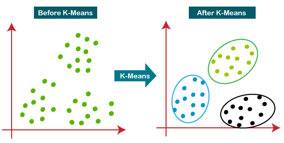

# K-means

Q1: ***What are some applications of K-means clustering?***

- Document classification: k-means can cluster documents into multiple categories based on tags, topics, and document content.
- Insurance fraud detection: using historical data on past fraudulent claims, new claims can be isolated based on how close they are to clusters that indicate fraud patterns.
- Cyber-profiling of criminals: this is the process of collecting data from individuals and groups to identify significant correlations. The idea of cyber profiling is derived from criminal profiling, which provides information to investigation divisions to classify the types of criminals present at a crime scene.

Q2: ***What is the difference between the K-means and KNN algorithms?***

- KNN is a **supervised** classification algorithm. This means we need labeled data in advance to classify unlabeled data points. KNN classifies a data point based on its proximity to other data points in the feature space.
- K-means Clustering is an **unsupervised** classification algorithm. It only needs a set of unlabeled points and a threshold `K`, and it clusters the data into K clusters.

Q3: ***Explain what K-means clustering is.***

- K-means clustering is a **cluster** analysis method that partitions n points in the data space into k clusters; the clustering objective is to make points within a cluster as tightly connected as possible while making the distance between clusters as large as possible (**minimum intra-cluster variance, maximum inter-cluster variance**);

Q4: ***What are the stopping criteria for K-means clustering?***

- Common stopping conditions are:
    - **Convergence**: the clusters no longer change, and points stay in the same cluster.
    - **Maximum number of iterations**. The algorithm stops when the maximum number of iterations is reached.
    - The improvement in variance < x (x is a preset parameter)

Q5: ***Describe the steps of the K-means algorithm***

1. Randomly select k samples from the data points as the initial cluster centers $a=a_{1},a_{2},...a_{k}$
2. For each sample in the dataset, compute its distance to the k cluster centers and assign it to the class of the nearest cluster center;
3. For each class, recompute its cluster center $a_{j}=\frac{1}{c_{i}}\sum_{x\epsilon c_{i}}^{}x$
4. Repeat steps 2 and 3 above until some stopping condition is reached (number of iterations, minimum change in error, etc.).

Q6: ***Why does the K-means algorithm use the Euclidean distance metric?***

- The goal of K-means clustering is to minimize the **within-cluster variance**. The within-cluster variance is the same as the sum of squared Euclidean distances from the data points to the cluster center.

Q7: ***What is the main difference between *k-Means* and *k-Nearest Neighbors*?**

- **k-Means** is a clustering algorithm that tries to partition a set of points into k clusters, where the points in each cluster tend to be close to each other. It is unsupervised; the points are not labeled in advance.
- k-Nearest Neighbors is a classification (or regression) algorithm that determines the class of a point based on the classes of its k nearest points. It is a supervised algorithm, because it tries to classify a point based on the known classes of other points.

Q8: ***When using the K-means clustering algorithm, how do you choose the value of K?***

- Empirical choice: divide the sample size by 2 and take the square root as the value of K: $K=\sqrt{n/2}$
- Elbow method: clustering algorithms in the K-means framework essentially minimize the total within-cluster distance when minimizing the objective function. By the definition of within-cluster distance, the smaller K is, the larger the within-cluster distance; the larger K is, the smaller the within-cluster distance. As K grows from small to large, the within-cluster distance gradually decreases, but once K reaches its optimal value, the within-cluster distance no longer drops noticeably. In the figure below, K=3 is empirically chosen as the optimal value for the dataset.

Q9: ***Compare Hierarchical Clustering and the K-means clustering algorithm***

- Hierarchical clustering first treats each sample as an independent class, then, via distance computation, merges the two closest samples into one class while other samples remain their own classes. This process is repeated until the number of clusters or a set target is reached.
- Compared with hierarchical clustering, K-Means is less computationally expensive. Even with a large sample size or many variables, it can still produce clustering results quickly. However, its range of application is fairly limited. It is very sensitive to the positions of the initial points, which easily causes the clustering results to differ from the true classes of the data, and it is also very sensitive to outliers. In addition, the variables for K-Means clustering must be continuous, and it places high demands on variable standardization; otherwise it may produce meaningless results.

Q10: ***How would you preprocess the data before using the K-means algorithm?***

- K-means is essentially a data partitioning algorithm based on Euclidean distance, and dimensions with large means and variances will have a decisive influence on the clustering. Therefore, data that has not been normalized and brought to unified units cannot directly participate in computation and comparison. So data normalization and standardization are needed before running K-means.
- In addition, outliers or noisy data have a large influence on the mean and cause the centers to shift, so we also need to perform outlier detection on the data.

Reference: [https://blog.csdn.net/qq_45898579/article/details/118379182](https://blog.csdn.net/qq_45898579/article/details/118379182)

Q11: ***In clustering algorithms, what is the difference between using Manhattan distance and Euclidean distance?***

- Euclidean distance is the true distance between two points; it treats the differences across different dimensions of the samples equally, which sometimes does not meet practical requirements;
- Manhattan distance is the sum of the projections onto the axes of the line segment formed by two points in a fixed Cartesian coordinate system in Euclidean space; computationally, Manhattan distance is faster to calculate.
- The difference between Euclidean distance and Manhattan distance is that, when computing the difference between vectors, the weights given to the differences in each dimension are different.

Q12: ***List several situations in which the K-means algorithm has difficulty achieving good results***

- If the sample data is anisotropic, k-means performs poorly. Put simply, the K-means algorithm is only suitable when the probability of the sample data falling in each direction is equal; it is not suitable when they are unequal.

- If the sample data is a non-convex dataset, k-means performs poorly. Non-convex data can be understood as a cluster whose center is a line.

- If the numbers of samples in the clusters differ greatly, clustering performance is poor.

Q13: ***How do you run the K-means algorithm on a very large dataset?***

- Use mini-batch K-means, which uses small batches of data subsets to reduce computation time while optimizing the objective function. A mini-batch is a randomly sampled subset of the data drawn each time the algorithm is trained; training the algorithm with these randomly generated subsets greatly reduces computation time.

Q14: ***What is the objective function optimized by the K-means algorithm?***

- The objective function is to minimize the distance from each point to its cluster center: $minimizeD_{1}+D_{2}+...+D_{n}$

Q15: ***What is the difference between the K-means and K-medians algorithms? In which situations would you choose K-means (or K-medians)?***

- The k-medians algorithm replaces Euclidean distance with Manhattan distance and replaces the mean with the median;
- The K-medians algorithm uses the median as the centroid and is more robust to outliers, so K-medians is chosen when there are many outliers in the data; **when clustering larger datasets, K-medians is slower because each iteration requires sorting, so K-means is chosen**

Q16: ***Can the K-means algorithm be used to find outliers in data?***

- Yes; first use K-means to cluster the data into several clusters, then compute the distance from each element to its cluster center, and finally select the few points with the largest distances and treat them as outliers.

Q17: ***In clustering algorithms, how do you determine whether data is "sufficiently" clustered so that the algorithm produces meaningful results?***

- For the k-means clustering algorithm, you can use Gap statistics. Basically, this method computes a goodness-of-clustering measure based on the average dispersion compared with a reference distribution for an increasing number of clusters.
- Alternatively, study cluster stability using resampling. Resample the data (by random sampling or by adding small noise to it) and compute the "closeness" of the resulting clustering partitions; closeness can be measured with [Jaccard](http://en.wikipedia.org/wiki/Jaccard_index) similarity.

Reference: [https://stats.stackexchange.com/questions/11691/how-to-tell-if-data-is-clustered-enough-for-clustering-algorithms-to-produce-m](https://stats.stackexchange.com/questions/11691/how-to-tell-if-data-is-clustered-enough-for-clustering-algorithms-to-produce-m)

Q18: ***How does the curse of dimensionality affect the K-means algorithm?***

- When the data dimensionality is too high, almost all of the high-dimensional space is far from its center, and the distances between any two points tend to converge, meaning the maximum and minimum distances between any two points become the same. Therefore the Euclidean-distance-based k-means algorithm becomes unable to cluster (because the distances tend to converge).
- When the data dimensionality is too high, you can first use a dimensionality reduction algorithm (PCA) to map the data into a low-dimensional space and then cluster.

Q19: ***What is the connection between the K-means algorithm and the PCA algorithm?***

- PCA represents all data vectors as linear combinations of a small number of eigenvectors, and its optimization objective is to minimize the mean squared reconstruction error. K-means represents all data vectors as linear combinations of a small number of cluster centroid vectors, and its optimization objective is also to minimize the mean squared reconstruction error. **So K-means can be viewed as a super-sparse PCA.**

Reference: [https://stats.stackexchange.com/questions/183236/what-is-the-relation-between-k-means-clustering-and-pca](https://stats.stackexchange.com/questions/183236/what-is-the-relation-between-k-means-clustering-and-pca)
