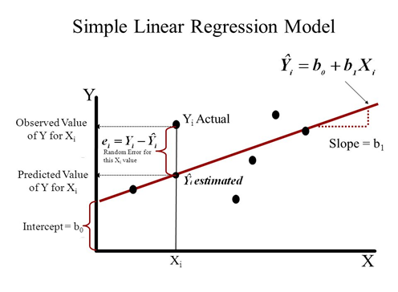

# Linear Regression

Q1: Explain what linear regression is?

- **Linear regression** is a supervised machine learning algorithm in which the predicted output is continuous and has a constant slope. It is used to predict values within a continuous range (e.g. sales, prices).

Q2: ****Which metrics can be used to check whether a regression model fits the data well?****

1. **R-squared coefficient**: a statistical measure of how close the data points are to the fitted regression line, based on the ratio of the residual sum of squares to the total sum of squares. Its value always lies between 0 and 1; the closer it is to 1, the better the regression model fits the observations.
2. **F-test**: evaluates the null hypothesis that the data is described by an intercept-only model, i.e. a regression in which all coefficients are equal to zero, against the alternative hypothesis that at least one coefficient is not equal to zero. If the P-value of the F-test is smaller than the significance level, we can reject the null hypothesis and conclude that the model provides a better fit than the intercept-only model.
3. **Root Mean Squared Error (RMSE):** measures the average deviation of the estimates from the observed values;

Q3: ****What is the difference between Mean Absolute Error (MAE) and Mean Squared Error (MSE)?****

- MSE (mean squared error) is defined as the average of the squared errors and is used when we want to penalize outliers in the dataset. It is defined as:

$$
MSE = \frac{1}{N}\sum_{i=1}^{N}(y_i-y)^2
$$

- MAE (mean absolute error) is defined as the average of the absolute errors. It is used when we do not want outliers to play an important role:

$$
MAE = \frac{1}{N}\sum_{i=1}^{N}|y_i-y|
$$

Q4: **How can you detect overfitting in a linear regression model?**

- As shown in the figure below, overfitting can be detected on the loss curves of the training and test sets. Overfitting appears as: the model's performance on the training set keeps improving (the loss or error keeps decreasing), while the performance on the test or validation set improves up to a point and then starts to get worse.

Q5: **What is the difference between covariance and correlation?**

- Covariance measures whether a change in one variable leads to a change in another variable, and deals only with the linear relationship between two variables in a dataset. Its value can range from negative infinity to positive infinity. Simply put, covariance indicates the direction of the linear relationship between variables.

- Correlation measures how related two or more variables are. Its value lies between -1 and 1. Correlation measures the strength and direction of the linear relationship between two variables and is a function of covariance: correlation equals the covariance divided by the standard deviation of X and the standard deviation of Y.

$$
\rho =\frac{Cov(X,Y)}{\sigma_x\sigma_y}
$$

Q6: **Provide an intuitive explanation of the learning rate**

- The Learning Rate is a hyperparameter that determines the speed, or step size, of moving towards the minimum point in gradient descent at each iteration. This value should be neither too small nor too high: if it is too small, convergence takes too long; if it is too large, the step size increases and moves very fast, and the global minimum point will not be reached even after many rounds of repeated iterations.

Q7: **How does non-linear regression differ from linear regression?**

- The variables of a non-linear function have powers greater than 1, while the variables of a linear function have a power of 1
- Non-linear regression tries to model a non-linear relationship between the independent and dependent variables, while linear regression analysis tries to model a linear relationship between the independent and dependent variables.

Q8: **What are the drawbacks of the R-squared coefficient? How can they be addressed?**

- There is one major drawback to using R Squared. The value of R Squared never decreases. Adding a new independent variable will cause the value of R-squared to increase, which means R Squared will keep suggesting that new variables be added and that they add value, regardless of whether they really matter. Therefore, the model may add a not-so-important variable, for example, the person's name when predicting salary, and the value of R-squared will still increase, suggesting the model is better.

Q9: **What is the difference between ordinary least squares and ridge regression?**

- **Ridge** regression is least-squares regression with an L2-norm penalty; the loss adds the squared norm of the coefficient vector on top of least squares;

Q10: ****What is the difference between ordinary least squares and lasso regression?****

- Lasso regression is an improvement on linear regression that adds an L1-norm penalty to linear regression. The effect is: the absolute values of the weights will decrease, and many will tend towards zero.

Q11: ****Why use Root Mean Squared Error (RMSE) rather than Mean Absolute Error (MAE) as the evaluation metric for linear regression?****

- RMSE is the square root of MSE, while MAE is the sum of the absolute values of the errors; relatively speaking, RMSE gives relatively higher weight to larger errors, which helps penalize outliers in the data

Q12: **How do you determine the importance of variables in a multiple regression model?**

- The general rule is to **treat the predictor with the largest standardized regression coefficient as the most important variable**; the predictor with the next largest standardized regression coefficient is the next most important variable, and so on.
- Assume the regression equation has the following form, where $Y$ is the estimate and the parameters $b_j$ are obtained by least squares. Then the standardized regression coefficient equals the standard deviation of $b_j$ * (standard deviation of $X_j$ / standard deviation of $Y$).

Reference: [http://www.dmstat1.com/res/PredictiveContributionCoefficient.html](http://www.dmstat1.com/res/PredictiveContributionCoefficient.html)

Q13: **What are the assumptions before applying least squares?**

- The regression model is linear in its coefficients and error term
- The error term has a population mean of zero
- There is no correlation between the independent variables and the error term
- Each observation of the error term is independent
- The variance of the error term is constant
- The error term follows a normal distribution
- No independent variable is a perfect linear function of other variables

Reference: [https://www.indeed.com/career-advice/career-development/ols-regression-assumptions](https://www.indeed.com/career-advice/career-development/ols-regression-assumptions)

Q14: **What is the difference between linear regression and logistic regression?**

- Linear regression fits a straight line to the data, while logistic regression fits a curve to the data. Linear regression is a regression algorithm, while logistic regression is a classification algorithm. Linear regression assumes the dependent variable follows a Gaussian (or normal) distribution. Logistic regression assumes the dependent variable follows a binomial distribution.

Q15: ****Why use normalization and standardization for linear regression?****

- Normalization and standardization make the data closer to a Gaussian distribution
- After normalization, gradient descent finds the optimal solution faster

Q16: **Compare linear regression and decision tree models**

- Decision trees support non-linear solutions, while LR only supports linear solutions. When there are many features with a small dataset (low noise), linear regression may outperform decision trees/random forests. In general cases, the average accuracy of decision trees will be higher.

Q17: **What is the difference between homoscedasticity and heteroscedasticity of data?**

- Homoscedasticity is an assumption that the classical linear regression model makes about the data, namely $\epsilon \sim N(0, \sigma^2)$. Simply put, the residuals must be random, and this distribution is one way we describe a random distribution: mean 0 and variance sigma squared.
- Heteroscedasticity means the residuals do not satisfy this normal distribution.

Q18: **How do you handle missing data in regression?**

- Delete directly, fill with statistics (mean, median, etc.), fill with predictions from a regression equation, etc.

Q19: ****What is multicollinearity? How do you detect collinearity?****

- When performing linear regression analysis, the independent (explanatory) variables are prone to being correlated with each other; this phenomenon is multicollinearity
- The variance inflation factor (VIF) is used to measure the severity of multicollinearity in a multiple linear regression model. VIF is the ratio of the variance of a regression coefficient estimator to its variance under the assumption that the independent variables are not linearly correlated

Q20: **How do you handle overfitting in linear regression?**

- Use Lasso regression or ridge regression

Q21: **What assumptions does linear regression make about the data?**

**1. Linear relationship:** there is a linear relationship between the independent variable x and the dependent variable y.

**2. Independence: the independent variables are independent of each other**.

**3. Homoscedasticity**: the residuals have constant variance at every level of x.

**4. Normality:** the residuals of the model are normally distributed.

Q22: ****How do you check whether the data satisfies all the regression assumptions?****

- Check linearity: a scatter plot shows intuitively whether there is some linear relationship between variables

- Independence:
    - Directly compute the Pearson coefficient between each pair of independent variables; if the Pearson coefficient is greater than 0.8, the two independent variables can be considered highly correlated
    - Variance inflation factor (VIF)[9]. The larger the variance inflation factor VIF, the greater the likelihood of collinearity among the independent variables. Generally speaking, if the variance inflation factor exceeds 10, the regression model has severe multicollinearity.
- Homoscedasticity: visualize and observe the relationship between the predicted values and the residuals
- Normality: the KS non-parametric test, or draw a Quantile-Quantile Plot, with the quantiles of the residuals on the vertical axis and the quantiles of the standard normal distribution on the horizontal axis. If the two distributions are similar, the Q-Q plot tends to fall on the line y=x; if the two distributions are linearly related, the points on the Q-Q plot tend to fall on a straight line.

Reference: [https://medium.com/@andrewhnberry/checking-your-linear-regression-assumptions-and-how-to-check-them-338f770acb57](https://medium.com/@andrewhnberry/checking-your-linear-regression-assumptions-and-how-to-check-them-338f770acb57)

Q23: **What are the respective advantages of solving linear regression with gradient descent versus least squares?**

- Ordinary least squares (OLS) is a non-iterative method that finds the optimal solution directly; if the task is simple and can be solved directly with OLS, it is better to use OLS; least squares also has drawbacks:
    - Least squares requires computing the inverse of $X^TX$, and $X^TX$ may not be invertible; moreover, when the number of features is very large, computing $X^TX$ is very expensive
    - Also, least squares can only be used when the fitting function is linear
- Gradient descent is more general, because it can be applied to any optimization problem (including non-linear regression) through an iterative process; but gradient descent easily gets stuck in local optima

Reference: [https://www.cnblogs.com/nickchen121/p/11686757.html#tid-WXpwFW](https://www.cnblogs.com/nickchen121/p/11686757.html#tid-WXpwFW)
