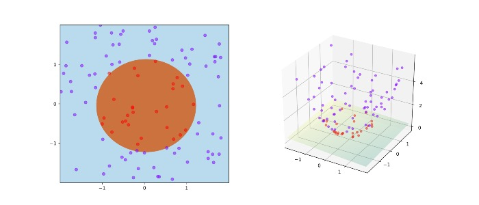

# Logistic regression

Q1: ***What problems is logistic regression suited to solve?***

- Logistic regression can be used for classification problems where the output or dependent variable is categorical or binary. However, to apply logistic regression correctly, the dataset must also satisfy the following properties:
    - There should not be high correlation among the independent variables. In other words, the predictors should be independent of each other.
    - There should be a linear relationship between the logit of the outcome and each predictor. The logit function is logit(p) = log(p/(1-p)), where p is the probability of the outcome.
    - The sample size must be large. How large depends on the number of independent variables in the model.
- Logistic regression can be used when all of the above requirements are met.

Q2: ***Why is logistic regression called regression rather than classification?***

- Although our target task in logistic regression is classification, *logistic regression actually* just predicts a probability (or the log odds in logit form). By adding a threshold, logistic regression makes a classification based on comparing the predicted probability with the threshold.

Q3: *****Why don't we use mean squared error as the cost function in logistic regression?*****

- When logistic regression uses MSE as the loss function, the loss is non-convex and hard to optimize; the log loss (binary cross-entropy loss), on the other hand, guarantees a convex loss function that can be optimized to the global minimum.
- In addition, the cross-entropy loss of logistic regression can also be derived via maximum likelihood estimation.

Q4: ***What is the difference between logistic regression and linear regression?***

- The differences are shown in the table below

| Difference | Linear regression | Logistic regression |
| --- | --- | --- |
| Algorithm type | Regression problem | Classification problem |
| Loss function | MSE (mean squared error) | Cross-entropy |
| Form | A plain linear model | Adds the nonlinear mapping function sigmoid on top of linear regression |

Q5: ***Logistic regression is generally used to find a linear decision boundary between two classes. Can it solve nonlinear classification problems, such as classification with a nonlinear hyperplane like
$x_{1}^{2}+x_{2}=0$?***

- Yes, but you need to use the kernel mapping trick to apply a nonlinear transformation to the original features; as in the figure below, after mapping 2D data into 3D, the problem can be converted into an easily solvable linear classification problem, which is then solved with logistic regression.

Q6: ***Compare SVM and Logistic Regression when there are many outliers in the classification data***

- LR is sensitive to outliers; when LR searches for the classification decision surface, it needs to consider all data points in the space.
- SVM is insensitive to outliers; SVM only considers the local points near the boundary (the support vectors).
- Therefore the SVM model is more robust to noise.

Q7: ***Space complexity analysis of logistic regression***

- While training a logistic regression model, we need to store four things in memory: x, y, w, and b. Since b is a constant, storing b takes only 1 step, i.e., an O(1) operation. x and y are two matrices of order (n x d) and (n x 1) respectively. Storing these two matrices takes O(nd + n) steps. Finally, w is a vector of size d. Storing it in memory takes O(d) steps. Therefore, the space complexity during training is O(nd + n + d).
- After training the model, all we need to keep in memory is w. We only need to compute wx+b to classify a point. Therefore, the space complexity at runtime is on the order of d, i.e., O(d).

Q8: ***Compare decision trees and logistic regression models***

- Decision boundary: a decision tree bisects the space into smaller and smaller regions, while logistic regression fits a single line that splits the space exactly into two; as in the figures below, a tree can capture the partition better, leading to better classification performance. However, when the classes are not well separated, a tree easily overfits the training data, so the simple linear boundary of logistic regression generalizes better.

Q9: ***Compare Naive Bayes and logistic regression***

- Naive Bayes is a generative model, while LR is a discriminative model.
- Naive Bayes is suited to small datasets, while LR works better on large datasets.
- When there are correlations among the features, LR performs better than Naive Bayes, because Naive Bayes expects all features to be independent.

Reference: [https://towardsdatascience.com/comparative-study-on-classic-machine-learning-algorithms-24f9ff6ab222](https://towardsdatascience.com/comparative-study-on-classic-machine-learning-algorithms-24f9ff6ab222)

Q10: ***Can logistic regression be used for imbalanced classification problems?***

- Logistic regression does not directly support imbalanced classification, because LR depends on all of the data;
- To handle imbalanced classification, the training algorithm used to fit the logistic regression model must be modified to take the skewed distribution of the data into account. This can be achieved by specifying a class weighting configuration, which influences how much the logistic regression coefficients are updated during training. The weighting can reduce the penalty when the model makes errors on classes with lots of data, while imposing more penalty on classes with little data. This method is called **weighted logistic regression.**

Reference: [https://stats.stackexchange.com/](https://stats.stackexchange.com/)

Q11: ***Explain the advantages of SVM over logistic regression***

- SVM determines the classification hyperplane from the support vectors, so it is little affected by outliers in the data;
- After SVM is converted into its dual problem, classification only requires computing distances to a few support vectors, which is a clear advantage when doing complex kernel function computations, and can greatly simplify the model and the amount of computation; therefore SVM is better suited to handling high-dimensional features.

Q12: ***How to avoid overfitting in a logistic regression model***

- Add a regularization term, L1 or L2 regularization; L2 regularization is generally used. Initially no regularization term is added; instead, after the LR model has been trained, if the w of some variables take extremely large values that do not fit the business logic, regularization is added and the model is retrained.
- Control the number of features; remove strongly correlated features.

Reference: [https://www.bogotobogo.com/](https://www.bogotobogo.com/)

Q13: *****Why is logistic regression considered a linear model?*****

- A model is considered linear if the feature transformation used to compute the prediction is a **linear combination** of the features.
- Logistic regression is considered a linear model because the features of the logistic regression model are **linear with respect to the log odds of the response variable; the formula of logistic regression**
    
    $$
    p=\frac{1}{1+e^{-(w^{T}x+b}))}
    $$
    
    can be expressed as:
    
    $$
    w^{T}x+b=log(\frac{p}{1-p})
    $$
    
    where $log(\frac{p}{1-p})$ is called the log odds, representing the ratio of the event occurring to not occurring; logistic regression is actually modeling the log odds, and the log odds are linear in the features.
    

Reference: [http://www.ciaburro.it/why-is-logistic-regression-considered-a-linear-model/](http://www.ciaburro.it/why-is-logistic-regression-considered-a-linear-model/)
