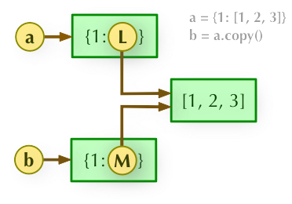

# Python

# Beginner:

Q1: **Name some features of Python.**

- Python is an interpreted language. This means that, unlike languages such as C and its variants, Python does not need to be compiled before it runs. Other interpreted languages include PHP and Ruby.
- Python is dynamically typed; types can be converted dynamically, and you do not need to declare the type of a variable when declaring it or anything similar.
- Python is object-oriented, allowing the definition of classes along with composition and inheritance. In Python, functions are objects: they can be assigned to variables, returned from other functions, and passed into functions. Classes are also objects.

Q2: ****What is a *Lambda function* in Python?***

- A **Lambda function** is a small anonymous function; it allows you to quickly define a one-line function, similar to a macro in C, and it can be used anywhere a function is needed.
- The usage of lambda is:

<aside>
💡 lambda [arg1 [, agr2,.....argn]] : expression

</aside>

- A lambda expression returns a function object; if no variable receives this return value, it is quickly discarded. Precisely because lambda is just an expression, it can be used directly as a member of a list or dict.

Q3: ****What are the rules for *local* and *global* variables in Python?**

- In Python, variables defined inside a subroutine are called local variables, and variables defined at the beginning of the program are called global variables.
- The scope of a global variable is the whole program, and the scope of a local variable is the subroutine in which it is defined.
- When a global variable and a local variable have the same name: inside the subroutine that defines the local variable, the local variable takes effect; elsewhere, the global variable takes effect.

Q4: ****When to use `tuple` vs `list` vs `dictionary` in Python?**

- Use ****`tuples`**** to store a sequence of variables that will not change.
- Use ****`list`**** to store a sequence of variables that may change.
- Use ****`dictionary`**** when you want to associate two variables as a pair.

Q5: **What is a Python descriptor?**

- A Python descriptor is an object attribute with "binding behavior", whose attribute access can be overridden by methods in the descriptor protocol. These methods are __get__(), __set__(), and **__delete__**(). If any of these methods is defined on an object, that object is a descriptor.
- **Descriptors can be used to control attribute access behavior, implementing features such as computed attributes, lazily loaded attributes, and attribute access control.**

Q6: **Can you use *static methods* in Python?**

- A static method in Python is bound to the class rather than to an object of the class, and it can be called without an object of that class.
- You can **create a static method** using staticmethod() or @staticmethod()**;**

Reference: [https://www.digitalocean.com/community/tutorials/python-static-method](https://www.digitalocean.com/community/tutorials/python-static-method)

Q7: **Explain the `UnboundLocalError` exception and how to avoid it?**

- **`UnboundLocalError`** occurs when a local variable is referenced before it is assigned;
- Look at the following code block:

```python
num = 10
def test_this ( ) :
    num + = 1
print ( num )
test_this ( )
```

Running it will raise **`UnboundLocalError`. The reason is that in Python, if an inner function references a variable with the same name as a variable of the outer function or a global variable, and modifies this variable, Python treats it as a local variable; and since there is no definition or assignment of num inside the function, an error is raised.**

- Solution 1: use the global keyword to declare that the variable is a global variable; modify the code block as follows:

```python
num = 10
def test_this ( ) :
    global num
		num + = 1
print ( num )
test_this ( )
```

- Solution 2: pass the variable into the function as a function argument.

Reference: [https://linuxhint.com/python-unboundlocalerror/](https://linuxhint.com/python-unboundlocalerror/)

Q8: **What are the main differences between Python 2 and Python 3?**

- In Python 2, print is a statement, while in Python 3 it exists as a function.
- The default encoding of Python 2 is ASCII, while the default encoding of Python 3 is utf-8.
- The xrange() function in Python 2 no longer exists in Python 3. It has been replaced by the range() function, which improves performance when iterating over sequences.

Reference: [https://www.datacamp.com/](https://www.datacamp.com/)

Q9: **How do you create a copy of an object in Python?**

- The assignment statement '=' in Python does not create a copy of an object; it only binds a name to an object. If you need to copy an object, you need to use the copy module from the standard library (import copy).
- Use type(object) for a special copy, which is a kind of shallow copy; or use copy.copy to make a shallow copy of an object, which copies the object but still uses references for the elements inside the object;

```python
import copy
xs = [[1, 2, 3], [4, 5, 6], [7, 8, 9]]
# Make a shallow copy
ys = list(xs)
zs = copy.copy(xs)
```

- Deep copy: use copy.deepcopy, which performs a deep copy: it copies not only the object but also the elements within the object, producing a completely new object that is fully independent of the copied object, but this comes at some cost in time and space.

```python
import copy
xs = [[1, 2, 3], [4, 5, 6], [7, 8, 9]]
# Make a deep copy
zs = copy.deepcopy(xs)
```

Q10: **Explain shallow copy and deep copy in Python**

- **Shallow copy (copy):** copies the parent object, but does not copy the child objects inside the object.



- **Deep copy (deepcopy):** the deepcopy method of the copy module fully copies the parent object and its child objects.


Q11: **What is the role of self in Python?**

- Python classes stipulate that the first parameter of a method is the instance object itself, and by convention it is named self. Its role is equivalent to this in Java: it represents the object of the current class and can be used to access the attributes and methods of the current class.

Q12: **What are magic methods in Python? Give a few examples.**

- In Python, any function that starts and ends with '__' is a magic method; for example, __init__ is a magic method. It can override the behavior of default functions, allowing each class to define its own specific operator-based behavior.
- Some examples of magic methods are: __**init__**, __add__, ___**len__**, __repr__, etc.


Reference: [https://www.geeksforgeeks.org/dunder-magic-methods-python/](https://www.geeksforgeeks.org/dunder-magic-methods-python/)

Q13: **In Python, when do you use the pass statement?**

- The pass statement is used as a placeholder for future code. The difference between a comment and a `pass` statement is that while the interpreter ignores comments entirely, `pass` is not ignored.
- When the pass statement is executed, nothing happens, but it avoids an error where empty code is not allowed. Python does not allow empty code in loops, function definitions, class definitions, or if statements.

Q14: **What are immutable objects in Python?**

- Objects allocated by Python on the heap fall into two categories: mutable objects and immutable objects. Immutable objects are value types, and mutable objects are reference types;
- Immutable objects include int, bool, string, float, and tuple; in Python, these data types are value types and cannot themselves be modified (immutable types). Modifying a value actually makes the variable point to a new object (a newly created object), so no shared-memory problems occur. This is the same as how Java implements immutable objects. The original object is reclaimed by Python's garbage collection mechanism.

Q15: **Is all memory deallocated whenever you exit Python?**

- No; variables that have circular object references or are referenced from the global namespace are often not freed when Python exits, and some parts reserved by C libraries are not freed either.

# Intermediate:

Q16: ****How is *memory managed* in Python?***

- Python's memory management mechanisms: reference counting, garbage collection, and the memory pool mechanism.
- **Reference counting**: Python tracks variables in memory through reference counting, i.e., it records the number of times an object is referenced by other objects in use. Python has an internal tracking variable called the reference counter, which records how many references each variable has, referred to as the reference count. When an object's reference count drops to 0, it is put into the garbage collection queue.

```python
>>> a=[1,2]
>>> import sys
>>> sys.getrefcount(a)  ## get the reference count of object a
2
>>> b=a
>>> sys.getrefcount(a)
3
>>> del b  ## delete the reference b
>>> sys.getrefcount(a)
2
>>> c=list()
>>> c.append(a) ## add to a container
>>> sys.getrefcount(a)
3
>>> del c  ## delete the container, references -1
>>> sys.getrefcount(a)
2
>>> b=a
>>> sys.getrefcount(a)
3
>>> a=[3,4]  ## reassign
>>> sys.getrefcount(a)
2
```

- **Garbage collection**:
    - When an object's reference count reaches zero, it is disposed of by the garbage collection mechanism.
    - When two objects a and b reference each other, the del statement can decrease the reference counts of a and b and destroy the names used to reference the underlying objects. However, since each object contains a reference to the other object, the reference counts do not reach zero and the objects are not destroyed (thereby causing a memory leak). To solve this problem, the interpreter periodically runs a cycle detector that searches for cycles of inaccessible objects and deletes them.
- **Memory pool**: when a large number of objects that consume small amounts of memory are created, frequently calling new/malloc causes a lot of memory fragmentation and reduces efficiency. The role of a memory pool is to pre-allocate a certain number of equally sized memory blocks in memory to keep in reserve; when a new memory request arrives, memory is first allocated to it from the memory pool, and new memory is requested only when the pool runs out. The most significant advantage of this is that it reduces memory fragmentation and improves efficiency.

Reference: [https://juejin.cn/post/6856235545220415496](https://juejin.cn/post/6856235545220415496)

Q17: **What is the difference between range and xrange in Python?**

- Both range and xrange are used in loops, and their output is the same.
- range returns a list object, while xrange returns a generator object (xrange object); xrange does not directly produce a list, but returns one of its values on each call, using very little memory, and therefore performs very well.
- Python 3 removed xrange and only has range, whose internals are the same as Python 2's xrange.

Q18: **What tools can help find bugs or perform static analysis in Python?**

- **Pychecker** and **Pylint** are static analysis tools that help find bugs in Python.
- **Pychecker** is an open-source tool for static analysis that detects bugs from source code and warns about style and complexity issues.
- **Pylint** is highly configurable; it controls warnings and errors like a special program, with an extensive configuration file. Pylint is also an open-source tool for static code analysis that looks for programming errors and is used for coding standards. It checks the length of each line of code and checks variable names against the project style. It can also be used as a standalone program, and **Pylint** also integrates with Python IDEs such as Pycharm, Spyder, Eclipse, and Jupyter.

Reference: [https://www.tutorialspoint.com/](https://www.tutorialspoint.com/)

Q19: ****How do you *share global variables* across Python modules?***

- You can create a configuration file config.py and store all the global variables in it to share across modules or scripts. By simply importing the configuration file, all the global variables defined in it become available to other modules; they are used as follows:

```python
import config
config.a = 1
config.b =2
config.c=3
```

Reference: [https://www.allindiaexams.in/](https://www.allindiaexams.in/)

Q20: **What does the Python `nonlocal` statement do?**

- The keyword nonlocal is used to use an outer (non-global) variable inside a function or other scope; in other words, nonlocal declares that the variable is not in the current function, and the interpreter needs to look in the function enclosing this function for the variable of the same name declared by nonlocal; once found, the value of this object can be used and operated on in the current function.

Q21: ****Explain how Python memory management works****

- Python's memory management mechanism is Pymalloc; Python's object management mainly resides in layers Level+1 to Level+3.
- Level+3: Python's built-in objects (such as int, dict, etc.) each have their own independent private memory pool, and memory pools are not shared between objects, i.e., memory freed by int will not be allocated for use by float.
- Level+2: when the requested memory size is smaller than 256KB, memory allocation is mainly carried out by the Python object allocator (**Python's object allocator**).
- Level+1: when the requested memory size is larger than 256KB, it is allocated by Python's native memory allocator, which essentially calls functions such as **malloc/realloc** in the C standard library.

Q22: ****What is the difference between the `append()` and `extend()` methods?**

- The similarity between extend and append is that both place the newly received argument at the end of the existing list. But the extend method only accepts a list, and adds each element of that list to the original list. The append method, on the other hand, accepts an argument of any data type and simply appends it to the end of the list.

Q23: Explain decorators in Python?

- A decorator is essentially a Python function that lets other functions gain extra functionality without any code changes; it is often used in scenarios with cross-cutting concerns, such as logging, performance testing, transaction handling, caching, and permission checks, and decorators are an excellent design for solving such problems. With decorators, we can extract large amounts of similar code unrelated to the function's own functionality into the decorator and keep reusing it. In general terms, the role of a decorator is to add extra functionality to an existing object.
- A simple decorator example: use_logging is a decorator; it is an ordinary function that wraps the function func, which executes the real business logic, inside it.

```python
def use_logging(func):

    def wrapper():
        logging.warn("%s is running" % func.__name__)
        return func()   # when foo is passed in as the argument, executing func() is equivalent to executing foo()
    return wrapper

def foo():
    print('i am foo')

foo = use_logging(foo)  # because the decorator use_logging(foo) returns the function object wrapper, this statement is equivalent to  foo = wrapper
foo()                   # executing foo() is equivalent to executing wrapper()
```

Q24: **What do these mean: `*args`, `**kwargs`? Why would we use them?**

- args is short for arguments and represents positional arguments; kwargs is short for keyword arguments and represents keyword arguments; args and kwargs are used to handle variable arguments, allowing multiple actual arguments to be passed when calling a function; after the arguments are received, args becomes a tuple and kwargs becomes a dict.

Q25: **Explain Python generators**

- A generator is an iterable object that can suspend execution and keep its current state.
- A generator stops executing when it reaches yield, and continues only when next() or send() is called.
- There are two ways to define a generator: one is a generator expression, and the other is adding a yield statement to an ordinary function and instantiating it.

Q26: **The difference between shallow copy and deep copy in Python**

- A shallow copy produces an independent object, but its child objects are still the child objects of the original object.
- A deep copy recursively Q

Q27: **Explain closures in Python**

- If a function is defined inside another function, and this inner function uses variables of the outer function, then this function together with the variables it uses is called a closure. Simply put, if an inner function references variables in an outer scope (but not in the global scope), the inner function is considered a closure.
- A closure can keep the variables of the outer function, which are not destroyed when the outer function call finishes. Example:

```python
def addx(x):
    def adder(y):
        return x + y
    return adder

c = addx(8)
print(type(c))
print(c.__name__)
print(c(10))
```

Q28: **What is the underlying implementation of the Python dict data structure? What is the time complexity of a dict lookup?**

- The underlying implementation of dict is a hash table; the time complexity of a dict lookup is O(1), allowing random access by index.

Q29: ****What is the difference between `@staticmethod` and `@classmethod`?**

- Functions decorated with the staticmethod (static method) decorator and the classmethod (class method) decorator can both be called with ClassName.method_name(). The differences are:
    - The first parameter of a classmethod is the class itself (cls), just as the first parameter of an instance method is the object itself (self); a staticmethod does not need cls or self as its first parameter, so a staticmethod cannot access the data of the class or object.
    - If a staticmethod wants to call the class's member variables or methods, since there is no self (this), it can only use ClassName.variable or ClassName.method.
    

Q30: **Can you speed up a Python program with multithreading?**

- No; a Python program itself can be multithreaded. Even when running a single-threaded program, Python is multithreaded: one thread runs the program, and another thread is the garbage collector.
- The reason Python does not support multithreading is that the underlying CPython has a global lock.

Reference: [https://www.quora.com/Is-Python-and-multithreading-a-good-idea](https://www.quora.com/Is-Python-and-multithreading-a-good-idea)

Q31: **Explain what a metaclass is in Python. Why are metaclasses needed?**

- A metaclass in Python is the class of a class, which defines how a class behaves. A class itself is an instance of a metaclass. A class in Python defines how instances of the class behave, i.e., a class is an instance of a metaclass.
- How a metaclass works: it intercepts the creation of a class; after intercepting it, it modifies it; after modifying it, it returns the modified class. With metaclasses, classes can be customized and modified; the way a metaclass works is by intercepting class creation.

Q32: **What are the characteristics of inheritance in Python's object-oriented programming?**

- Both single inheritance and multiple inheritance are supported: it is single inheritance when there is only one parent class, and multiple inheritance when there are several parent classes;
- A subclass inherits all attributes and methods of the parent class, and the subclass can also override variables and methods of the same name in the parent class;
- In inheritance, the constructor (**init**()) of the base class is not called automatically; it has to be called explicitly in the constructor of the derived class;
- When calling a method of the base class, you need to prefix it with the base class's name and pass the self parameter. This differs from calling an ordinary function within a class, where you do not need to pass the self parameter.

# Advanced:

Q33: What does the super function do in Python

- The `super()` function is used to call a method of the parent class (superclass).

```python
class A():
    def funcA(self):
        print("this is func A")
        
class B(A):
    def funcA_in_B(self):
        super(B, self).funcA()
        
    def funcC(self):
        print("this is func C")
        
>>> ins = B()
>>> ins.funcA_in_B()
this is func A
>>> ins.funcC()
this is func C
```

Q34: **Explain the singleton pattern and the factory pattern**

- Singleton pattern: ensures that only one instance of a certain class exists; this pattern involves a single class that is responsible for creating its own object while ensuring that only a single object is created. This class provides a way to access its unique object, which can be accessed directly without instantiating an object of the class. The singleton pattern guarantees that a class has only one instance and provides a global access point to it, avoiding **a globally used class being frequently created and destroyed**.
- Factory pattern: contains a superclass that provides an abstract interface for creating objects of a specific type, rather than deciding which objects can be created. The main problem the factory pattern solves: it extracts the object creation process, originally scattered in various places, and hands it over to a factory class responsible for creation. Other places that want to use an object go directly to the factory (i.e., call the factory's method) to get the object. The advantages of the factory pattern are high extensibility and strong safety.

Q35: ****Describe the advantages of coroutines****

- Coroutines do not increase the number of threads; they just run multiple coroutines on top of a thread by means of **time-division multiplexing**, and coroutine switching is done in user mode, so the cost of switching is much smaller than the cost of a thread switching from user mode to kernel mode.
- The biggest advantage of coroutines is their extremely high **execution efficiency**. Because subroutine switching is not thread switching but is controlled by the program itself, there is no thread-switching overhead; compared with multithreading, the more threads there are, the more obvious the performance advantage of coroutines becomes.
- **Coroutines do not need the locking mechanism of multithreading**, because there is only one thread and there are no conflicts from simultaneous writes to variables; controlling shared resources in coroutines requires no locking, only checking the state, so execution efficiency is much higher than with multithreading.

Q36: **You need to process a file of size 10G, but you only have 4G of memory. If you may only modify the get_lines function while keeping the rest of the code unchanged, how should you implement it? What issues need to be considered?**

- The `readlines()` function is not suitable when the file is too large; you should add an argument to limit the number of bytes read, and use a generator.

```python
def get_lines(): 
    l = []
    with open('file.txt','rb') as f: 
        data = f.readlines(60000)
    l.append(data) 
    yield l
```

- Or use mmap

```python
from mmap import mmap

def get_lines(fp):
    with open(fp, "r+") as f:
        m = mmap(f.fileno(), 0) 
        tmp = 0
        for i, char in enumerate(m): 
            if char==b"\n":
                yield m[tmp:i + 1].decode() 
                tmp = i + 1

if name ==" main ":
    for i in get_lines("fp_some_huge_file"): 
        print(i)
```

Q37: **What is monkey patching in Python?**

- Monkey patching means dynamically modifying classes and modules at runtime. Monkey patching has the following main uses:
    - Replacing methods, attributes, etc. at runtime;
    - Adding functionality that was not originally supported without modifying third-party code;
    - Adding patches to objects in memory at runtime instead of to the source code on disk.

Q38: **How does Python pass arguments?**

- Python's argument passing is pass by assignment, also called pass by object reference. All data types in Python are objects, so when passing arguments, the new variable and the original variable point to the same object.
- Arguments are passed by object reference, and depending on whether the object is mutable or immutable, there are two different outcomes. If it is a mutable object, it is modified directly. If it is an immutable object, a new object is produced and the formal parameter is made to point to the new object.

Q39: **Do you know about the GIL in Python?**

- The global interpreter lock GIL, Global Interpreter Lock in English, is a thread synchronization mechanism in the interpreter.
- Every interpreter process has one GIL; its direct effect is to restrict the parallel execution of multiple threads within a single interpreter process, so that even on a multi-core processor, only one thread can run at a time within a single interpreter process.
- Python code is compiled into bytecode, which is executed in the interpreter; during execution, the GIL in the CPython interpreter causes only one thread to be able to execute bytecode at any given moment. The most direct problem caused by the GIL is: within one interpreter process, multithreading cannot use multi-core processors to achieve true parallelism. Therefore, Python's multithreading is pseudo-multithreading: it cannot use multi-core resources, and only one thread is truly running at any moment.

Q40: **What are iterators and generators?**


- Iterator: Python has many containers, such as lists, tuples, dictionaries, sets, etc. A container can be intuitively imagined as a unit of multiple elements together, and all containers are iterable. A for in statement is usually used to enumerate an iterable object; the underlying mechanism is: the iterable object returns an iterator via the iter() function, and the iterator provides a next method. After calling this method, you either get the next object of the container or get a StopIteration error. An iterator is like a lazy-loading factory: it only generates and returns a value when someone needs it, and when it is not called it stays dormant waiting for the next call.

- Generator: a generator can simply be understood as a lazy version of an iterator. Its advantage over an iterator is that a generator does not occupy a large amount of memory the way an iterator does. For example, declaring an iterator:

```python
L = [i for i in range(100000000)]
```

declares a list containing one hundred million elements, and each element is stored in memory after it is generated. But in fact we may not need to store so much; we only want the next variable to be generated when you call the next() function, and so generators came into being. In Python they are written as

```python
(i for i in range(100000000)
```

In addition, generators can take other forms, such as generator functions, which return results to the next() method via the yield keyword. For example:

```python
def frange(start, stop, increment):
    x = start
    while x < stop:
        yield x
        x += increment

for n in frange(0, 2, 0.5):
    print(n)

0
0.5
1.0
1.5
```

**Q41: Explain the garbage collection mechanism in Python**

- GC has 2 things to do: first, find the useless garbage objects in memory; second, clear these garbage objects and release the memory for other objects to use.
- Python GC mainly uses reference counting to track and reclaim garbage. On top of reference counting, it uses "mark and sweep" to solve the circular reference problem that container objects may produce, and uses "generation collection", trading space for time, to improve garbage collection efficiency.

Q42: **What is the difference between __new__ and __init__ in Python?**

- `__new__` is a static method, while `__init__` is an instance method.
- The `__new__` method returns a created instance, while `__init__` returns nothing.
- The subsequent `__init__` can only be called when `__new__` returns an instance of cls.
- `__new__` is called when creating a new instance, and `__init__` is used when initializing an instance.

Reference: [https://taizilongxu.gitbooks.io/stackoverflow-about-python/content/](https://taizilongxu.gitbooks.io/stackoverflow-about-python/content/)

[https://github.com/kenwoodjw/python_interview_question](https://github.com/kenwoodjw/python_interview_question)

[https://gitbook.cn/gitchat/activity/5c8e364590020a6262806c8d](https://gitbook.cn/gitchat/activity/5c8e364590020a6262806c8d)

[https://docs.python.org/zh-cn/3/](https://docs.python.org/zh-cn/3/)
